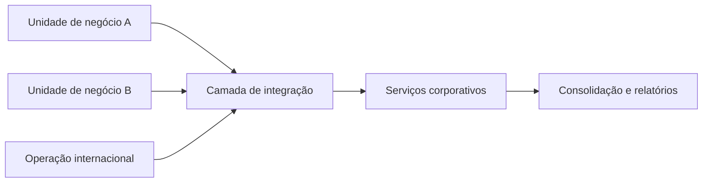

# Aula 02 — Software Enterprise como Contexto da Arquitetura de Solução

**Módulo:** 01 — Fundamentos de Arquitetura de Solução  
**Tema:** Solution Enterprise  
**Status:** Documentada  
**Origem:** Resumo de estudo fornecido pelo aluno, reorganizado e complementado com exemplos autorais.

## Objetivo de aprendizagem

Compreender o que caracteriza o contexto **enterprise**, por que ele exige uma visão arquitetural sistêmica e como estruturas organizacionais, integrações e obrigações regulatórias influenciam decisões técnicas.

## 1. Software enterprise e arquitetura de solução

Software enterprise sustenta processos de organizações com necessidades significativas de **integração, governança, controle e prestação de contas**. Isso inclui grandes empresas, governos e organizações menores com operações institucionalmente complexas.

O tamanho do código ou o número de usuários, isoladamente, não define o contexto enterprise. O fator decisivo é a **complexidade do ambiente em que o software opera**.

Na [Aula 01 — Introdução](./aula-01-introducao.md), vimos que arquitetura de solução conecta objetivos de negócio, restrições e decisões técnicas. Aqui, esse raciocínio é aplicado ao ambiente organizacional.

## 2. Grandes empresas e business units

Uma organização pode ser composta por várias **business units** (unidades de negócio), cada uma com processos, metas e sistemas próprios.

A arquitetura precisa equilibrar:
- **Autonomia local:** permitir processos específicos de cada unidade.
- **Integração corporativa:** compartilhar dados e eventos necessários.
- **Consistência:** preservar definições e regras comuns.
- **Governança:** garantir rastreabilidade e responsabilidades claras.

**Exemplo complementar:** unidades comerciais podem usar sistemas de vendas diferentes, mas precisam enviar informações consolidadas ao sistema financeiro corporativo. Nesse caso, contratos de integração, identificadores e regras contábeis precisam ser definidos explicitamente.

## 3. Governo e escala institucional

Sistemas governamentais atendem processos administrativos, cidadãos, servidores e outras instituições. A complexidade costuma envolver múltiplas responsabilidades, controles e regras formais.

**Compliance** significa atender requisitos legais, normativos e de controle aplicáveis. Dependendo do sistema, isso pode exigir:
- Trilhas de auditoria;
- Controle de acesso por perfil e responsabilidade;
- Retenção e proteção de dados;
- Rastreabilidade de alterações e decisões;
- Integração com sistemas institucionais.

> As exigências concretas dependem da jurisdição, do órgão e do domínio. Nenhuma tecnologia, por si só, garante conformidade.

## 4. Multinacionais e integração entre países

Uma unidade pequena em determinado país pode depender de uma arquitetura enterprise porque seus dados e processos precisam se conectar à operação global.

Desafios frequentes incluem:
- Consolidação financeira e contábil;
- Integração entre sistemas locais e centrais;
- Diferenças de moeda, idioma, fuso horário e calendário;
- Requisitos legais e fiscais distintos;
- Visibilidade corporativa sem eliminar necessidades locais.

**Exemplo complementar:** uma filial registra transações em moeda local, enquanto a matriz precisa consolidar relatórios globais. A solução deve definir como valores, taxas de câmbio, datas e regras contábeis serão representados e reconciliados.

## 5. Pequenas e médias empresas com atuação global

O porte da empresa não elimina a complexidade institucional. Uma empresa menor, ao operar em diversos países, pode enfrentar diferentes legislações tributárias, trabalhistas e comerciais.

Por isso, soluções enterprise também podem fazer sentido para empresas menores com **operações distribuídas, múltiplas jurisdições e necessidade de consolidação**.

## 6. Definição prática e limites do termo

Não existe uma fronteira universal para o termo *software enterprise*. Neste contexto de estudo, ele descreve software que sustenta organizações grandes **ou** operações com elevada complexidade institucional, regulatória, contábil ou global.

A definição é útil para orientar o vocabulário e reconhecer requisitos arquiteturais que podem passar despercebidos quando se observa apenas a aplicação isoladamente.

## Comparação de cenários (exemplo complementar)

| Cenário | Principal desafio | Implicação arquitetural |
| --- | --- | --- |
| Empresa com várias business units | Autonomia versus padronização | Contratos de integração e governança de dados |
| Governo | Processos formais e prestação de contas | Auditoria, autorização e rastreabilidade |
| Multinacional | Consolidação global e diferenças locais | Integração, localização e reconciliação |
| PME com operação internacional | Várias regras para uma equipe menor | Modularidade e gestão de regras por jurisdição |

## Exemplo de fluxo de integração (complemento autoral)

O desenho é **conceitual**: não recomenda necessariamente um barramento central ou uma topologia específica. A escolha real dependeria de volume, contratos, latência, autonomia e governança.

## Perguntas para revisão

1. Por que uma empresa pequena pode precisar de software enterprise?
2. Como a autonomia de business units pode entrar em conflito com a padronização corporativa?
3. Quais necessidades de compliance podem impactar a arquitetura de um sistema governamental?
4. Por que a consolidação contábil entre países não é apenas um problema de banco de dados?

## Síntese

> Software enterprise é caracterizado principalmente pelo contexto organizacional e suas exigências de integração, controle e governança — não apenas pelo porte da empresa ou pelo tamanho do sistema.

## Próxima aula

Aguardando o próximo resumo do tema **Solution Enterprise**.
