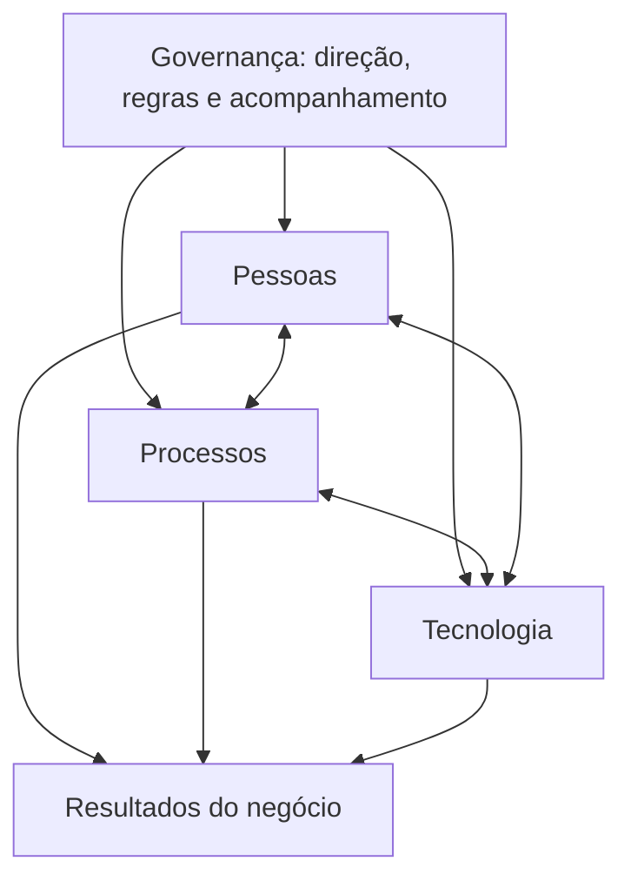

# Aula 03 — Ecossistema Enterprise

**Módulo:** 01 — Fundamentos de Arquitetura de Solução  
**Tema:** Solution Enterprise  
**Status:** Documentada  
**Origem:** Resumo de estudo enviado pelo aluno, reorganizado e complementado com exemplos autorais.

## Objetivo de aprendizagem

Compreender como **pessoas, processos e tecnologia** formam o ecossistema enterprise e por que a **governança** é essencial para conectar decisões arquiteturais ao funcionamento real de uma organização.

## 1. O ecossistema enterprise

Um software corporativo não opera isoladamente: ele participa de processos, é utilizado e mantido por pessoas e precisa respeitar regras organizacionais. Seu valor depende do funcionamento conjunto desses elementos.

Uma solução pode estar tecnicamente correta e, ainda assim, fracassar se não atender ao processo de trabalho, não for adotada pelos usuários ou não puder ser operada de forma sustentável.

## 2. A tríade: pessoas, processos e tecnologia

| Elemento | Papel | Risco quando negligenciado |
| --- | --- | --- |
| **Pessoas** | Executam, supervisionam e evoluem o trabalho | Baixa adoção, erros operacionais, falta de responsabilidades claras |
| **Processos** | Definem atividades, regras, aprovações e fluxos | Retrabalho, inconsistência e operação reativa |
| **Tecnologia** | Suporta, registra, integra e automatiza processos | Dependência de controles manuais, pouca rastreabilidade e gargalos |

A tecnologia **não substitui automaticamente processos bem definidos**: automatizar um fluxo inadequado pode apenas acelerar seus problemas.

### Relação conceitual

> Diagrama didático autoral: representa relações de coordenação, não uma topologia de software.

## 3. Governança como coordenação da tríade

**Governança** estabelece diretrizes, responsabilidades, mecanismos de decisão e acompanhamento para manter pessoas, processos e tecnologia alinhados aos objetivos organizacionais.

Não é sinônimo de burocracia: quando proporcional ao contexto, ajuda a evitar decisões desconectadas, responsabilidades ambíguas e riscos não tratados.

Exemplos de práticas de governança:
- Definir responsáveis por processos e dados;
- Estabelecer políticas de acesso e aprovação;
- Documentar decisões e seus critérios;
- Acompanhar indicadores operacionais;
- Revisar riscos e aderência a normas aplicáveis.

## 4. Eficiência, conformidade e continuidade

A ausência de governança pode causar retrabalho, falhas de controle e até interrupções de operação. Além de eficiência, sistemas enterprise precisam respeitar exigências legais, regulatórias e contratuais pertinentes.

É útil distinguir:

- **Governança:** como a organização direciona, decide e acompanha.
- **Compliance:** aderência a obrigações e políticas aplicáveis.
- **Operação:** execução diária dos processos e serviços.

Os três aspectos se relacionam, mas não são equivalentes. Governança **apoia** a conformidade; não a garante automaticamente.

## 5. Papel do arquiteto de solução

O arquiteto de solução deve traduzir necessidades e restrições organizacionais em escolhas técnicas justificáveis.

Antes de propor componentes, integrações ou tecnologias, deve entender:
1. Quem participa do processo e quais responsabilidades possui;
2. Como o trabalho ocorre hoje e como deveria ocorrer;
3. Quais regras de negócio, orçamento e normas precisam ser respeitadas;
4. Quais capacidades tecnológicas já existem;
5. Como medir se a solução gerou o resultado esperado.

A arquitetura agrega valor quando melhora a organização como um todo, e não apenas um sistema isolado.

## 6. Exemplo prático complementar: aprovação de compras

**Cenário hipotético:** uma empresa quer automatizar solicitações de compra.

| Dimensão | Questão arquitetural | Possível resposta |
| --- | --- | --- |
| Pessoas | Quem solicita e quem aprova? | Perfis e responsabilidades separados |
| Processos | Quando uma compra exige aprovação? | Regras por valor, centro de custo e categoria |
| Tecnologia | Como implementar e registrar o fluxo? | Workflow com trilha de auditoria e integração financeira |
| Governança | Quem define e revisa as regras? | Responsável pelo processo, política versionada e indicadores |

**Trade-off:** um fluxo com controles rígidos pode reduzir riscos, mas aumentar o tempo de aprovação. O desenho precisa equilibrar controle e agilidade de acordo com o contexto.

> Exemplo criado como complemento de estudo; não é apresentado como exercício oficial do MBA.

## Checklist de análise

- [ ] Identifiquei os participantes e suas responsabilidades?
- [ ] Entendi o processo antes de propor automação?
- [ ] Mapeei regras, exceções e necessidades de auditoria?
- [ ] Considerei custos, capacidades da equipe e operação?
- [ ] Defini como avaliar o resultado após a implantação?

## Perguntas para revisão

1. Por que software enterprise não pode ser analisado apenas como código em produção?
2. O que acontece quando uma organização automatiza um processo mal definido?
3. Qual a diferença entre governança e compliance?
4. Como o arquiteto de solução equilibra necessidades das pessoas, processos e tecnologia?

## Síntese

> Em um ecossistema enterprise, arquitetura de solução é uma disciplina sociotécnica: tecnologia só entrega valor sustentável quando se integra às pessoas, aos processos e à governança da organização.

## Conexão com as aulas anteriores

- [Aula 01 — Introdução](./aula-01-introducao.md): visão sistêmica e decisões justificadas.
- [Aula 02 — Software Enterprise](./aula-02-software-enterprise.md): complexidade organizacional e institucional.
- **Aula 03:** governança da tríade pessoas–processos–tecnologia.
