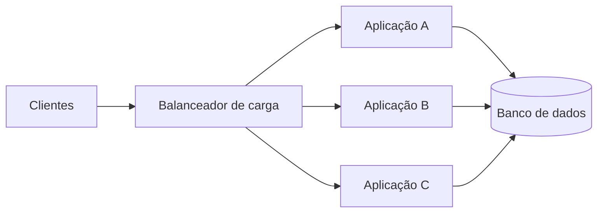

# Aula 04 — Escalabilidade

**Módulo:** 01 — Fundamentos de Arquitetura de Solução  
**Tema:** Solution Enterprise  
**Status:** Documentada  
**Origem:** Resumo de estudo fornecido pelo aluno, reorganizado com complementos didáticos autorais.

## Objetivo de aprendizagem

Entender escalabilidade como requisito de negócio e capacidade arquitetural, relacionando aumento de demanda, desempenho, disponibilidade e custos operacionais.

## 1. Escalabilidade como requisito de negócio

**Escalabilidade** é a capacidade de um sistema lidar com mudanças de demanda — especialmente crescimento — mantendo níveis de serviço aceitáveis dentro de limites planejados. Em ambientes enterprise, isso afeta diretamente receita, continuidade operacional, experiência dos usuários e custos.

Não basta adicionar servidores: a arquitetura deve sustentar as operações que realmente importam ao negócio.

## 2. Comportamento sob aumento de carga

Se um endpoint responde em aproximadamente 100 ms com pouca carga, o objetivo pode ser manter uma latência próxima desse valor à medida que o volume aumenta, **desde que isso esteja definido como meta mensurável**.

A latência não precisa ser literalmente idêntica em toda condição. É preciso explicitar volume esperado, tipo de operação, percentis de latência e limites de erro.

Exemplo de objetivo hipotético:

> Suportar 2.000 requisições por segundo, com latência p95 abaixo de 300 ms e taxa de erro inferior a 1%, durante uma janela de 30 minutos.

Esses números são **ilustrativos**, não requisitos apresentados pelo curso.

## 3. Cenários críticos enterprise

- **Folha de pagamento:** processamento concentrado em datas específicas; atrasos podem comprometer pagamentos.
- **Black Friday:** aumento previsível de acessos, consultas e pedidos.
- **Guias e tributos:** picos próximos a vencimentos, com requisitos de integridade e rastreabilidade.

Nesses casos, é necessário conhecer o perfil de carga: acessos simultâneos, requisições por segundo, tarefas em lote, leitura/escrita e dependências externas.

## 4. Escalabilidade versus elasticidade

| Conceito | Significado | Exemplo |
| --- | --- | --- |
| Escalabilidade | Capacidade de atender maior carga preservando objetivos de serviço | Acrescentar capacidade para processar mais pedidos |
| Elasticidade | Ajuste de recursos conforme a demanda sobe ou cai | Aumentar réplicas durante o pico e reduzi-las depois |

Elasticidade ajuda a controlar gastos, mas depende de mecanismos de provisionamento, observabilidade e capacidade de redução segura.

### Escala vertical e horizontal (complemento)

- **Vertical (scale up):** aumentar CPU, memória ou outros recursos de uma instância; é simples em alguns cenários, mas tem limites físicos e de custo.
- **Horizontal (scale out):** distribuir carga entre múltiplas instâncias; exige atenção a estado compartilhado, balanceamento, sessões e consistência.

> Diagrama conceitual autoral. Replicar aplicações não elimina gargalos de banco de dados, filas ou integrações.

## 5. Métricas para avaliar escalabilidade

| Métrica | O que informa |
| --- | --- |
| **Latência p95/p99** | Tempo de resposta observado pela maioria das requisições, inclusive caudas mais lentas |
| **Throughput** | Volume processado por unidade de tempo (ex.: requisições/s) |
| **Taxa de erros** | Proporção de operações que falham |
| **CPU, memória e I/O** | Pressão sobre recursos e possíveis gargalos |
| **Tempo de fila** | Espera antes do processamento em sistemas assíncronos |
| **Custo por operação** | Eficiência econômica ao variar a carga |

As métricas devem ser avaliadas em conjunto: throughput elevado com erros ou latência inaceitável não representa sucesso.

## 6. Exemplo prático complementar — Black Friday

**Cenário hipotético:** uma plataforma de comércio eletrônico recebe um pico previsível de pedidos.

1. **Antes do evento:** definir SLOs e executar testes de carga.
2. **Durante o pico:** observar latência, erros, saturação e dependências.
3. **Ajuste de capacidade:** adicionar réplicas da aplicação quando necessário, respeitando limites do banco e serviços externos.
4. **Depois do pico:** reduzir recursos com segurança e analisar custos e incidentes.

**Trade-off:** manter capacidade máxima o ano inteiro simplifica alguns aspectos operacionais, mas pode desperdiçar recursos. Escalar sob demanda economiza, porém introduz dependência de mecanismos de autoscaling e tempos de provisionamento.

## 7. Como validar a arquitetura

Um processo básico de avaliação pode incluir:

- Definir a carga-alvo e o perfil de operações;
- Estabelecer objetivos mensuráveis de desempenho e erro;
- Executar testes de carga, estresse e duração;
- Identificar gargalos de aplicação, dados e dependências;
- Repetir os testes após alterações de capacidade;
- Comparar desempenho e custo em diferentes níveis de demanda.

**Observação:** aumentar infraestrutura pode ocultar ineficiências temporariamente. Medição e investigação são indispensáveis.

## Perguntas de revisão

1. Qual é a diferença entre escalabilidade e elasticidade?
2. Por que dizer apenas “suportar milhares de usuários” é insuficiente como requisito?
3. Como avaliar se um sistema escalou sem degradar a experiência?
4. Por que adicionar instâncias da aplicação pode não resolver um gargalo no banco?
5. Como custos de infraestrutura influenciam decisões de escala?

## Síntese

> Escalar não é simplesmente colocar mais máquinas em produção: é atender à variação de demanda com qualidade de serviço mensurável e custo compatível com o negócio.

## Conexão com as aulas anteriores

- [Aula 01 — Introdução](./aula-01-introducao.md): decisões arquiteturais devem considerar restrições e objetivos.
- [Aula 02 — Software Enterprise](./aula-02-software-enterprise.md): operações corporativas exigem continuidade e integração.
- [Aula 03 — Ecossistema Enterprise](./aula-03-ecossistema-enterprise.md): pessoas, processos e tecnologia influenciam os requisitos de escala.
