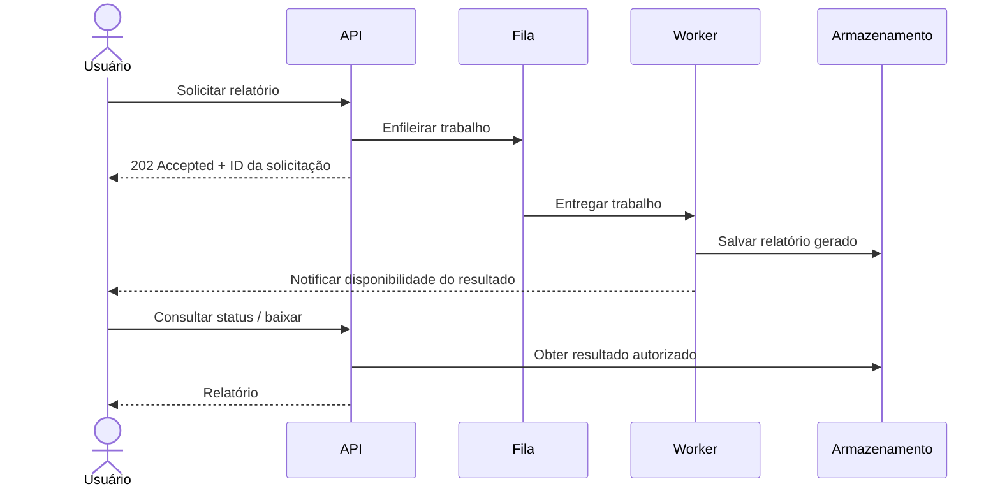

# Aula 05 — Disponibilidade

**Módulo:** 01 — Fundamentos de Arquitetura de Solução  
**Tema:** Solution Enterprise  
**Status:** Documentada  
**Origem:** Síntese autoral baseada no resumo enviado pelo estudante, com complementos didáticos identificados.

## Objetivo de aprendizagem

Compreender disponibilidade a partir da **capacidade de realizar operações de negócio quando necessárias**, relacionando experiência funcional, custo, desempenho, requisitos temporais e decisões compartilhadas.

## 1. Disponibilidade além de “sistema no ar”

A disponibilidade não se resume a máquinas ligadas ou a um endpoint de health check respondendo. O usuário precisa conseguir **executar a operação que importa** no momento acordado.

Exemplo: um banco pode permitir login e consulta de saldo, mas não disponibilizar imediatamente a geração de um extrato histórico extenso. A plataforma está acessível; a experiência da funcionalidade específica tem outro contrato de serviço.

**Distinção técnica complementar:** um relatório que aceita solicitações e entrega resultados depois pode estar plenamente **disponível conforme seu contrato assíncrono**. Não se deve classificá-lo como indisponível só por não ser instantâneo.

## 2. Custo e estratégia

Disponibilidade é uma escolha técnica **e econômica**. É necessário equilibrar infraestrutura, operação, criticidade e orçamento.

Recursos sob demanda — como funções serverless agendadas ou acionadas por eventos — podem reduzir custos em certas cargas. Porém, também possuem limites de concorrência, inicialização, duração e dependências. Usá-los **não garante**, por si só, alta disponibilidade.

## 3. Disponibilidade sob estresse

Picos de tráfego, concorrência e tarefas pesadas podem tornar funcionalidades inacessíveis, mesmo quando a infraestrutura parece saudável.

A arquitetura precisa ser validada com testes de carga e cenários de falha. Adicionar capacidade computacional pode não resolver gargalos de banco de dados, locks, filas ou serviços externos.

## 4. “Tempo real” deve ser especificado

“Preciso disso em tempo real” não é um requisito suficientemente preciso. É necessário negociar:

- Qual operação precisa ser atendida?
- Em quanto tempo o usuário precisa de uma resposta?
- Quão recentes precisam ser os dados?
- Qual o impacto de atraso ou falha?
- Qual o custo aceitável para cumprir a expectativa?

### Conceitos relacionados (complemento)

| Conceito | Pergunta |
| --- | --- |
| **Disponibilidade** | A operação pode ser executada quando necessária? |
| **Latência** | Quanto tempo leva para responder ou concluir? |
| **Frescor dos dados** | Quão atualizada está a informação apresentada? |
| **Confiabilidade** | O sistema realiza corretamente suas funções ao longo do tempo? |

Uma operação pode estar disponível e ainda apresentar dados com atraso **aceito pelo negócio**.

## 5. Relatórios pesados e processamento assíncrono

Relatórios históricos podem exigir consultas custosas. Em vez de bloquear a requisição HTTP até a conclusão, o sistema pode aceitar a solicitação, processá-la em segundo plano e disponibilizar o resultado posteriormente.

### Fluxo conceitual (complemento autoral)

**Cuidados arquiteturais adicionais:** autenticação e autorização no download, retenção dos arquivos, idempotência, tentativas de reprocessamento, observabilidade e tratamento de falhas. O envio por e-mail é uma opção, não uma exigência da abordagem.

## 6. Caso bancário: disponibilidade por funcionalidade

| Funcionalidade | Expectativa típica | Possível estratégia |
| --- | --- | --- |
| Consultar saldo | Resposta rápida | Consulta otimizada com controles adequados |
| Consultar extrato recente | Interação imediata | Consultas indexadas e dados preparados |
| Solicitar extrato de 24 meses | Entrega dentro de prazo acordado | Geração assíncrona e aviso de conclusão |

As expectativas acima são **ilustrativas**. Cada instituição precisa definir seus próprios compromissos e obrigações regulatórias.

## 7. Trade-offs de disponibilidade

| Abordagem | Benefício | Custo ou limitação |
| --- | --- | --- |
| Responder tudo de forma síncrona | Experiência imediata quando a carga permite | Infraestrutura cara e maior risco de saturação |
| Processamento assíncrono | Absorve picos e desacopla trabalho pesado | Espera, filas e maior complexidade de acompanhamento |
| Provisionamento sob demanda | Pode reduzir recursos ociosos | Tempo de ativação e limites de escalonamento |

A escolha correta depende da **prioridade da operação**, da expectativa do usuário e do custo aceitável.

## 8. Decisão arquitetural compartilhada

Negócio, arquitetura, desenvolvimento e operação devem negociar os níveis de serviço. O arquiteto apresenta alternativas, custos, riscos e consequências; os responsáveis pelo negócio definem prioridades.

### Indicadores úteis (complemento)

- **SLI (Service Level Indicator):** medida observável, por exemplo a proporção de solicitações concluídas com sucesso.
- **SLO (Service Level Objective):** meta interna para um indicador, por exemplo 99,9% de sucesso em uma janela definida.
- **SLA (Service Level Agreement):** compromisso formal de nível de serviço, quando aplicável.

Exemplo **hipotético**: “99,9% das solicitações de geração de relatório devem ser aceitas com sucesso, e 95% dos relatórios devem ficar prontos em até 10 minutos”. São **dois objetivos distintos**: aceitar a solicitação e concluir o processamento.

## Checklist de análise

- [ ] Defini quais funcionalidades são críticas e em quais períodos?
- [ ] Negociei prazo de resposta e prazo de conclusão separadamente?
- [ ] Especifiquei frescor de dados quando necessário?
- [ ] Avaliei custo e comportamento em picos?
- [ ] Defini métricas e testes para validar o compromisso?
- [ ] Considerei falhas de dependências e recuperação?

## Perguntas de revisão

1. Um endpoint de health check saudável garante disponibilidade de negócio?
2. Quando um relatório assíncrono pode ser considerado disponível?
3. Como diferenciar latência, disponibilidade e frescor dos dados?
4. Por que maximizar a disponibilidade de toda funcionalidade pode ser uma decisão ruim?
5. Quais equipes devem participar da definição de níveis de serviço?

## Síntese

> Disponibilidade deve ser definida **por operação e pelo momento de necessidade do negócio**. O objetivo não é oferecer tudo instantaneamente, mas entregar compromissos claros e mensuráveis com custo sustentável.

## Conexões

- [Aula 03 — Ecossistema Enterprise](./aula-03-ecossistema-enterprise.md): governança e decisões compartilhadas.
- [Aula 04 — Escalabilidade](./aula-04-escalabilidade.md): manutenção de níveis de serviço sob variações de carga.
