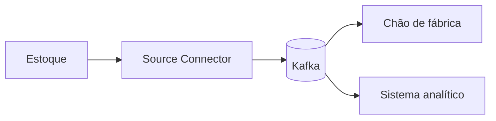

# Aula 08 — Integração

**Módulo:** 01 — Fundamentos de Arquitetura de Solução  
**Tema:** Solution Enterprise  
**Origem:** Síntese autoral do resumo da aula, com complementos identificados.

## Objetivo

Compreender integração como requisito essencial em sistemas enterprise que precisam conectar módulos, produtos contratados, serviços externos e legados.

## Integração no contexto enterprise

Integração permite que sistemas troquem dados, comandos e eventos para realizar processos de negócio. Uma aplicação pode ser excelente isoladamente e ainda ser inadequada se não conseguir colaborar com os demais sistemas da organização.

## Três perguntas arquiteturais

1. Os sistemas internos conseguem se comunicar?
2. As aplicações internas conseguem se integrar com serviços externos?
3. Os produtos contratados oferecem integração eficiente e com custo aceitável?

É preciso avaliar contratos, segurança, manutenção e governança dos dados, não apenas conectividade.

## Heterogeneidade tecnológica

Um ambiente corporativo pode combinar mainframes, aplicações web modernas e aplicativos Flutter. A arquitetura deve permitir interoperabilidade sem exigir reescrita completa dos legados.

## Abordagens de integração — complemento

| Abordagem | Uso típico | Atenção |
| --- | --- | --- |
| APIs síncronas | Consultas com resposta imediata | Dependência temporal |
| Mensageria | Trabalho assíncrono | Retentativas e duplicidade |
| Streaming de eventos | Distribuição contínua a vários consumidores | Contratos e operação |
| Lotes | Consolidação periódica | Defasagem dos dados |

## Ferramentas e padrões

API gateways organizam a entrada e políticas de APIs. Barramentos e plataformas de integração conectam sistemas e podem transformar mensagens. Brokers e plataformas de streaming desacoplam produtores e consumidores. A escolha depende do problema e do custo operacional.

## Apache Kafka

Kafka é uma plataforma distribuída de streaming de eventos. Produtores publicam registros em tópicos e consumidores os leem de forma independente. Isso facilita distribuir eventos a diferentes domínios.

Kafka não elimina cuidados com consistência, idempotência, segurança e observabilidade.

## Kafka Connect

Kafka Connect utiliza conectores padronizados para mover dados entre Kafka e sistemas externos.

- **Source connector:** leva dados de uma origem para tópicos Kafka.
- **Sink connector:** leva dados de tópicos Kafka para um destino.

Os conectores reduzem código repetitivo, mas exigem configuração e operação.

## Exemplo complementar — estoque e fábrica

Quando o estoque muda, um evento pode ser publicado para que diferentes consumidores reajam sem integração direta entre todos os sistemas.

> Exemplo conceitual autoral, não atividade oficial do MBA.

## Cuidados arquiteturais

- Versionamento de APIs e eventos;
- Autenticação e autorização entre sistemas;
- Retentativas e idempotência;
- Monitoramento de falhas e atrasos;
- Definição de consistência e responsabilidade sobre dados;
- Custos de infraestrutura e suporte.

## Perguntas de revisão

1. Por que a integração deve ser considerada desde o desenho da solução?
2. Quando uma API síncrona é preferível ao streaming?
3. Qual a diferença entre Kafka e Kafka Connect?
4. Como integrar sistemas legados sem reescrevê-los?
5. Por que duplicidade de eventos precisa ser tratada?

## Síntese

> Integrar sistemas enterprise significa permitir colaboração confiável entre tecnologias e domínios distintos, com contratos, segurança e custos sustentáveis.

## Conexões

- [Aula 04 — Escalabilidade](./aula-04-escalabilidade.md)
- [Aula 05 — Disponibilidade](./aula-05-disponibilidade.md)
- [Aula 06 — Segurança](./aula-06-seguranca.md)
- [Aula 07 — Customização e Modularização](./aula-07-customizacao-e-modularizacao.md)
