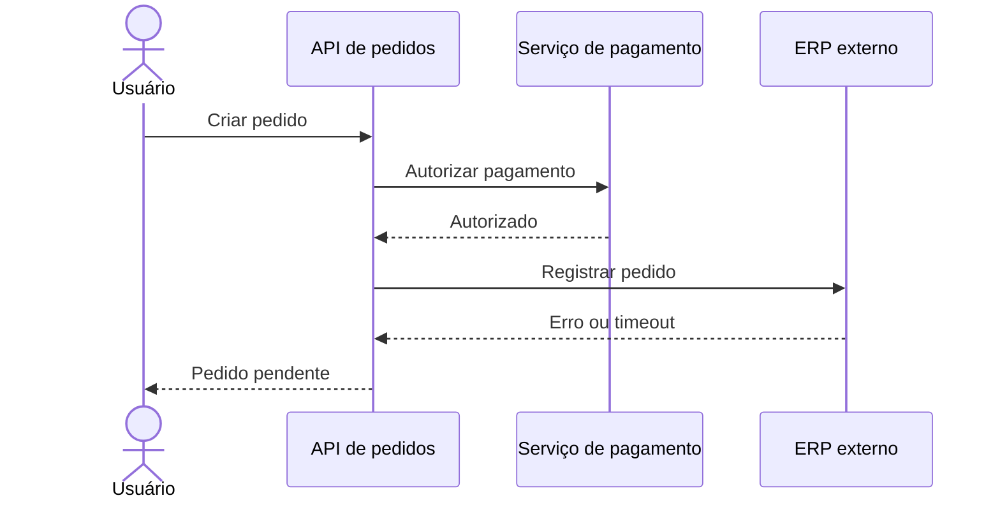

# Aula 09 — Observabilidade

**Módulo:** 01 — Fundamentos de Arquitetura de Solução  
**Tema:** Solution Enterprise — concluído  
**Origem:** Resumo do estudante, organizado e complementado com exemplos didáticos autorais.

## Objetivo

Compreender como sinais operacionais permitem inferir o comportamento de sistemas distribuídos, diagnosticar falhas e validar compromissos de negócio.

## 1. Observabilidade no ecossistema enterprise

Observabilidade é a capacidade de compreender o estado e o comportamento interno de um sistema a partir de sinais que ele produz. Em ambientes enterprise, parte dos componentes pode funcionar como uma **black box**: serviços de terceiros, legados e integrações sem acesso ao código-fonte.

Entradas, saídas, erros e tempos de resposta oferecem evidências sobre o funcionamento desses componentes. Entretanto, observar apenas o resultado final nem sempre revela **onde** ocorreu o problema.

**Distinção complementar:** monitoramento verifica condições conhecidas e dispara alertas; observabilidade também ajuda a investigar comportamentos inesperados.

## 2. Logs, métricas e traces

| Sinal | O que mostra | Exemplo |
| --- | --- | --- |
| **Logs** | Registros de eventos específicos | Falha ao validar um pedido |
| **Métricas** | Medidas agregadas ao longo do tempo | Erros por minuto, uso de CPU |
| **Traces distribuídos** | Percurso de uma operação entre componentes | API → pagamentos → ERP |
| **Indicadores de performance** | Comportamento sob carga | Latência p95, throughput |

Logs, métricas e traces são frequentemente chamados de pilares da observabilidade. Traces são um complemento técnico importante ao rastreamento do caminho da informação mencionado na aula.

## 3. Throughput e latência

- **Throughput:** quantidade de trabalho processado por unidade de tempo, como requisições por segundo ou pedidos por minuto.
- **Latência:** tempo que uma operação leva para responder ou concluir.
- **Taxa de erros:** proporção de operações que falham.

Um sistema pode continuar acessível, mas tornar-se inadequado para o negócio quando a latência cresce ou o throughput não acompanha a demanda.

**Complemento:** percentis como p95 e p99 revelam experiências lentas que uma média pode esconder.

## 4. Rastreabilidade em sistemas distribuídos

Uma operação pode atravessar APIs, filas, serviços internos e plataformas externas. O rastreamento distribuído conecta essas etapas por identificadores de trace e spans.

**Exemplo hipotético:** a API de pedidos responde lentamente. Sem rastreamento, as equipes podem discutir se a falha ocorreu no pagamento, na API ou no ERP. Com um trace correlacionado, é possível identificar a etapa com timeout e avaliar o impacto.

> O diagrama é autoral e ilustrativo, não uma arquitetura oficial do curso.

## 5. Investigação de incidentes

Uma sequência útil de diagnóstico é:

1. **Detectar:** alertas e métricas indicam degradação.
2. **Dimensionar:** identificar usuários, operações e períodos afetados.
3. **Correlacionar:** cruzar métricas, logs e traces pelo horário e pelos identificadores.
4. **Localizar:** descobrir a etapa ou dependência associada ao sintoma.
5. **Corrigir e validar:** acompanhar se os indicadores retornaram ao comportamento esperado.
6. **Aprender:** registrar causas, ações preventivas e melhorias de instrumentação.

Observabilidade fornece evidências; não substitui investigação e julgamento técnico.

## 6. Ownership e DevOps

Observabilidade não deve ser responsabilidade exclusiva de infraestrutura. Quem desenvolve os serviços conhece seus fluxos críticos e deve contribuir para a instrumentação, definição de indicadores e investigação de incidentes.

A colaboração entre desenvolvimento e operações melhora a capacidade de diagnosticar problemas e reduzir o tempo de recuperação.

## 7. Boas práticas complementares

- Definir indicadores alinhados à experiência do usuário e aos objetivos de negócio.
- Propagar identificadores de correlação entre serviços e mensagens.
- Usar logs estruturados, com contexto suficiente para diagnóstico.
- Evitar registrar senhas, tokens e dados pessoais desnecessários.
- Estabelecer retenção, permissões e custos para telemetria.
- Instrumentar dependências externas até o limite de visibilidade disponível.
- Criar alertas acionáveis, evitando excesso de notificações.

**Ferramentas possíveis, como complemento de estudo:** OpenTelemetry para instrumentação; Prometheus para métricas; Grafana para visualização; Jaeger para análise de traces. A escolha depende do ecossistema e não é uma exigência desta aula.

## 8. Checklist de revisão

- [ ] Consigo identificar operações críticas e suas métricas?
- [ ] Há logs úteis para investigar falhas?
- [ ] Consigo correlacionar uma requisição entre serviços?
- [ ] Acompanho latência, throughput e erros?
- [ ] Tenho visibilidade das integrações externas?
- [ ] Os desenvolvedores participam da instrumentação?
- [ ] Telemetria respeita segurança, privacidade e orçamento?

## Perguntas de fixação

1. Por que um health check positivo não garante saúde de todas as operações?
2. Qual a diferença entre logs, métricas e traces?
3. Como throughput e latência ajudam a identificar degradação?
4. Por que identificadores de correlação são úteis em sistemas distribuídos?
5. Como o ownership em DevOps altera a responsabilidade pela observabilidade?

## Síntese

> Integrar sistemas não basta: é preciso produzir evidências contínuas de que os fluxos estão saudáveis e conseguir investigar o caminho da informação quando algo falha.

## Conexões com as aulas anteriores

- [Aula 04 — Escalabilidade](./aula-04-escalabilidade.md): métricas sob diferentes níveis de carga.
- [Aula 05 — Disponibilidade](./aula-05-disponibilidade.md): verificação de níveis de serviço por operação.
- [Aula 06 — Segurança](./aula-06-seguranca.md): auditoria e proteção da telemetria.
- [Aula 08 — Integração](./aula-08-integracao.md): rastreamento entre sistemas e terceiros.

## Encerramento do tema Solution Enterprise

As nove aulas estabeleceram uma visão sistêmica de arquitetura de solução: contexto organizacional, pessoas, processos, tecnologia, governança, escalabilidade, disponibilidade, segurança, customização, modularização, integração e observabilidade. O próximo passo é aplicar esses fundamentos em decisões arquiteturais concretas.
