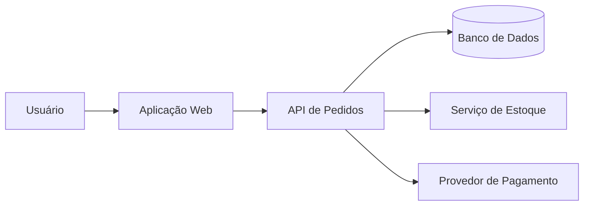

# Aula 01 — O que é arquitetura de solução?

**Módulo:** 01 — Fundamentos de Arquitetura de Solução  
**Tema:** 02 — Solution Architecture  
**Status:** Documentada  
**Origem:** Síntese autoral baseada no resumo de estudo fornecido, com complementos didáticos identificados.

## Objetivo de aprendizagem

Compreender como a arquitetura de solução transforma requisitos de negócio e restrições técnicas em um desenho coerente de componentes, interfaces, comportamentos e infraestrutura.

## 1. O que é arquitetura de solução?

Arquitetura de solução é o processo de definir a estrutura e as decisões técnicas de uma solução de software para atender **requisitos funcionais e não funcionais**. Ela orienta a organização de módulos, componentes, integrações, dados e responsabilidades antes e durante a implementação.

Arquitetar não significa desenhar todos os detalhes antecipadamente: significa explicitar decisões relevantes, restrições e trade-offs, revisando-os à medida que surgem novas informações.

## 2. Requisitos funcionais e não funcionais

| Tipo | Pergunta | Exemplos |
| --- | --- | --- |
| **Funcional** | O que o sistema deve fazer? | Registrar pedidos, consultar estoque, emitir notas |
| **Não funcional** | Com quais características e restrições deve operar? | Latência, disponibilidade, segurança, escalabilidade, auditabilidade |

**Complemento:** hospedagem, deploy, persistência e escolha de plataforma frequentemente são **decisões ou restrições arquiteturais** que ajudam a atender requisitos não funcionais, e não necessariamente requisitos por si só.

Um sistema pode implementar corretamente o cadastro de pedidos e ainda falhar se não suportar a demanda, expuser dados ou depender de integrações indisponíveis.

## 3. Estrutura, componentes e comportamento

O desenho arquitetural identifica:

- **Componentes:** unidades com responsabilidades identificáveis, como API, serviço de pagamentos e banco de dados.
- **Módulos:** agrupamentos lógicos de funcionalidades e regras de negócio.
- **Interfaces:** contratos de comunicação, como APIs, eventos e mensagens.
- **Comportamento:** sequência de interações, tratamento de falhas e fluxo de dados.

Separar responsabilidades reduz ambiguidades, mas fronteiras inadequadas podem aumentar acoplamento e custo de integração.

## 4. Stack, plataformas e infraestrutura

A arquitetura define ou recomenda tecnologias conforme requisitos, competências da equipe, custos e restrições do ambiente.

Exemplos de decisões: linguagem e framework, banco de dados, modelo de deploy, hospedagem, filas e ferramentas de observabilidade.

**Trade-off:** uma tecnologia sofisticada pode oferecer recursos valiosos, mas também exigir conhecimento e operação que a organização não possui.

## 5. Blueprint: mapa compartilhado da solução

O **blueprint** representa a arquitetura em alto nível para orientar desenvolvimento, integração e alinhamento entre stakeholders.

Ele pode incluir:
- Contexto e objetivos de negócio;
- Componentes e suas responsabilidades;
- Fluxos de dados e interfaces;
- Dependências externas;
- Restrições, riscos e decisões relevantes.

Um blueprint não substitui código, testes ou documentação de contratos; ele oferece uma referência comum que deve evoluir junto com a solução.

## 6. Exemplo complementar — sistema corporativo de pedidos

**Cenário hipotético:** uma organização precisa registrar pedidos, consultar estoque e solicitar pagamentos por um provedor externo.

**Decisões a avaliar:** quem é responsável pelo estoque, como tratar timeout no pagamento, quais dados persistir, como autenticar as chamadas e quais níveis de serviço são exigidos.

> Exemplo e diagrama autorais, não um projeto oficial do MBA.

## 7. Papel da pessoa arquiteta de solução

A pessoa arquiteta atua em visão de alto nível (*high level*) e conecta negócio, engenharia e operação. Seu papel inclui:

1. Esclarecer requisitos e restrições;
2. Identificar componentes, integrações e dependências;
3. Comparar alternativas e trade-offs;
4. Comunicar o desenho e suas decisões;
5. Validar a arquitetura com equipes e evidências práticas.

O desenho arquitetural não substitui a implementação: orienta decisões e reduz o risco de esforços isolados.

## 8. Por que isso é especialmente importante em enterprise?

Sistemas enterprise costumam reunir demandas simultâneas de escala, segurança, disponibilidade, desempenho, governança e integração com legados ou terceiros. Uma decisão local pode afetar operações de várias áreas.

Soluções menores também se beneficiam de decisões arquiteturais; a **formalização deve ser proporcional à complexidade e ao risco**, evitando burocracia desnecessária.

## 9. Integração e impacto organizacional

Quando sistemas compartilham dados e processos, falhas de contratos, indisponibilidade e mudanças de comportamento podem se propagar. A arquitetura precisa antecipar dependências e estabelecer responsabilidades claras.

Isso conecta diretamente este tema ao anterior, **Solution Enterprise**, no qual foram estudados integração, observabilidade, segurança e disponibilidade.

## Checklist de arquitetura

- [ ] Os objetivos de negócio estão claros?
- [ ] Requisitos funcionais e atributos de qualidade foram identificados?
- [ ] Componentes e responsabilidades estão delimitados?
- [ ] Interfaces e dependências externas foram mapeadas?
- [ ] Tecnologias e infraestrutura são coerentes com as restrições?
- [ ] Os principais trade-offs foram registrados?
- [ ] O blueprint é compreensível para as equipes envolvidas?

## Perguntas de revisão

1. Qual é a diferença entre requisito funcional e não funcional?
2. Por que um sistema funcional pode ser arquiteturalmente inadequado?
3. Qual a finalidade de um blueprint?
4. Por que a escolha da stack não deve preceder a compreensão dos requisitos?
5. Como a integração com outros sistemas aumenta o impacto das decisões arquiteturais?

## Síntese

> Arquitetura de solução é transformar necessidades e restrições em decisões técnicas coordenadas, comunicáveis e verificáveis, que orientam a construção e a evolução do software.

## Conexões

- [Tema 01 — Solution Enterprise](../tema-01-solution-enterprise/README.md): contexto organizacional e atributos de qualidade.
- [Aula 08 — Integração](../tema-01-solution-enterprise/aula-08-integracao.md): dependências e comunicação entre sistemas.
- [Aula 09 — Observabilidade](../tema-01-solution-enterprise/aula-09-observabilidade.md): validação operacional das decisões.
