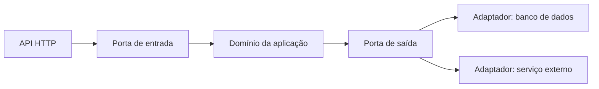

# Aula 04 — Princípios para Arquitetar uma Solução

**Módulo:** 01 — Fundamentos de Arquitetura de Solução  
**Tema:** 02 — Solution Architecture  
**Origem:** Resumo do estudante, reorganizado com complementos e exemplos autorais.

## Objetivo

Compreender os princípios que orientam decisões arquiteturais e reconhecer seus trade-offs diante de objetivos de negócio e restrições reais.

## 1. Objetivos de negócio: princípio central

Arquitetura existe para gerar valor para a organização e seus usuários. A decisão começa pelo problema e pelos resultados esperados, não pela tecnologia preferida.

**Perguntas orientadoras:** quem será beneficiado? Qual resultado será medido? Quais riscos impedem a adoção? Quando a solução precisa entregar valor?

Uma tecnologia elegante pode ser uma má escolha se aumentar custos, atrasar a entrega ou não resolver o problema.

## 2. Flexibilidade diante das restrições

Orçamento, legado, prazos, equipe e maturidade operacional delimitam as alternativas viáveis. Ser flexível é avaliar trade-offs com critérios explícitos, não abandonar a qualidade.

**Exemplo complementar:** uma equipe pequena pode escolher um monólito modular com deploy automatizado em vez de vários microsserviços, desde que os requisitos sejam atendidos.

## 3. Reusabilidade

Antes de construir um componente novo, investigar se já existe um serviço, módulo, biblioteca ou sistema legado capaz de atender à necessidade.

Reutilizar pode reduzir prazo e risco, mas também pode criar dependências inadequadas. É necessário avaliar qualidade, segurança, contratos, suporte e custo de adaptação.

> Reutilização não significa aceitar qualquer legado; significa comparar reaproveitamento e reconstrução com evidências.

## 4. Interoperabilidade

É a capacidade de sistemas trocarem informações e colaborarem por contratos previsíveis. APIs, eventos e formatos padronizados reduzem atritos de integração.

**Complemento técnico — arquitetura hexagonal:** Ports and Adapters separa a lógica de domínio das tecnologias externas. Uma porta define o contrato necessário; um adaptador implementa a comunicação com banco, API ou mensageria.

Esse desenho é conceitual e **não exige microsserviços**.

## 5. Manutenibilidade, operação e deploy

Manutenibilidade envolve corrigir, modificar, implantar, monitorar e recuperar a solução com esforço controlado.

Decisões relevantes incluem automação de deploy, testes, observabilidade, procedimentos de rollback e recuperação diante de falhas. DevOps e SRE oferecem práticas úteis para sustentar essas capacidades.

**Trade-off:** aumentar automação e instrumentação tem custo inicial, mas pode reduzir o esforço de mudanças e incidentes.

## 6. Aderência regulatória

Leis, normas setoriais e obrigações contratuais podem impor restrições sobre coleta, retenção, acesso, processamento e transferência de dados.

**Exemplo complementar:** uma solução que trata dados pessoais deve considerar obrigações aplicáveis, como a LGPD no Brasil. A arquitetura precisa envolver jurídico, segurança e compliance na interpretação dos requisitos; não basta presumir que um padrão técnico garante conformidade.

## 7. Portabilidade

Portabilidade é a capacidade de mover ou adaptar a solução entre ambientes e tecnologias com esforço razoável. Isolar regras de negócio de detalhes de infraestrutura e utilizar contratos explícitos pode facilitar migrações.

**Trade-off:** abstrações extras também custam tempo e manutenção. O objetivo é portabilidade proporcional ao risco de mudança, não independência absoluta de qualquer fornecedor.

## 8. Princípios e decisões — quadro comparativo

| Princípio | Pergunta prática | Risco de ignorá-lo |
| --- | --- | --- |
| Objetivos de negócio | Que valor a solução entrega? | Construir algo sem adoção |
| Flexibilidade | O que é viável neste contexto? | Projeto caro ou inexequível |
| Reusabilidade | O que já pode ser aproveitado? | Retrabalho e duplicação |
| Interoperabilidade | Como a solução conversa com outras? | Integrações frágeis |
| Manutenibilidade | Como evoluir e recuperar em produção? | Mudanças lentas e incidentes longos |
| Aderência regulatória | Quais obrigações restringem o desenho? | Não conformidade e retrabalho |
| Portabilidade | Qual o custo de migrar ou substituir dependências? | Aprisionamento tecnológico excessivo |

## 9. Exemplo complementar — evolução de um sistema de pedidos

**Cenário hipotético:** uma empresa precisa disponibilizar pedidos online rapidamente, usando um ERP legado e orçamento limitado.

1. **Negócio:** priorizar o fluxo de pedidos mais valioso para o cliente.
2. **Flexibilidade:** entregar um MVP em fases, sem comprometer controles críticos.
3. **Reusabilidade:** aproveitar o cadastro de produtos já existente no ERP.
4. **Interoperabilidade:** expor integração por uma interface bem definida.
5. **Manutenibilidade:** automatizar testes, deploy e monitoramento.
6. **Regulação:** avaliar proteção de dados pessoais e requisitos setoriais.
7. **Portabilidade:** evitar misturar regras de pedido com detalhes específicos do fornecedor.

> Exemplo autoral, não atividade oficial do MBA.

## Checklist de revisão

- [ ] O objetivo de negócio e os critérios de sucesso estão claros?
- [ ] Restrições financeiras, operacionais e técnicas foram consideradas?
- [ ] Avaliei ativos existentes antes de reconstruir?
- [ ] Defini contratos de integração e fronteiras de domínio?
- [ ] Planejei deploy, observabilidade e recuperação?
- [ ] Identifiquei obrigações regulatórias aplicáveis?
- [ ] Avaliei riscos e custos de dependência tecnológica?
- [ ] Registrei trade-offs e justificativas?

## Perguntas de fixação

1. Por que objetivos de negócio devem preceder a escolha da stack?
2. Quando reutilizar um legado é melhor do que reescrevê-lo?
3. Como Ports and Adapters ajuda a isolar dependências externas?
4. Por que deploy e recuperação fazem parte da manutenibilidade?
5. Quais riscos surgem ao deixar compliance para o fim do projeto?
6. Em que situações a portabilidade adicional não compensa?

## Síntese

> Uma boa arquitetura equilibra valor de negócio, viabilidade organizacional e sustentabilidade técnica. Princípios orientam escolhas, mas não substituem a análise de contexto.

## Conexões

- [Aula 01 — O que é arquitetura de solução?](./aula-01-o-que-e-arquitetura-de-solucao.md)
- [Aula 02 — Perfil da Função](./aula-02-perfil-da-funcao.md)
- [Aula 03 — Soft Skills](./aula-03-soft-skills.md)
- [Tema 01 — Solution Enterprise](../tema-01-solution-enterprise/README.md)
