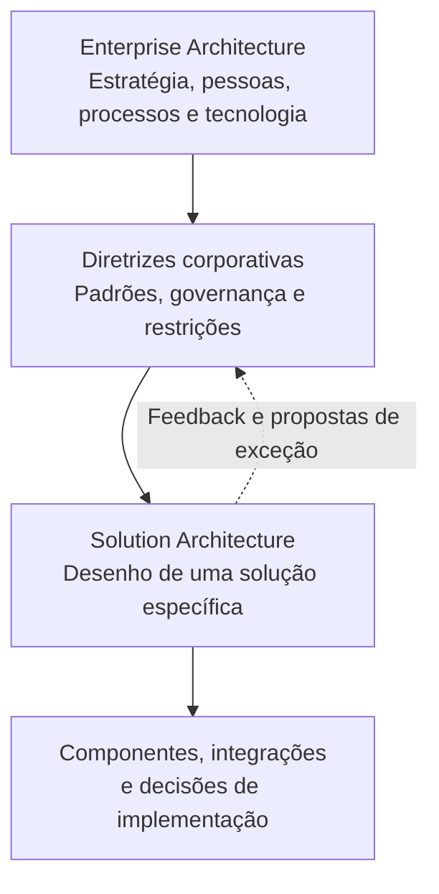

# Aula 07 — Enterprise Architecture vs. Solution Architecture

**Módulo:** 01 — Fundamentos de Arquitetura de Solução  
**Tema:** 02 — Solution Architecture  
**Origem:** Resumo do estudante, reorganizado com exemplos e complementos autorais.

## Objetivo

Distinguir o escopo da arquitetura corporativa (**Enterprise Architecture — EA**) e da arquitetura de solução (**Solution Architecture — SA**), entendendo como diretrizes organizacionais condicionam o desenho de sistemas específicos.

## 1. Enterprise Architecture: visão corporativa

Enterprise Architecture organiza a visão estrutural da organização, alinhando **pessoas, processos e tecnologia** aos objetivos corporativos. Seu escopo atravessa unidades, produtos e sistemas.

Pode estabelecer diretrizes para:
- Padrões e tecnologias aprovadas;
- Governança de dados e integrações;
- Aquisição de sistemas e relacionamento com fornecedores;
- Processos e responsabilidades organizacionais;
- Segurança, conformidade e evolução do portfólio tecnológico.

O objetivo não é detalhar cada componente de um sistema, mas manter coerência entre iniciativas da empresa.

## 2. Solution Architecture: visão da solução

Solution Architecture define a estrutura e o comportamento de uma solução particular: componentes, interfaces, integrações, requisitos e decisões tecnológicas.

Ela traduz uma necessidade concreta do negócio em um desenho implementável, considerando restrições e capacidades existentes.

Uma solução não surge em um vazio: precisa coexistir com sistemas, fornecedores, padrões e processos corporativos.

## 3. Comparação de escopos

| Aspecto | Enterprise Architecture | Solution Architecture |
| --- | --- | --- |
| Abrangência | Organização e seu ecossistema | Solução ou iniciativa específica |
| Pergunta principal | Como a organização deve se estruturar e evoluir? | Como resolver este problema com uma solução viável? |
| Foco | Pessoas, processos, capacidades, dados e tecnologia | Componentes, integrações, requisitos e comportamentos |
| Horizonte | Estratégico e transversal | Entrega e evolução de uma solução |
| Resultado típico | Diretrizes, princípios, padrões e mapas de capacidades | Blueprint, decisões técnicas e contratos de integração |
| Interlocutores | Lideranças corporativas e áreas transversais | Produto, engenharia, operação e stakeholders da iniciativa |

## 4. Relação entre as arquiteturas

A EA oferece o **enquadramento corporativo**; a SA detalha a solução respeitando esse enquadramento.

**Nuance complementar:** a relação é de escopo e governança, não necessariamente de hierarquia administrativa entre cargos. A arquitetura de solução pode solicitar exceções ou propor ajustes às diretrizes quando houver justificativa e aprovação apropriadas.

## 5. Diretrizes corporativas como restrições concretas

Se uma organização decide utilizar apenas ERPs de mercado e consultores externos para determinadas atividades, a pessoa arquiteta de solução deve incorporar essas premissas.

Isso afeta:
- A escolha entre comprar e construir;
- Contratos e pontos de integração;
- Responsabilidades entre equipe interna e fornecedor;
- Custos recorrentes, suporte e dependências;
- Prazos e procedimentos de implantação.

Ignorar essas regras pode produzir um desenho tecnicamente válido, mas incompatível com a organização.

## 6. Pessoas, processos e tecnologia

A arquitetura corporativa considera a empresa como um sistema sociotécnico.

**Pessoas:** competências, papéis, contratação e responsabilidade.  
**Processos:** fluxos, governança, aprovação e operação.  
**Tecnologia:** sistemas, dados, plataformas e integrações.

Uma mudança de plataforma, por exemplo, pode exigir treinamento, novos contratos e alteração de processos — não apenas mudanças de código.

## 7. Exemplo complementar — ERP externo e consultoria

**Cenário hipotético:** a empresa determina que processos financeiros sejam atendidos por um ERP externo e que customizações sejam executadas por consultoria homologada.

Uma nova solução de pedidos precisa enviar dados financeiros ao ERP.

1. **EA:** define a diretriz de ERP externo, políticas de integração e responsabilidades de fornecedores.
2. **SA:** define como pedidos serão validados, transformados e enviados ao ERP.
3. **Integração:** avalia APIs disponíveis, tratamento de falhas, autenticação e reconciliação.
4. **Operação:** define monitoramento, suporte, escalonamento e contingência.
5. **TCO:** contabiliza licenças, integração, consultoria, operação e custo de saída.

> Exemplo autoral para estudo; não é uma atividade oficial do MBA.

## 8. Como agir quando uma diretriz parece inadequada?

**Prática complementar:**
1. Confirmar a diretriz e sua justificativa;
2. Evidenciar o conflito com requisitos da solução;
3. Comparar alternativas e trade-offs;
4. Estimar impactos financeiros, operacionais e regulatórios;
5. Solicitar exceção ou revisão pela governança competente;
6. Registrar a decisão e os responsáveis.

O objetivo é manter coerência organizacional sem bloquear melhorias justificadas.

## Checklist

- [ ] Conheço os padrões corporativos aplicáveis?
- [ ] Identifiquei restrições de fornecedores, tecnologia e operação?
- [ ] Mapeei pessoas e processos afetados?
- [ ] A solução se integra ao ecossistema existente?
- [ ] Custos e responsabilidades de terceiros estão explícitos?
- [ ] Existe caminho formal para exceções arquiteturais?
- [ ] As decisões foram registradas e comunicadas?

## Perguntas de revisão

1. Qual é a diferença de abrangência entre EA e SA?
2. Por que a arquitetura corporativa considera pessoas e processos?
3. Como a diretriz de utilizar ERP externo muda uma solução de pedidos?
4. A arquitetura de solução pode questionar um padrão corporativo? Como?
5. Qual a relação entre diretrizes de EA e avaliação de TCO?

## Síntese

> Enterprise Architecture orienta a coerência da organização; Solution Architecture transforma necessidades específicas em soluções alinhadas a esse contexto.

## Conexões

- [Aula 01 — O que é arquitetura de solução?](./aula-01-o-que-e-arquitetura-de-solucao.md)
- [Aula 02 — Perfil da Função](./aula-02-perfil-da-funcao.md)
- [Aula 04 — Princípios para Arquitetar uma Solução](./aula-04-principios-para-arquitetar-uma-solucao.md)
- [Aula 06 — Aprofundando no TCO](./aula-06-aprofundando-no-tco.md)
- [Tema 01 — Solution Enterprise](../tema-01-solution-enterprise/README.md)
