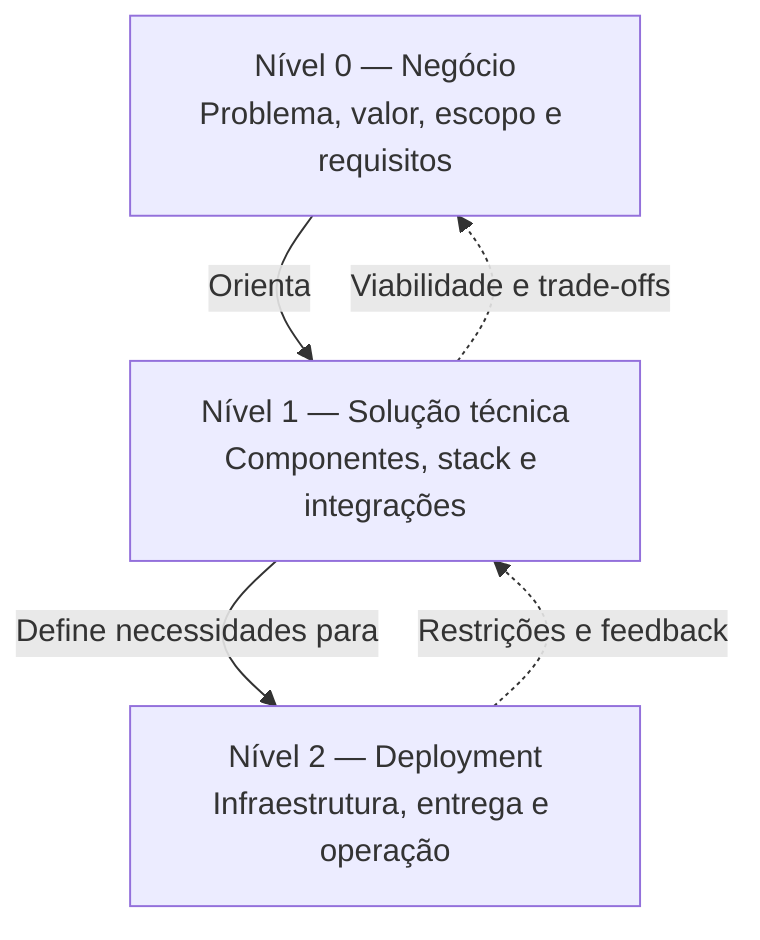

# Aula 08 — 3 Camadas da Arquitetura de Soluções

**Módulo:** 01 — Fundamentos de Arquitetura de Solução  
**Tema:** 02 — Solution Architecture  
**Origem:** Resumo do estudante, reorganizado e complementado com exemplo autoral.

## Objetivo de aprendizagem

Entender o modelo de três níveis de raciocínio arquitetural — **Nível 0: negócio**, **Nível 1: solução técnica** e **Nível 2: deployment** — e aplicá-lo para evitar decisões prematuras.

> Este é o modelo de organização apresentado nesta aula. Não deve ser confundido com o padrão de arquitetura de software em três camadas (apresentação, negócio e dados) nem com os níveis de abstração do modelo C4.

## 1. Por que separar as camadas?

Misturar objetivos de negócio, linguagem de programação, cloud e implantação na mesma discussão tende a gerar confusão. A separação permite esclarecer **por que**, **como** e **onde** uma solução será realizada.

| Nível | Foco | Pergunta orientadora | Exemplos de decisões |
| --- | --- | --- | --- |
| **0 — Negócio** | Problema e valor | O que precisamos resolver e por quê? | Escopo, processos, requisitos, volume de uso |
| **1 — Técnico** | Construção da solução | Como a solução funcionará? | Stack, módulos, integrações, Buy vs. Build, esforço |
| **2 — Deployment** | Entrega e operação | Onde e como a solução será executada? | Infraestrutura, ambientes, CI/CD, observabilidade |

## 2. Nível 0 — Arquitetura focada no negócio

Estabelece o problema, os resultados esperados e os limites da solução. Inclui contexto organizacional, módulos e processos envolvidos, requisitos funcionais e não funcionais, estimativa de demanda e critérios de sucesso.

**Exemplo:** permitir que clientes acompanhem pedidos online, com atualização de status e integração ao processo de estoque.

Sem esse enquadramento, a engenharia pode otimizar uma solução que não atende às necessidades reais.

## 3. Nível 1 — Área técnica

Traduz as necessidades em desenho técnico viável:
- Componentes e fronteiras de responsabilidade;
- Tecnologias e stack de desenvolvimento;
- Contratos e integrações;
- O que construir, reutilizar ou contratar;
- Estimativas de esforço, equipe e custos técnicos.

A **stack** é consequência das necessidades e restrições identificadas, não ponto de partida para inventar o problema.

## 4. Nível 2 — Arquitetura focada no deployment

Define como a solução será disponibilizada e sustentada no ambiente real:
- Hospedagem, rede, computação e armazenamento;
- Ambientes de desenvolvimento, homologação e produção;
- Pipelines de build, testes e deploy;
- Monitoramento, logs, métricas e rastreamento;
- Segurança operacional, rollback e recuperação.

Cloud é uma possibilidade, não uma obrigação. Uma solução pode operar on-premises, em cloud ou em modelo híbrido.

## 5. Visão geral dos três níveis

As camadas são separadas **para pensar com clareza**, mas continuam interdependentes. Uma limitação operacional pode exigir rever decisões técnicas ou até ajustar escopo e requisitos.

## 6. Área técnica não é deployment

**Nível 1:** definir que a aplicação terá um módulo de pedidos e uma integração assíncrona com estoque.

**Nível 2:** definir como esses componentes serão empacotados, implantados, monitorados e recuperados em produção.

Escolher Kubernetes antes de entender se existe necessidade operacional para isso inverte a análise e pode elevar o TCO sem benefício proporcional.

## 7. Exemplo complementar — sistema de pedidos

**Cenário hipotético:** uma loja quer oferecer acompanhamento de pedidos pela web.

| Nível | Aplicação do modelo |
| --- | --- |
| 0 — Negócio | Cliente consulta status; atualização em até alguns minutos; operação compatível com o orçamento |
| 1 — Técnico | API de pedidos, módulo de consulta, integração com estoque e persistência |
| 2 — Deployment | Hospedagem adequada à demanda, pipeline automatizado, logs e alertas |

**Sequência de decisão:**
1. Confirmar o problema e os critérios de sucesso;
2. Modelar componentes e integrações;
3. Avaliar como executar e operar a solução;
4. Revisar decisões se custo, risco ou restrições inviabilizarem o desenho.

> Exemplo autoral para fixação, não atividade oficial do MBA.

## 8. Relação com entrega da solução

Entregar não é apenas concluir código. É fazer o desenho técnico atender ao objetivo de negócio **em ambiente executável, observável e sustentável**.

O nível 2 materializa operacionalmente o que o nível 1 projetou para satisfazer o nível 0.

## Checklist de aplicação

- [ ] O problema e os resultados de negócio estão explícitos?
- [ ] Requisitos, escopo e volume esperado foram discutidos?
- [ ] A stack foi escolhida em função da solução?
- [ ] Componentes e integrações estão definidos?
- [ ] Infraestrutura e pipelines atendem aos requisitos?
- [ ] Custos e capacidade operacional foram considerados?
- [ ] Existe espaço para revisar decisões entre níveis?

## Perguntas de revisão

1. Qual problema o nível 0 procura evitar?
2. Por que a escolha da stack pertence ao nível 1?
3. Qual a diferença entre definir uma integração e implantá-la?
4. Como uma restrição do nível 2 pode afetar o nível 1?
5. Por que este modelo não equivale à arquitetura de software em três camadas?

## Síntese

> Primeiro compreender o valor de negócio; depois desenhar a solução técnica; por fim planejar sua execução e operação — revisitando decisões quando novas restrições surgirem.

## Conexões

- [Aula 01 — O que é arquitetura de solução?](./aula-01-o-que-e-arquitetura-de-solucao.md)
- [Aula 04 — Princípios para Arquitetar uma Solução](./aula-04-principios-para-arquitetar-uma-solucao.md)
- [Aula 05 — Iniciando com TCO](./aula-05-iniciando-com-tco.md)
- [Aula 07 — Enterprise Architecture vs. Solution Architecture](./aula-07-enterprise-architecture-vs-solution-architecture.md)
