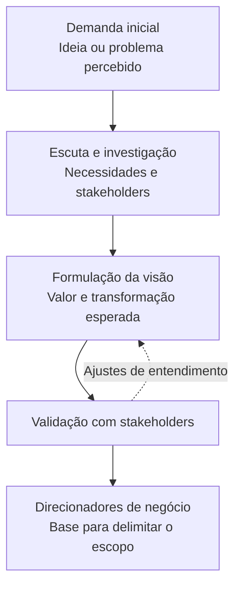

# Aula 09 — Nível 0: Negócio

**Módulo:** 01 — Fundamentos de Arquitetura de Solução  
**Tema:** 02 — Solution Architecture  
**Origem:** Resumo do estudante, organizado com exemplos e técnicas complementares autorais.

## Objetivo de aprendizagem

Compreender como o **Nível 0 — Negócio** define a razão de existir de uma solução, identifica stakeholders e estabelece uma visão que orienta o escopo e as decisões arquiteturais posteriores.

## 1. A camada de negócio vem primeiro

No modelo de três níveis apresentado na [Aula 08](./aula-08-3-camadas-da-arquitetura-de-solucoes.md), o Nível 0 procura responder:

- **Por que** a solução deve existir?
- **Para quem** ela gera valor?
- **Que mudança** o negócio espera produzir?
- **Qual é a visão** da solução?
- **Qual será o escopo** a ser detalhado depois?

A intenção precede stack, integrações e deployment. Uma implementação tecnicamente correta pode fracassar se não responder à necessidade real.

## 2. Visão: formulação inicial dos objetivos

A **visão** é uma formulação de alto nível da intenção do projeto. Ela pode nascer de percepções, experiências e objetivos ainda pouco formalizados; por isso, precisa ser investigada e refinada.

Não é necessário ter todos os detalhes para formular uma visão útil. É necessário, porém, torná-la suficientemente clara para orientar prioridades e permitir validação com os envolvidos.

> **Visão não é desenho técnico.** Ela descreve a transformação desejada, não a tecnologia que a realizará.

## 3. A razão de existir da solução

Entender a razão de existir significa ir além de uma lista de tarefas.

**Pedido superficial:** “Precisamos criar um aplicativo de venda de ingressos.”

**Intenção de negócio:** “Queremos reduzir o atrito na compra, tornar a experiência acessível em dispositivos móveis e incentivar clientes a comprar novamente.”

A segunda formulação oferece critérios para avaliar decisões futuras.

## 4. Visão nem sempre está documentada

Em empresas, a demanda pode chegar em frases vagas, apresentações comerciais ou conversas informais. O solicitante costuma conhecer a dor e o resultado esperado, mas não necessariamente os requisitos completos.

A pessoa arquiteta deve **captar e validar** a intenção — não inventar objetivos por conta própria.

### Técnica complementar: perguntas de descoberta

- Que problema motivou a iniciativa?
- Quem enfrenta esse problema hoje?
- O que deve melhorar para considerarmos o projeto bem-sucedido?
- Que comportamentos desejamos incentivar ou eliminar?
- Que restrições ou dependências já conhecemos?
- Quem pode confirmar se interpretamos corretamente a necessidade?

Essas perguntas são uma sugestão autoral de prática profissional, não uma metodologia formal atribuída à aula.

## 5. Visão versus escopo

| Aspecto | Visão | Escopo |
| --- | --- | --- |
| Pergunta | Que transformação queremos gerar? | O que será incluído ou excluído? |
| Natureza | Direção e intenção | Limites e entregas |
| Exemplo | Simplificar a compra de ingressos | Permitir busca, seleção e compra na primeira versão |
| Momento | Orienta o detalhamento | É refinado a partir da visão |

A visão vem antes do escopo detalhado, mas ambos podem ser revisitados à medida que surgem novas informações.

## 6. Exemplo: startup de venda de ingressos

**Cenário discutido no resumo:** uma startup quer oferecer compra de ingressos simples, rápida e acessível por celular e tablet, incentivando recorrência.

### Formulação de visão — exemplo autoral

> Facilitar a compra de ingressos para eventos por meio de uma experiência móvel simples, rápida e conveniente, aumentando a satisfação e a probabilidade de novas compras.

### O que essa visão orienta?

| Intenção | Consequência para decisões futuras |
| --- | --- |
| Simplicidade | Evitar etapas desnecessárias no fluxo |
| Rapidez | Investigar pontos de atrito e desempenho percebido |
| Acessibilidade em dispositivos móveis | Priorizar experiência adequada a celular e tablet |
| Recorrência | Entender motivos de retorno e experiência pós-compra |

**Atenção:** essas consequências são direcionadores, não requisitos técnicos fechados. Métricas, funcionalidades e restrições ainda precisam ser descobertas e validadas.

## 7. Stakeholders e perspectivas

A visão precisa considerar quem solicita, utiliza, executa, mantém ou é afetado pela solução.

| Stakeholder | Perspectiva possível |
| --- | --- |
| Cliente | Facilidade, confiança e conveniência |
| Equipe de atendimento | Dúvidas, cancelamentos e suporte |
| Organizadores de eventos | Controle e acompanhamento de vendas |
| Financeiro | Custos, receitas e conciliação |
| Operação e tecnologia | Sustentação, segurança e disponibilidade |
| Parceiros | Integrações e responsabilidades |

Essas perspectivas são hipóteses iniciais e devem ser confirmadas com os envolvidos.

## 8. Do pedido informal à visão validada

**Complemento importante:** a visão de alto nível pode ser refinada iterativamente; o diagrama representa uma ordem de raciocínio, não um processo rígido.

## 9. Checklist para trabalhar no Nível 0

- [ ] Consigo explicar por que a solução deve existir?
- [ ] Identifiquei quem recebe valor e quem sofre impacto?
- [ ] A visão está descrita sem antecipar tecnologias?
- [ ] Diferenciei a intenção de negócio do escopo de entrega?
- [ ] Registrei objetivos ainda incertos como hipóteses?
- [ ] Validei o entendimento com stakeholders relevantes?
- [ ] A visão fornece critérios para decisões posteriores?

## Perguntas de revisão

1. Por que a visão deve ser compreendida antes de escolher a stack?
2. Qual a diferença entre visão e escopo?
3. Como descobrir uma visão que ainda não está escrita?
4. Por que ouvir apenas quem solicitou o projeto é insuficiente?
5. No exemplo dos ingressos, qual é a transformação desejada além de processar vendas?
6. Como uma visão de negócio ajuda a evitar decisões arquiteturais desalinhadas?

## Síntese

> O Nível 0 começa pela razão de existir da solução. Uma visão clara, construída e validada com os stakeholders, oferece direção para definir o escopo e orientar a arquitetura técnica.

## Conexões

- [Aula 03 — Soft Skills](./aula-03-soft-skills.md): escuta ativa e comunicação com stakeholders.
- [Aula 04 — Princípios para Arquitetar uma Solução](./aula-04-principios-para-arquitetar-uma-solucao.md): alinhamento aos objetivos de negócio.
- [Aula 08 — 3 Camadas da Arquitetura de Soluções](./aula-08-3-camadas-da-arquitetura-de-solucoes.md): visão geral dos níveis 0, 1 e 2.
