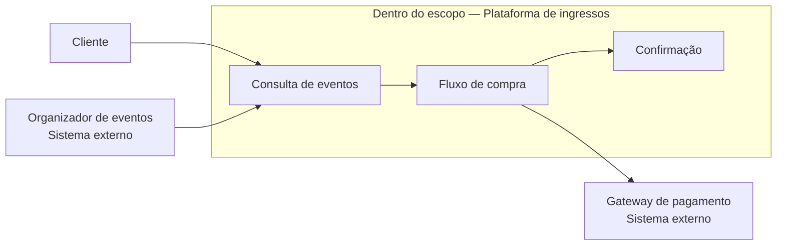
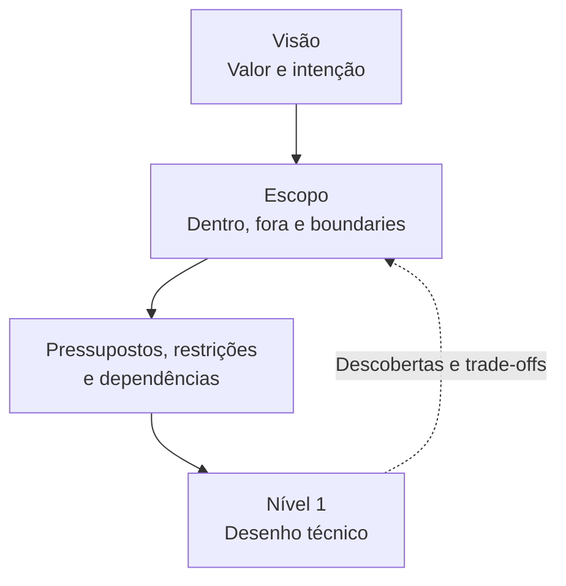

# Aula 10 — Nível 0: Escopo

**Módulo:** 01 — Fundamentos de Arquitetura de Solução  
**Tema:** 02 — Solution Architecture  
**Origem:** Resumo do estudante, com exemplos e aprofundamentos autorais identificados.

## Objetivo

Entender como a **visão de negócio** se transforma em um **escopo de solução** que explicita limites, responsabilidades, requisitos, pressupostos e restrições antes do detalhamento técnico.

## 1. Da visão ao escopo

A [Aula 09 — Nível 0: Negócio](./aula-09-nivel-0-negocio.md) apresentou a visão como a intenção que justifica a existência de uma solução.

**Visão:** por que queremos construir e qual transformação esperamos?  
**Escopo:** o que a solução cobrirá, o que não cobrirá e quais limites orientarão as próximas decisões?

Sem delimitação, uma intenção legítima pode gerar expansão descontrolada de responsabilidades (*scope creep*).

## 2. Boundaries: até onde a solução atua?

Os **boundaries** delimitam responsabilidades, funcionalidades, processos e interfaces com o ambiente externo.

Eles ajudam a responder:
- Quais problemas esta iniciativa resolverá?
- Quais processos e usuários serão atendidos?
- Quais capacidades pertencem a sistemas existentes?
- Onde termina a responsabilidade desta solução?
- Que integrações são necessárias, sem absorver responsabilidades alheias?

> Um sistema externo pode estar **dentro do contexto de integração** e, ao mesmo tempo, **fora da responsabilidade de implementação** da solução. Essa distinção evita confundir dependência com propriedade.

## 3. Problema coberto e requisitos

Requisitos funcionais descrevem **o que a solução faz**; requisitos não funcionais descrevem **qualidades e condições** que ela precisa atender.

No Nível 0, os requisitos relevantes são associados ao escopo definido, evitando projetar funcionalidades que não pertencem à iniciativa.

**Nuance complementar:** requisitos identificados fora do escopo não precisam ser ignorados. Podem ser registrados como dependências, demandas futuras ou itens de outra iniciativa, para avaliação e rastreabilidade.

## 4. Componentes, sistemas e tecnologias no escopo

O Nível 0 pode identificar **sistemas participantes, capacidades existentes e restrições tecnológicas conhecidas**, sem antecipar a escolha detalhada de stack, frameworks ou desenho de componentes do Nível 1.

Por exemplo, indicar que a plataforma precisa integrar-se a um gateway de pagamentos delimita uma dependência. Decidir contratos, protocolos, módulos e padrões de implementação pertence ao aprofundamento técnico.

## 5. Pressupostos versus restrições

| Conceito | Significado | Exemplo |
| --- | --- | --- |
| **Pressuposto** | Condição assumida como verdadeira, ainda sujeita a validação | “Teremos desconto contratual no provedor cloud.” |
| **Restrição** | Limite que a solução deve respeitar | “O lançamento precisa ocorrer até determinada data.” |
| **Dependência** | Elemento externo necessário para realizar algo | “O parceiro precisa disponibilizar uma API de ingressos.” |
| **Risco** | Evento incerto com impacto potencial | “O desconto esperado pode não ser aprovado.” |

Uma condição pode mudar de classificação conforme o conhecimento evolui: um desconto presumido pode se tornar uma condição contratual confirmada — ou revelar um risco de orçamento.

### Registro recomendado — complemento autoral

| ID | Tipo | Descrição | Responsável | Validação / ação |
| --- | --- | --- | --- | --- |
| P-01 | Pressuposto | Parceiro fornecerá catálogo de eventos | Comercial | Confirmar acordo e formato |
| R-01 | Restrição | Primeira versão deve atender celulares | Produto | Validar critérios de aceitação |
| D-01 | Dependência | Serviço externo processará pagamentos | Integrações | Confirmar contrato e disponibilidade |

## 6. Exemplo prático: startup de ingressos

**Visão retomada:** simplificar a compra de ingressos em dispositivos móveis, reduzindo atrito e incentivando recorrência.

### Escopo inicial hipotético — exemplo autoral

**Dentro do escopo:**
- Consultar eventos e ingressos disponíveis;
- Selecionar ingressos e iniciar a compra;
- Integrar com um provedor externo de pagamentos;
- Confirmar compra e disponibilizar comprovante.

**Fora do escopo da primeira versão:**
- Criar um sistema próprio de processamento financeiro;
- Gerenciar a operação física dos eventos;
- Construir um marketplace de revenda entre usuários.

**Pressupostos a validar:**
- Organizadores disponibilizarão dados dos eventos;
- O provedor de pagamento atenderá ao modelo comercial;
- Haverá condições de custo compatíveis com a estratégia.

**Restrições a confirmar:**
- Prazo de lançamento;
- Orçamento máximo;
- Regras de segurança e proteção de dados;
- Diretrizes corporativas aplicáveis.

Esses itens são **ilustrativos**, não requisitos oficiais da aula ou de um projeto real.

## 7. Visualização dos limites

O diagrama mostra **responsabilidades e dependências de alto nível**, não a implementação final.

## 8. Escopo como base para o Nível 1

A transição para a solução técnica exige clareza **suficiente**, não certeza absoluta. Questões abertas podem seguir como hipóteses e riscos explícitos.

Essa sequência organiza o raciocínio, mas admite refinamento iterativo.

## 9. Documentação como trabalho arquitetural

Arquitetura produz valor ao **tornar decisões explícitas e compartilháveis**, não apenas ao escrever código.

Artefatos possíveis:
- Declaração de visão e escopo;
- Mapa de stakeholders e sistemas externos;
- Lista de requisitos e exclusões;
- Registro de pressupostos, restrições, dependências e riscos;
- Diagramas de contexto e *system design*;
- Estimativas e insumos para cotações;
- Registros de decisão arquitetural (ADRs).

A documentação deve ser proporcional ao risco e à complexidade, atualizada quando as decisões mudarem.

## 10. Checklist de definição de escopo

- [ ] A visão e o problema de negócio estão claros?
- [ ] O que entra e o que fica fora está registrado?
- [ ] Boundaries e responsabilidades estão explícitos?
- [ ] Requisitos relevantes foram associados ao escopo?
- [ ] Sistemas externos e dependências foram identificados?
- [ ] Pressupostos têm responsáveis e planos de validação?
- [ ] Restrições de prazo, orçamento e organização foram verificadas?
- [ ] Há clareza suficiente para iniciar o Nível 1?
- [ ] Stakeholders relevantes validaram o entendimento?

## Perguntas de revisão

1. Qual a diferença entre visão e escopo?
2. Por que um gateway de pagamento pode ser uma dependência sem estar dentro da responsabilidade de implementação?
3. Como distinguir pressuposto, restrição e risco?
4. O que pode acontecer quando os boundaries não são definidos?
5. Que documentos ajudam a alinhar stakeholders antes do desenho técnico?
6. Por que o escopo não precisa estar absolutamente imutável para avançar ao Nível 1?

## Síntese

> A visão dá direção; o escopo estabelece fronteiras. Definir o que a solução cobre, quais condições assume e quais limites respeita torna o desenho técnico mais coerente e defensável.

## Conexões

- [Aula 08 — 3 Camadas da Arquitetura de Soluções](./aula-08-3-camadas-da-arquitetura-de-solucoes.md)
- [Aula 09 — Nível 0: Negócio](./aula-09-nivel-0-negocio.md)
- [Aula 07 — Enterprise Architecture vs. Solution Architecture](./aula-07-enterprise-architecture-vs-solution-architecture.md)
- [Aula 05 — Iniciando com TCO](./aula-05-iniciando-com-tco.md)
