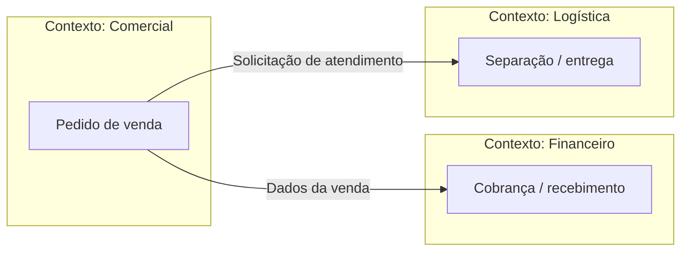

# Aula 11 — Domínio e Contextos

**Módulo:** 01 — Fundamentos de Arquitetura de Solução  
**Tema:** 02 — Solution Architecture  
**Origem:** Resumo do estudante, organizado com exemplos e complementos autorais identificados.

## Objetivo

Compreender como o conhecimento do **domínio de negócio**, as perspectivas dos participantes e os diferentes **contextos organizacionais** orientam uma arquitetura de solução aderente à realidade da empresa.

## 1. Arquitetura começa pelo problema real

Uma solução enterprise não começa por linguagem, framework ou diagrama. Antes de escolher componentes, é preciso compreender o problema que a organização pretende resolver.

As aulas de [visão](./aula-09-nivel-0-negocio.md) e [escopo](./aula-10-nivel-0-escopo.md) estabelecem a intenção e os limites. Estudar o **domínio** aprofunda o entendimento das regras, atividades, conceitos e conflitos que existem dentro desses limites.

Uma implementação pode estar correta tecnicamente e ainda fracassar por modelar um problema diferente do que as pessoas enfrentam.

## 2. Domínio de negócio e perspectivas dos participantes

O **domínio** corresponde à área de conhecimento e atividade que a solução atende — por exemplo, vendas, logística, faturamento ou atendimento.

Participantes distintos enxergam o mesmo processo de maneiras diferentes:

| Participante | Preocupação possível |
| --- | --- |
| Vendedor | Agilidade para concluir uma venda |
| Financeiro | Recebimento, conciliação e controle |
| Logística | Disponibilidade e cumprimento da entrega |
| Parceiro | Contratos, integração e previsibilidade |
| Cliente | Clareza, confiança e conveniência |

Essas perspectivas precisam ser investigadas e validadas. Uma otimização local pode transferir custo ou dificuldade para outra área.

## 3. Cultura organizacional também condiciona a arquitetura

Cada área possui rotinas, linguagem, incentivos e formas de trabalho. Mudanças podem ser percebidas como benefício por um grupo e como ameaça por outro.

Isso influencia:
- Adoção da solução;
- Resistência à mudança;
- Necessidade de treinamento;
- Redesenho de processos;
- Suporte e operação;
- Viabilidade do projeto no cotidiano.

O sistema pode funcionar em produção sem produzir o resultado de negócio esperado, caso não seja incorporado ao trabalho real.

## 4. Entrega técnica não garante adoção

Uma implantação concluída não equivale automaticamente a sucesso.

**Exemplo autoral:** um novo fluxo de aprovação de vendas reduz etapas para a gerência, mas obriga vendedores a preencher informações redundantes. A métrica de implantação é positiva, porém o time passa a contornar o sistema usando planilhas.

O problema não está necessariamente no código: pode estar na compreensão insuficiente do processo e das necessidades de quem o executa.

## 5. O risco de decisões exclusivamente top-down

Diretrizes da liderança são importantes, mas ouvir apenas quem patrocina o projeto pode deixar de fora detalhes decisivos do trabalho diário.

Uma descoberta de domínio mais completa combina:
1. Objetivos estratégicos e restrições organizacionais;
2. Observação de processos reais;
3. Conversas com pessoas que executam o trabalho;
4. Identificação de exceções, conflitos e adaptações informais;
5. Validação conjunta do entendimento.

As [soft skills](./aula-03-soft-skills.md) são fundamentais para escuta ativa, mediação e comunicação entre áreas.

## 6. Contextos e diferenças de significado

Termos aparentemente iguais podem representar conceitos diferentes dependendo da área.

**Exemplo complementar:**

| Termo | Em vendas | Em financeiro | Em logística |
| --- | --- | --- | --- |
| Pedido | Intenção comercial registrada | Referência para cobrança | Demanda a separar e entregar |
| Concluído | Venda confirmada | Pagamento conciliado | Entrega realizada |

Essas diferenças podem causar requisitos ambíguos e integrações incorretas se não forem explicitadas.

O objetivo não é obrigar toda a empresa a usar sempre uma única definição, mas **compreender e tornar claras as diferenças entre contextos**.

## 7. Complemento: conexão com DDD e Bounded Contexts

No **Domain-Driven Design (DDD)**, um *Bounded Context* delimita onde determinado modelo de domínio e sua linguagem possuem significado consistente.

Isso se relaciona à necessidade de entender contextos, mas **não é sinônimo de departamento, equipe ou organograma**. Um departamento pode atuar em múltiplos contextos; um contexto pode envolver várias áreas.

**Exemplo autoral de contextos de domínio:**

O diagrama é conceitual: não define microservices, bancos de dados separados nem a implementação das integrações.

### Linguagem ubíqua — complemento autoral

DDD propõe uma **linguagem ubíqua** compartilhada entre especialistas de domínio e equipe técnica **dentro de um contexto delimitado**. Termos podem mudar de significado entre contextos, desde que as traduções e contratos sejam explícitos.

## 8. Como investigar domínio e contextos

**Roteiro complementar de descoberta:**
- Mapear atores e processos envolvidos;
- Perguntar o que cada participante entende como sucesso;
- Observar etapas, exceções e contornos operacionais;
- Registrar termos ambíguos e suas definições;
- Identificar pontos de passagem entre áreas e sistemas;
- Validar interpretações com representantes de cada contexto;
- Revisar visão, escopo e requisitos conforme as descobertas.

## 9. Checklist arquitetural

- [ ] Entendo o problema além do pedido inicial?
- [ ] Ouvi pessoas que executam o processo?
- [ ] Considerei objetivos e restrições de áreas diferentes?
- [ ] Identifiquei impactos de cultura e adoção?
- [ ] Registrei termos com significados divergentes?
- [ ] Mapeei interações entre contextos?
- [ ] Validei o entendimento com especialistas do domínio?
- [ ] Ajustei visão e escopo quando necessário?

## Perguntas de revisão

1. Por que uma solução tecnicamente correta pode fracassar?
2. Como diferentes participantes podem interpretar o mesmo processo?
3. De que forma a cultura organizacional afeta a adoção?
4. Qual o risco de definir requisitos somente com a liderança?
5. Por que o termo “pedido concluído” pode gerar ambiguidades?
6. Qual a diferença entre um contexto organizacional e um *Bounded Context* em DDD?

## Síntese

> Entender o domínio é compreender o problema como ele existe na organização — incluindo pessoas, processos, culturas e significados. Essa compreensão prepara a arquitetura para definir uma linguagem consistente e soluções realmente adotáveis.

## Conexões

- [Aula 03 — Soft Skills](./aula-03-soft-skills.md)
- [Aula 07 — Enterprise Architecture vs. Solution Architecture](./aula-07-enterprise-architecture-vs-solution-architecture.md)
- [Aula 09 — Nível 0: Negócio](./aula-09-nivel-0-negocio.md)
- [Aula 10 — Nível 0: Escopo](./aula-10-nivel-0-escopo.md)
