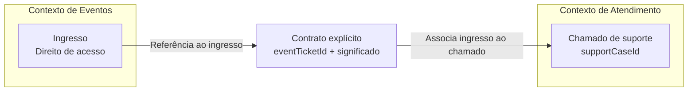

# Aula 12 — Domínio, Contextos e Linguagens

**Módulo:** 01 — Fundamentos de Arquitetura de Solução  
**Tema:** 02 — Solution Architecture  
**Origem:** Resumo do estudante, com exemplos e complementos autorais identificados.

## Objetivo de aprendizagem

Entender por que a **linguagem do domínio depende do contexto**, como construir uma **Ubiquitous Language** e como evitar conflitos semânticos na modelagem, nos requisitos e nas integrações entre sistemas.

## 1. Conflitos semânticos entre áreas

No cenário da plataforma de ingressos, **ingresso** e **ticket** podem parecer sinônimos. Porém, dependendo da área, *ticket* pode designar um ingresso de evento ou um chamado de atendimento.

O conflito não é apenas linguístico: ele pode alterar regras de negócio, requisitos, telas, modelos de dados e contratos de integração.

**Exemplo:** uma API retorna `ticketId`. O consumidor não consegue saber apenas pelo nome se o identificador se refere ao ingresso comprado ou ao chamado de suporte.

## 2. Linguagem depende do contexto

Cada área percebe e descreve o negócio a partir de suas responsabilidades. Uma palavra não tem significado universal por padrão.

| Contexto | Termo | Significado possível |
| --- | --- | --- |
| Vendas de eventos | Ingresso | Direito de acesso a um evento |
| Atendimento | Ticket | Chamado aberto pelo cliente |
| Parcerias | Ticket | Pode representar ingresso ou solicitação, dependendo do processo |

**Importante:** os significados são exemplos hipotéticos; devem ser confirmados com especialistas de cada contexto.

## 3. Ubiquitous Language

Na abordagem de **Domain-Driven Design (DDD)**, *Ubiquitous Language* é a linguagem compartilhada, explícita e consistente entre especialistas de negócio e equipe técnica **dentro de um contexto delimitado** (*Bounded Context*).

Ela não exige que todos os departamentos adotem um único vocabulário. Seu propósito é reduzir ambiguidades **dentro de cada modelo** e explicitar traduções **entre modelos diferentes**.

A linguagem deve aparecer de modo coerente em conversas, documentação, regras, testes e código, sempre que aplicável.

> Uma *Ubiquitous Language* não é um glossário imposto pelo time técnico: ela é construída e refinada em conjunto com pessoas que conhecem o domínio.

## 4. Impacto na modelagem

Modelar tudo como uma entidade genérica `Ticket` pode misturar responsabilidades incompatíveis:

- Um **ingresso** tem evento, titularidade, validade e regras de acesso.
- Um **chamado de suporte** tem assunto, prioridade, atendente e status de atendimento.

Mesmo que os dois recebam informalmente o nome *ticket*, isso não os transforma na mesma entidade de negócio.

**Exemplo autoral de nomenclatura:**

```text
Contexto de Eventos:
  Ingresso
  Evento
  Compra

Contexto de Atendimento:
  Chamado
  Solicitante
  InteracaoAtendimento
```

A nomenclatura final deve refletir a linguagem validada em cada contexto, e não apenas preferências do desenvolvedor.

## 5. Glossário por contexto

Um glossário ajuda a registrar definições e diferenças relevantes sem forçar padronização global.

| Contexto | Termo preferido | Definição | Termos relacionados |
| --- | --- | --- | --- |
| Eventos | Ingresso | Direito de acesso adquirido para determinado evento | Ticket de evento |
| Atendimento | Chamado | Solicitação de suporte registrada e acompanhada | Ticket de suporte |
| Financeiro | Reembolso | Processo de devolução de valor conforme regras aplicáveis | Estorno, devolução — verificar distinções |

### Prática complementar: campos úteis no glossário

Registrar **contexto, termo, definição, exemplo de uso, regras relevantes, responsável pela validação e data de revisão**. Sempre que um termo for ambíguo, documentar explicitamente em quais contextos seu significado muda.

## 6. Integração também exige tradução semântica

Uma integração pode retornar HTTP 200, JSON válido e todos os campos obrigatórios, mas ainda estar errada **do ponto de vista do negócio**.



O desenho é conceitual e não implica uma arquitetura de microservices.

### Exemplo complementar de contrato

**Ambíguo:**

```json
{
  "ticketId": "12345",
  "status": "open"
}
```

**Mais explícito para um chamado relacionado a ingresso:**

```json
{
  "supportCaseId": "SUP-12345",
  "eventTicketId": "EVT-98765",
  "supportCaseStatus": "OPEN"
}
```

Nomes mais claros ajudam, mas **não substituem documentação de significado, estados permitidos, regras e responsabilidades**.

### Complemento: Anti-Corruption Layer

Em DDD, uma *Anti-Corruption Layer (ACL)* pode traduzir conceitos de um sistema externo para o modelo interno, evitando que uma linguagem ambígua ou inadequada contamine o domínio da solução. É uma alternativa arquitetural a avaliar no Nível 1, não uma obrigação para toda integração.

## 7. Decisões arquiteturais orientadas pela linguagem

Antes de definir entidades, APIs e componentes:
1. Identificar os contextos relevantes;
2. Conversar com especialistas e operadores;
3. Registrar os termos e suas definições;
4. Resolver ambiguidades **dentro** de cada contexto;
5. Definir traduções explícitas **entre** contextos;
6. Validar os contratos e exemplos com os participantes;
7. Manter o glossário atualizado conforme o domínio evolui.

Essas práticas são complementos autorais para aplicação do conteúdo.

## 8. Checklist

- [ ] Identifiquei termos ambíguos entre áreas?
- [ ] Sei em qual contexto cada definição é válida?
- [ ] A linguagem foi validada com especialistas de domínio?
- [ ] Os nomes do modelo refletem conceitos reais?
- [ ] APIs e eventos comunicam significados inequívocos?
- [ ] Contratos documentam regras, estados e responsabilidades?
- [ ] Existe tradução explícita entre modelos diferentes?
- [ ] O glossário é consultável e mantido atualizado?

## Perguntas de revisão

1. Por que usar o termo `ticket` em dois contextos pode causar problemas?
2. O que é *Ubiquitous Language* e qual é seu limite de aplicação?
3. Por que não devemos impor um vocabulário único a toda a empresa?
4. Como um glossário pode melhorar uma integração entre sistemas?
5. Qual é a diferença entre compatibilidade técnica e compatibilidade semântica?
6. Quando uma *Anti-Corruption Layer* pode ser útil?

## Síntese

> Uma boa arquitetura não conecta apenas sistemas: ela conecta **significados**. Compreender a linguagem de cada contexto evita que modelos e integrações tecnicamente corretos produzam resultados de negócio errados.

## Conexões

- [Aula 03 — Soft Skills](./aula-03-soft-skills.md)
- [Aula 10 — Nível 0: Escopo](./aula-10-nivel-0-escopo.md)
- [Aula 11 — Domínio e Contextos](./aula-11-dominio-e-contextos.md)
- [Tema 01 — Integração](../tema-01-solution-enterprise/aula-08-integracao.md)
