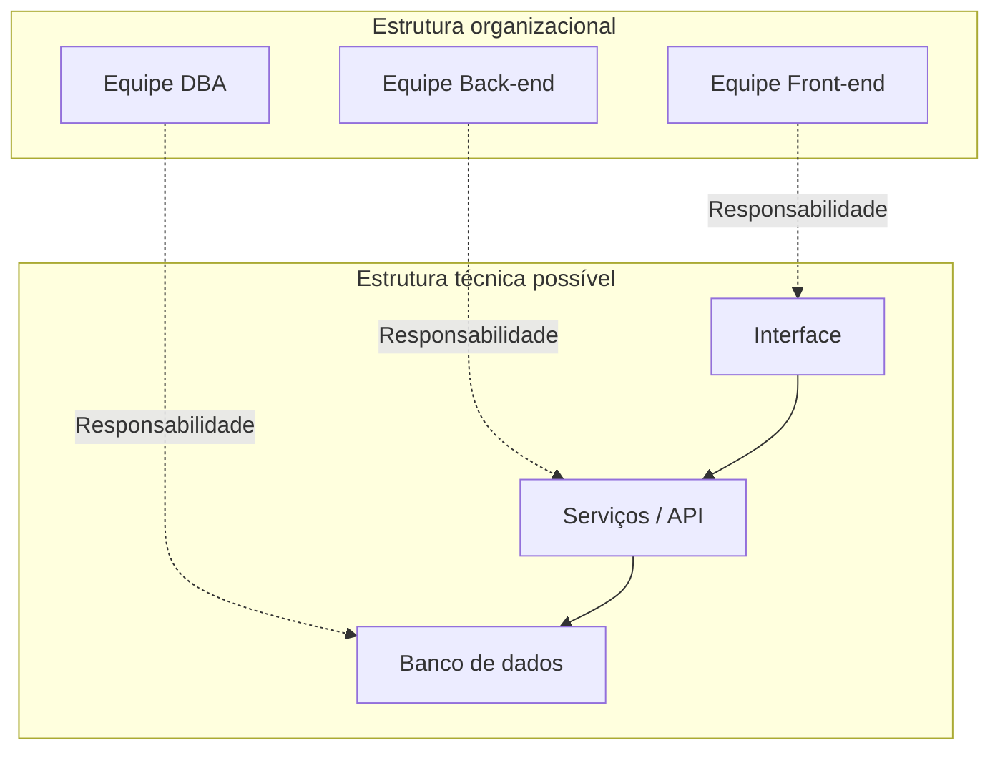

# Aula 13 — Lei de Conway

**Módulo:** 01 — Fundamentos de Arquitetura de Solução  
**Tema:** 02 — Solution Architecture  
**Origem:** Resumo do estudante, com exemplos e complementos autorais identificados.

## Objetivo de aprendizagem

Compreender como a **estrutura de comunicação de uma organização influencia a arquitetura de seus sistemas**, identificar riscos de desalinhamento entre equipes e componentes e considerar a viabilidade organizacional nas decisões de solução.

## 1. O que é a Lei de Conway?

A **Lei de Conway**, formulada por Melvin Conway, descreve a tendência de organizações projetarem sistemas cujas estruturas refletem seus padrões de comunicação.

Em termos práticos, o software não é moldado apenas por requisitos, domínio e tecnologia. Ele também reflete **quem conversa com quem, quem decide e onde estão as fronteiras de colaboração**.

> **Ideia central:** a estrutura social da organização tende a aparecer na estrutura técnica dos sistemas que ela produz.

É uma observação sobre tendências, **não uma regra determinística**: uma empresa pode reconhecer esse efeito e organizar seu trabalho para mitigá-lo.

## 2. Limites sociais e limites técnicos

Fronteiras entre departamentos, equipes e especialidades podem se tornar fronteiras entre módulos, serviços, bancos de dados e integrações.

Por exemplo, se front-end, back-end e banco de dados são geridos por grupos com pouca interação, mudanças simples de negócio podem depender de várias filas de trabalho e aprovações.

A divisão por especialidade não é necessariamente ruim. O risco é quando a estrutura organizacional determina os limites do software **sem considerar os contextos do domínio e o fluxo de entrega de valor**.

## 3. Estrutura organizacional como força de design

A organização influencia:

- **Autonomia:** quem pode alterar e implantar determinado componente?
- **Coordenação:** quantos times precisam aprovar uma mudança?
- **Responsabilidade:** quem mantém e opera o que foi entregue?
- **Comunicação:** como requisitos, eventos e decisões atravessam equipes?
- **Acoplamento:** onde o software exige mudanças coordenadas?

Uma arquitetura viável precisa levar em conta a capacidade real da empresa de construí-la e sustentá-la.

## 4. Exemplo: equipes organizadas por especialidade

**Cenário apresentado na aula:** equipes separadas em especialistas de front-end, back-end e DBA.

O diagrama ilustra uma **possível correspondência**, não uma arquitetura obrigatória nem um defeito por si só.

### Consequência possível

Uma funcionalidade ponta a ponta pode depender de três equipes. Se os processos de colaboração forem lentos, o ciclo de entrega também será.

## 5. Exemplo: um time monolítico tentando adotar microservices

**Cenário apresentado na aula:** uma equipe acostumada a tomar decisões, desenvolver e publicar tudo em conjunto divide a aplicação em múltiplos deployables, mas mantém os mesmos acoplamentos e dependências.

O resultado pode incluir:

- Releases que precisam ser coordenados entre vários serviços;
- Mudanças pequenas que exigem alterações simultâneas;
- Contratos instáveis e responsabilidades pouco claras;
- Dependência excessiva de uma única equipe central;
- Custos operacionais maiores sem autonomia correspondente.

Ter processos separados não basta para obter os benefícios de microservices. **Autonomia de evolução, limites coerentes e capacidade operacional** precisam acompanhar a decomposição.

> **Nuance:** um único time pode manter múltiplos serviços com sucesso em determinadas condições. A Lei de Conway alerta para o desalinhamento entre arquitetura desejada e padrões de colaboração; não proíbe configurações específicas de equipe.

## 6. Organização funcional versus equipes multidisciplinares

**Comparativo complementar autoral:**

| Aspecto | Organização por especialidade | Equipe multidisciplinar por domínio/produto |
| --- | --- | --- |
| Composição | Front-end, back-end, dados em grupos distintos | Competências necessárias reunidas em torno de uma capacidade |
| Vantagem potencial | Profundidade técnica e padrões especializados | Maior autonomia ponta a ponta |
| Risco potencial | Handoffs e filas entre áreas | Duplicação de conhecimento e necessidade de governança |
| Fronteira predominante | Especialidade técnica | Domínio ou fluxo de valor |

Nenhum modelo é universalmente superior. A escolha depende de escala, competências, governança, custos e natureza do produto.

## 7. Relação com domínio, contextos e linguagem

A [Aula 11](./aula-11-dominio-e-contextos.md) mostrou que diferentes participantes percebem o negócio de formas distintas. A [Aula 12](./aula-12-dominio-contextos-e-linguagens.md) explicou que contextos podem ter linguagens próprias.

A Lei de Conway acrescenta que **os canais reais de colaboração entre esses participantes influenciam a forma final do software**.

Se equipes responsáveis por contextos diferentes quase não se comunicam, conceitos e contratos podem divergir. Se fronteiras de responsabilidade são claras e a colaboração é adequada, as integrações tendem a ser mais compreensíveis e evolutivas.

**Importante:** fronteiras de equipes e *Bounded Contexts* do DDD podem ser alinhados intencionalmente, mas não são conceitos idênticos.

## 8. Complemento: Reverse Conway Maneuver

A chamada **Reverse Conway Maneuver** é a estratégia de ajustar deliberadamente a organização e seus padrões de comunicação para favorecer a arquitetura desejada.

**Exemplo autoral:** se uma empresa deseja equipes responsáveis por capacidades de negócio com autonomia de entrega, pode reorganizar responsabilidades, interfaces e fluxos de colaboração para tornar essa arquitetura sustentável.

Isso não significa reorganizar pessoas automaticamente por causa de um diagrama. Exige considerar custos de mudança, competências, governança e impactos humanos.

## 9. Armadilhas previsíveis

| Armadilha | Efeito possível | Pergunta de prevenção |
| --- | --- | --- |
| Dividir serviços sem autonomia | Monólito distribuído | Cada serviço pode evoluir sem coordenar tudo? |
| Ignorar handoffs | Lentidão de entrega | Quantos grupos participam de uma mudança comum? |
| Desconsiderar linguagem entre áreas | Contratos semanticamente frágeis | Os times concordam sobre os conceitos compartilhados? |
| Centralizar todas as decisões | Gargalos de aprovação | Quais decisões podem ser delegadas? |
| Desenhar sem avaliar operação | Arquitetura inviável na prática | Quem mantém, monitora e responde a incidentes? |

## 10. Checklist de avaliação arquitetural

- [ ] Mapeei as equipes que vão construir e operar a solução?
- [ ] Entendi os canais de comunicação e decisão?
- [ ] Identifiquei dependências e handoffs entre equipes?
- [ ] Os limites técnicos refletem necessidades de domínio, e não apenas o organograma?
- [ ] Existe autonomia compatível com o estilo arquitetural proposto?
- [ ] Os contratos entre contextos são compreendidos pelos envolvidos?
- [ ] A organização consegue operar e evoluir a solução?
- [ ] Considerei ajustes de colaboração antes de aumentar a complexidade técnica?

## Perguntas de revisão

1. O que a Lei de Conway descreve?
2. Como a separação entre front-end, back-end e DBA pode afetar a entrega de funcionalidades?
3. Por que dividir um monólito em serviços não garante microservices autônomos?
4. Qual a relação entre limites sociais, *Bounded Contexts* e contratos?
5. O que é *Reverse Conway Maneuver*?
6. Que perguntas um arquiteto deveria fazer antes de recomendar microservices para uma organização?

## Síntese

> Uma arquitetura não existe fora da organização que a constrói. Entender comunicação, autonomia e responsabilidades ajuda a desenhar soluções tecnicamente coerentes e organizacionalmente executáveis.

## Conexões

- [Aula 03 — Soft Skills](./aula-03-soft-skills.md)
- [Aula 07 — Enterprise Architecture vs. Solution Architecture](./aula-07-enterprise-architecture-vs-solution-architecture.md)
- [Aula 10 — Nível 0: Escopo](./aula-10-nivel-0-escopo.md)
- [Aula 11 — Domínio e Contextos](./aula-11-dominio-e-contextos.md)
- [Aula 12 — Domínio, Contextos e Linguagens](./aula-12-dominio-contextos-e-linguagens.md)
