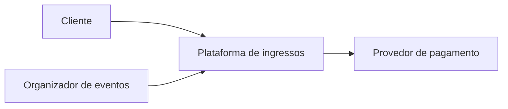
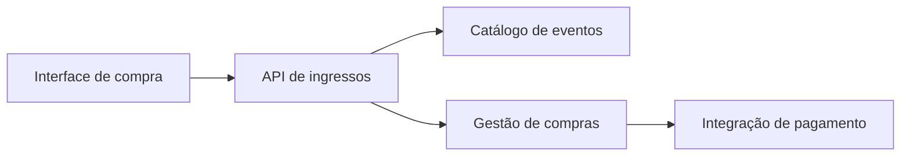
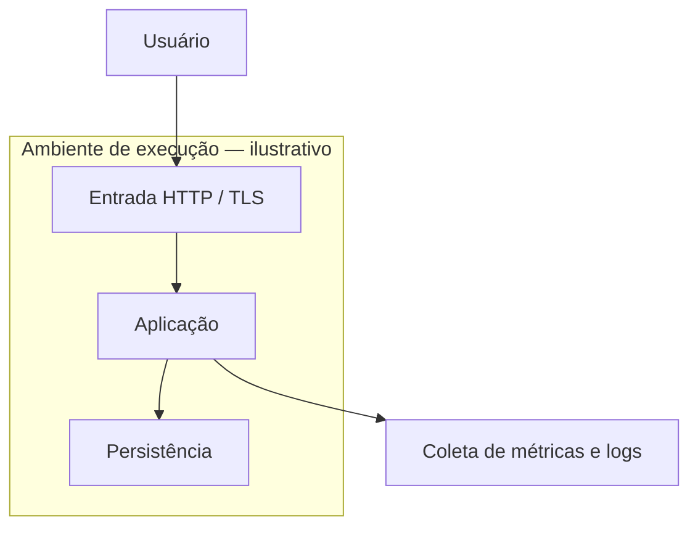

# Aula 14 — Views e Viewpoints

**Módulo:** 01 — Fundamentos de Arquitetura de Solução  
**Tema:** 02 — Solution Architecture  
**Origem:** Resumo do estudante, organizado com exemplos e complementos autorais identificados.

## Objetivo de aprendizagem

Distinguir **architectural view** de **architectural viewpoint**, entender como stakeholders e suas preocupações orientam a documentação e aplicar perspectivas diferentes à mesma solução.

## 1. View: a representação da arquitetura

Uma **view** é uma representação da arquitetura sob uma perspectiva específica. Ela seleciona aspectos da solução relevantes para determinadas preocupações (*concerns*) dos stakeholders.

Pode incluir diagramas, modelos e descrições. Não precisa — e geralmente não deve — mostrar todos os detalhes do sistema simultaneamente.

**Exemplo:** uma representação dos componentes e integrações da plataforma de ingressos, destinada a discutir responsabilidades técnicas.

## 2. Viewpoint: as regras para construir a representação

Um **viewpoint** estabelece as convenções para produzir e interpretar uma view: quais preocupações serão abordadas, quais stakeholders são relevantes, que tipos de modelos serão usados e quais regras de representação se aplicam.

> **Viewpoint é a lente; view é a representação produzida por essa lente.**

Um mesmo viewpoint pode orientar diferentes views em sistemas distintos; e uma descrição arquitetural pode conter várias views da mesma solução.

## 3. View versus Viewpoint

| Aspecto | View | Viewpoint |
| --- | --- | --- |
| Natureza | Representação concreta | Especificação da perspectiva |
| Pergunta | O que esta representação mostra? | Como e para quem devemos representar? |
| Conteúdo | Diagramas, modelos, descrições | Preocupações, stakeholders, convenções e tipos de modelos |
| Exemplo | Diagrama de implantação de um sistema | Regras e foco da perspectiva de implantação |

**Nuance:** não basta classificar qualquer diagrama como view. Uma view deve comunicar aspectos arquiteturais e atender a preocupações identificáveis; o viewpoint explicita os critérios para isso.

## 4. A mesma solução, múltiplas perspectivas

A aula usa o exemplo de um celular: engenharia de software, design de produto, materiais e logística observam o mesmo objeto, mas fazem perguntas diferentes.

Na arquitetura de solução, o princípio é semelhante:

| Stakeholder | Preocupação principal | View possível |
| --- | --- | --- |
| Negócio / produto | Valor, capacidades e limites | Contexto e capacidades da solução |
| Desenvolvimento | Componentes, contratos e dependências | Componentes e integrações |
| Operação / SRE | Implantação, monitoramento e recuperação | Deployment e operação |
| Segurança | Identidades, fluxos de dados e riscos | Fluxos de confiança e controles |
| Financeiro | Custos e premissas | Modelo de custos e decisões relevantes |

Esses exemplos são **sugestões autorais**, não uma taxonomia universal de viewpoints. Uma preocupação pode aparecer em várias views.

## 5. Exemplo prático: plataforma de venda de ingressos

**Visão de negócio já estudada:** simplificar a compra de ingressos por dispositivos móveis, reduzindo atrito e incentivando recorrência.

### View A — Contexto da solução

**Preocupação:** quem usa a plataforma e de quais sistemas externos ela depende?

**Stakeholders:** produto, parceiros e áreas de negócio.



O objetivo é explicar relações externas e limites de responsabilidade, sem expor classes ou detalhes de infraestrutura.

### View B — Componentes e responsabilidades

**Preocupação:** como as principais responsabilidades técnicas estão organizadas?

**Stakeholders:** desenvolvimento e arquitetura.



O desenho é **hipotético** e não determina microservices nem processos de deployment separados.

### View C — Implantação e operação

**Preocupação:** onde a solução será executada e o que precisa ser operado?

**Stakeholders:** plataforma, operações e segurança.



Esta view é uma **possibilidade de documentação**, não uma decisão de infraestrutura do projeto.

## 6. Como definir um viewpoint útil

**Roteiro complementar autoral:**

1. Identificar quem consumirá a representação.
2. Registrar as perguntas que essa pessoa precisa responder.
3. Definir quais elementos e relações são relevantes.
4. Escolher notação, modelos e nível de detalhe adequados.
5. Produzir a view e validá-la com os stakeholders.
6. Manter consistência entre views quando a arquitetura evoluir.

### Template simples de viewpoint — complemento autoral

```text
Nome:
Stakeholders:
Preocupações a responder:
Elementos e relações representados:
Notação / convenções:
Restrições e premissas:
Critérios de validação:
```

## 7. Documentação por perspectivas não é duplicação

A finalidade não é repetir a mesma informação em diversos diagramas. É **selecionar detalhes relevantes para cada pergunta**.

Views diferentes devem permanecer coerentes entre si. Se uma view mostra dependência de um gateway externo e outra sugere processamento financeiro interno, essa divergência precisa ser explicada ou corrigida.

A documentação se torna instrumento de comunicação, revisão e tomada de decisão — não apenas um arquivo de diagramas.

## 8. Complemento conceitual: ISO/IEC/IEEE 42010

A **ISO/IEC/IEEE 42010** estabelece conceitos e requisitos para descrições de arquitetura, incluindo stakeholders, concerns, viewpoints e views.

Nesta aula, a conexão importante é a separação entre:
- **Stakeholders e concerns:** quem precisa entender o sistema e quais perguntas importam;
- **Viewpoint:** convenções e critérios de representação;
- **View:** representação arquitetural construída a partir desses critérios.

Esta seção é um **enquadramento complementar**, não uma reprodução normativa da especificação.

## 9. Preparação para o modelo 4+1

A ideia de usar múltiplas perspectivas prepara o estudo de modelos estruturados de documentação, como o **4+1**, que organiza visões complementares da arquitetura.

Por enquanto, o essencial é compreender **por que** são necessárias diferentes representações e **como** seus viewpoints são escolhidos. O detalhamento do 4+1 fica para a aula correspondente.

## 10. Checklist

- [ ] Identifiquei os stakeholders relevantes?
- [ ] Registrei quais preocupações cada representação deve responder?
- [ ] Escolhi um viewpoint adequado ao objetivo?
- [ ] A view apresenta apenas o nível de detalhe necessário?
- [ ] Os símbolos e as relações são compreensíveis?
- [ ] A representação foi validada com quem vai utilizá-la?
- [ ] As diferentes views são consistentes entre si?
- [ ] Existe um critério claro para atualizar a documentação?

## Perguntas de revisão

1. Qual é a diferença entre view e viewpoint?
2. Por que uma única representação raramente atende a todos os stakeholders?
3. Como concerns influenciam a escolha dos modelos e diagramas?
4. Qual a diferença entre uma view de contexto e uma view de componentes?
5. Como evitar contradições entre diferentes views?
6. Por que a distinção entre view e viewpoint ajuda a preparar o estudo do modelo 4+1?

## Síntese

> **Viewpoint define a perspectiva e suas regras; view materializa essa perspectiva.** Documentar arquitetura por diferentes perspectivas permite responder às preocupações reais de negócio, desenvolvimento e operação sem sobrecarregar uma única representação.

## Conexões

- [Aula 03 — Soft Skills](./aula-03-soft-skills.md)
- [Aula 09 — Nível 0: Negócio](./aula-09-nivel-0-negocio.md)
- [Aula 10 — Nível 0: Escopo](./aula-10-nivel-0-escopo.md)
- [Aula 13 — Lei de Conway](./aula-13-lei-de-conway.md)
