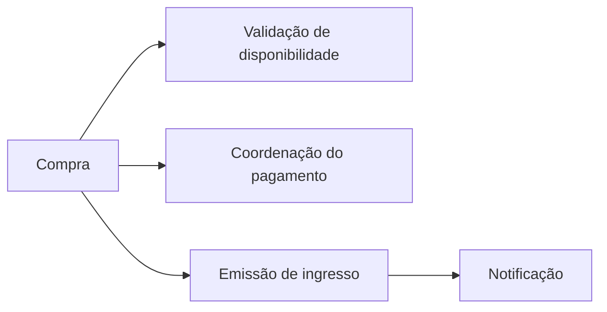
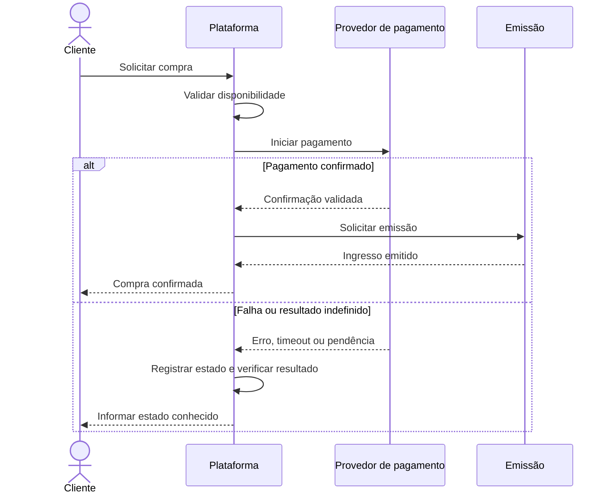
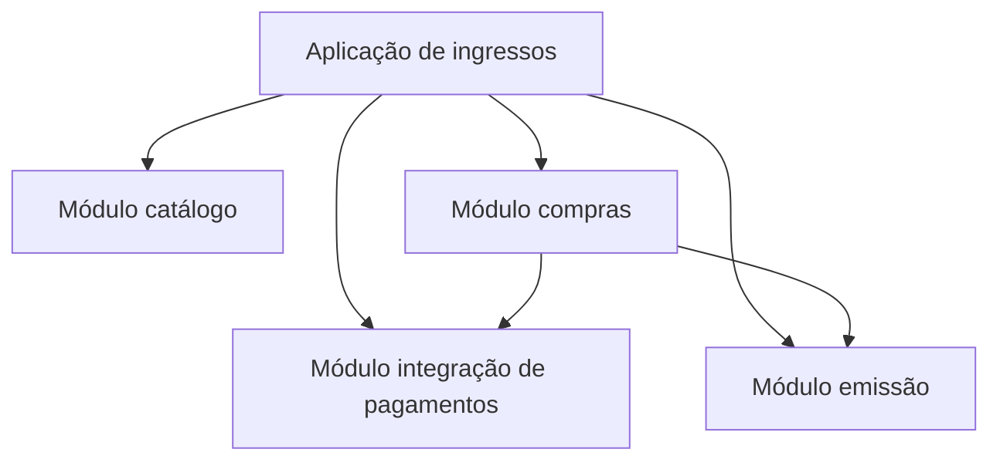
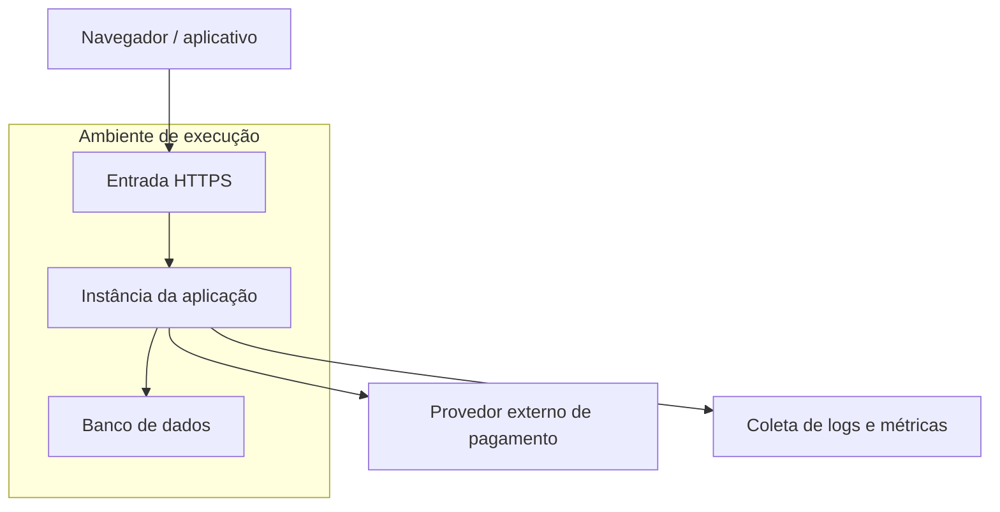

# Aula 15 — Modelo 4+1

**Módulo:** 01 — Fundamentos de Arquitetura de Solução  
**Tema:** 02 — Solution Architecture  
**Origem:** Resumo do estudante, com exemplos e complementos autorais identificados.

## Objetivo

Compreender o **modelo de visões arquiteturais 4+1**, relacionar suas quatro perspectivas aos cenários de uso e reconhecer quando cada representação ajuda a responder preocupações dos stakeholders.

## 1. O que é o modelo 4+1?

O **4+1 View Model**, proposto por Philippe Kruchten, organiza a descrição da arquitetura em quatro visões complementares — **lógica, processo, desenvolvimento e física** — conectadas por **cenários (+1)**.

O modelo concretiza a distinção estudada na [Aula 14 — Views e Viewpoints](./aula-14-views-e-viewpoints.md): diferentes perspectivas selecionam diferentes preocupações de uma mesma solução.

Não é necessário concentrar todas as decisões em um único diagrama.

| Parte | Pergunta principal | Preocupações típicas |
| --- | --- | --- |
| **+1 — Cenários** | O que acontece quando o usuário executa um fluxo relevante? | Casos de uso, validação e coerência das visões |
| **Visão lógica** | Quais são as principais responsabilidades e relações da solução? | Funcionalidade, decomposição conceitual |
| **Visão de processo** | Como a solução se comporta em execução? | Concorrência, comunicação, sincronização, falhas |
| **Visão de desenvolvimento** | Como o software é organizado para ser construído e mantido? | Módulos, pacotes, dependências e trabalho de engenharia |
| **Visão física** | Onde os elementos executam? | Deployment, infraestrutura, distribuição e disponibilidade |

## 2. Cenários: o “+1” que integra as visões

O “+1” representa **cenários relevantes de uso**, que ajudam a descobrir, ilustrar e validar a arquitetura.

**Exemplo autoral:** uma pessoa compra um ingresso para um evento.

1. Seleciona evento e ingresso;
2. Inicia a compra;
3. O sistema valida a disponibilidade;
4. Solicita pagamento ao provedor externo;
5. Confirma o pagamento;
6. Emite o ingresso;
7. Notifica o cliente.

Esse fluxo atravessa as quatro visões. Perguntas sobre indisponibilidade, pagamento duplicado e reprocessamento tornam visíveis riscos que diagramas estáticos podem ocultar.

**Nuance:** cenários não substituem testes nem garantem correção por si só; são instrumentos para avaliar e comunicar decisões.

## 3. Visão lógica

Mostra a decomposição conceitual da solução em responsabilidades e suas relações, com foco no atendimento aos comportamentos funcionais.

**Exemplo autoral — compra de ingresso:**

A representação **não define** onde cada parte será implantada nem exige serviços independentes.

**Perguntas:** quais responsabilidades existem? Quais dependências são necessárias? Onde ficam as regras de negócio?

## 4. Visão de processo

Descreve comportamento em execução, comunicação, concorrência, sincronização e respostas a falhas.

**Exemplo autoral — fluxo de compra com resultado de pagamento:**

**Atenção ao exemplo:** em pagamentos reais, um timeout não deve ser interpretado automaticamente como falha definitiva. Retentativas exigem estratégia de **idempotência**, consulta ou reconciliação do estado e regras que evitem cobrança ou emissão duplicadas. O fluxo acima é conceitual e não especifica todos os mecanismos.

**Perguntas:** o que acontece durante um timeout? Como lidar com mensagens repetidas? Quais operações precisam ser coordenadas?

## 5. Visão de desenvolvimento

Mostra a organização estática do software do ponto de vista de implementação e manutenção: módulos, pacotes, componentes de código e dependências.

**Exemplo autoral — monólito modular hipotético:**

Este desenho **não implica repositórios ou deploys separados**. Sua utilidade é explicitar fronteiras de implementação e facilitar evolução, testes e manutenção.

A relação com a [Lei de Conway](./aula-13-lei-de-conway.md) é importante: a divisão de responsabilidades no código pode ser influenciada pela estrutura e comunicação das equipes.

**Perguntas:** onde cada regra será implementada? Como evitar dependências circulares? Quais módulos mudam juntos?

## 6. Visão física

Descreve o mapeamento da solução para os ambientes de execução e infraestrutura.

**Exemplo autoral — deployment simplificado e hipotético:**

O diagrama ilustra um possível arranjo, **não uma decisão tomada** sobre cloud, número de instâncias, alta disponibilidade ou serviços gerenciados.

**Perguntas:** onde a aplicação executa? O que precisa escalar? Quais são os pontos únicos de falha? Como monitorar e recuperar a operação?

## 7. Como o cenário atravessa as quatro visões

| Etapa do cenário | Lógica | Processo | Desenvolvimento | Física |
| --- | --- | --- | --- | --- |
| Validar ingresso | Responsabilidade de disponibilidade | Sequência de validação | Módulo de catálogo/compras | Aplicação e persistência |
| Processar pagamento | Coordenação de pagamento | Comunicação e estados de resposta | Integração com provedor | Conectividade com serviço externo |
| Emitir ingresso | Regra de emissão | Evento ou chamada após confirmação | Módulo de emissão | Execução e armazenamento |
| Tratar falha | Regras de consistência | Timeout, retry e reconciliação | Tratamento de erros e testes | Telemetria e resiliência |

**Exemplo de validação cruzada:** se a visão de processo prevê reprocessamento após timeout, as visões lógica e de desenvolvimento precisam prever a responsabilidade por essa decisão, e a visão física deve considerar os mecanismos operacionais necessários.

## 8. O modelo é ferramenta, não checklist obrigatório

O 4+1 é uma referência clássica, mas não substitui a análise de **stakeholders e concerns**.

Nem todo projeto exige o mesmo grau de detalhamento em todas as visões. Em algumas situações, perspectivas adicionais de segurança, dados, custos ou operação serão mais úteis.

**Princípio prático:** produzir documentação suficiente para esclarecer decisões, riscos e responsabilidades, sem burocracia desproporcional.

## 9. Complemento autoral — roteiro de aplicação

1. Escolher um cenário de negócio relevante e suas exceções.
2. Identificar stakeholders e preocupações.
3. Representar responsabilidades na visão lógica.
4. Explicitar execução e falhas na visão de processo.
5. Mostrar módulos e dependências na visão de desenvolvimento.
6. Descrever deployment e restrições operacionais na visão física.
7. Verificar a consistência entre as representações.
8. Registrar decisões e lacunas que exigem validação.

## 10. Checklist

- [ ] Escolhi cenários que representam fluxos importantes e riscos?
- [ ] A visão lógica explicita responsabilidades?
- [ ] A visão de processo trata execução e falhas relevantes?
- [ ] A visão de desenvolvimento mostra módulos e dependências?
- [ ] A visão física esclarece distribuição e operação?
- [ ] As visões contam uma história consistente?
- [ ] Os diagramas distinguem hipóteses de decisões aprovadas?
- [ ] A documentação responde às preocupações dos stakeholders?

## Perguntas de revisão

1. Quais são as quatro visões do modelo 4+1?
2. Por que os cenários representam o “+1”?
3. Em qual visão você investigaria um timeout de pagamento?
4. Qual a diferença entre a visão lógica e a visão de desenvolvimento?
5. Por que um módulo de código não precisa corresponder a um serviço implantado?
6. Como um cenário ajuda a detectar inconsistências entre visões?
7. Em que situações faz sentido adaptar ou complementar o 4+1?

## Síntese

> O **4+1** permite observar uma mesma solução por quatro perspectivas complementares, enquanto **cenários** demonstram como essas representações se conectam para atender a comportamentos reais de negócio.

## Conexões

- [Aula 08 — 3 Camadas da Arquitetura de Soluções](./aula-08-3-camadas-da-arquitetura-de-solucoes.md)
- [Aula 10 — Nível 0: Escopo](./aula-10-nivel-0-escopo.md)
- [Aula 13 — Lei de Conway](./aula-13-lei-de-conway.md)
- [Aula 14 — Views e Viewpoints](./aula-14-views-e-viewpoints.md)
