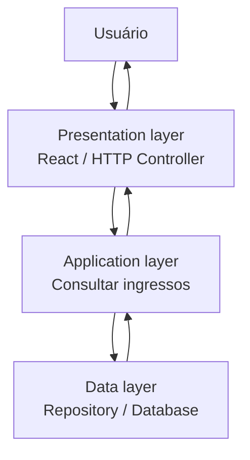
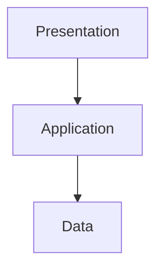
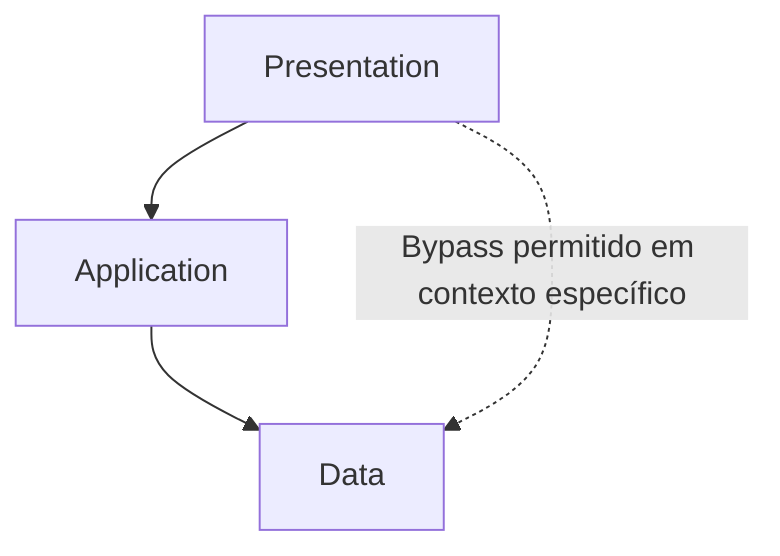
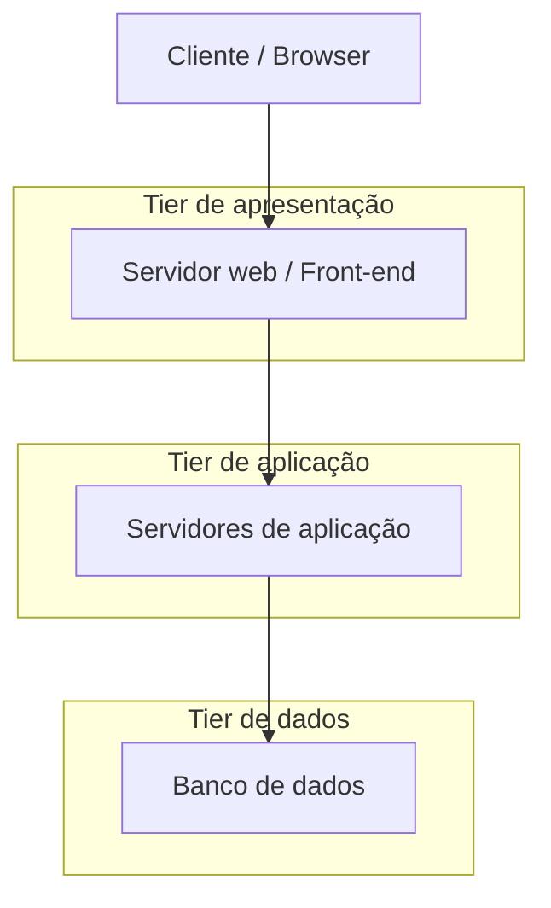

# Aula 02 — N-Tier e N-Layered Architecture

**Módulo:** 01 — Fundamentos de Arquitetura de Solução  
**Tema:** 03 — Design Patterns  
**Origem:** Resumo do estudante, com distinções conceituais e exemplos complementares identificados.

## Objetivo

Compreender a organização de sistemas em **camadas lógicas (layers)** e **tiers de implantação**, suas responsabilidades, modelos de comunicação *closed* e *open* e os trade-offs de evolução, escalabilidade e segurança.

## 1. N-Layered vs. N-Tier: uma distinção importante

Embora os termos sejam usados informalmente como sinônimos, descrevem dimensões diferentes:

| Conceito | O que separa? | Exemplo |
| --- | --- | --- |
| **Layer (camada)** | Responsabilidades lógicas e dependências no software | Presentation, application e data access |
| **Tier** | Partes executadas em processos, servidores ou ambientes separados | Navegador, servidor de aplicação e servidor de banco |

**Uma aplicação pode ter três layers e apenas um tier de aplicação.** Da mesma forma, um sistema distribuído em múltiplos tiers não é necessariamente bem organizado em camadas lógicas.

A arquitetura em camadas é um **padrão arquitetural**; não se confunde com os padrões de objetos GoF vistos no panorama anterior.

## 2. Responsabilidades das camadas

### Presentation layer

Cuida de **exibir informações, receber entradas e adaptar a interação com o usuário**. Exemplos: interface React, páginas renderizadas no servidor e controladores HTTP.

Não deve concentrar regras centrais do negócio nem acessar diretamente detalhes de persistência sem justificativa arquitetural.

### Application layer

**Coordena casos de uso e fluxos da aplicação**, como iniciar uma compra, validar permissões, acionar serviços e gerenciar transações.

**Complemento conceitual:** em projetos que distinguem *application* de *domain*, as **regras de negócio fundamentais** pertencem ao domínio; a camada de aplicação principalmente orquestra seu uso. Em uma arquitetura simplificada de três camadas, ambas podem aparecer agrupadas na camada de aplicação.

### Data layer

Cuida do **acesso e da persistência de dados**, por meio de repositórios, queries, adaptadores e tecnologias de armazenamento.

Estratégias como réplicas de leitura, sharding e particionamento podem apoiar escalabilidade, mas não surgem automaticamente pela simples separação da camada.

## 3. Fluxo clássico de requisição

**Exemplo autoral: consulta de ingressos disponíveis.**



O fluxo lógico clássico segue **presentation → application → data**, com resposta no sentido inverso. O diagrama não define quantos processos ou servidores serão utilizados.

## 4. Closed layering

Em **closed layering**, uma camada acessa apenas a camada adjacente permitida. A apresentação não pula a aplicação para falar diretamente com a persistência.



**Benefícios possíveis:** encapsulamento, centralização de políticas, previsibilidade de dependências e facilidade de revisão.

**Custos possíveis:** mais indireção, código de passagem e etapas no caminho de execução.

**Nuance:** restringir dependências entre camadas não implica necessariamente uma chamada de rede entre cada uma delas.

## 5. Open layering e bypass consciente

Em **open layering**, uma camada pode acessar outra não adjacente, se a arquitetura permitir.



O bypass **não é automaticamente correto ou incorreto**: depende do motivo e dos controles.

**Exemplo de risco:** se a apresentação consulta diretamente o banco, pode contornar autorização, validação de regras, auditoria e limites de segurança.

**Alternativa contextual:** um endpoint de leitura otimizado pode usar um modelo de consulta separado sem percorrer toda a lógica de domínio; isso **não exige** expor o banco diretamente ao navegador.

**Regra prática:** documentar por que o bypass existe, quais invariantes permanecem protegidas e quem assume a responsabilidade por mudanças.

## 6. Exemplo em Java/Spring Boot — complemento autoral

Organização lógica ilustrativa:

```text
com.exemplo.ingressos
├── presentation
│   └── IngressoController.java
├── application
│   └── ConsultarIngressosUseCase.java
└── data
    └── IngressoRepository.java
```

Exemplo simplificado de interação entre camadas:

```java
// Presentation
@RestController
@RequestMapping("/ingressos")
class IngressoController {
    private final ConsultarIngressosUseCase useCase;

    IngressoController(ConsultarIngressosUseCase useCase) {
        this.useCase = useCase;
    }

    @GetMapping("/{id}")
    IngressoResponse consultar(@PathVariable Long id) {
        return useCase.executar(id);
    }
}

// Application
@Service
class ConsultarIngressosUseCase {
    private final IngressoRepository repository;

    ConsultarIngressosUseCase(IngressoRepository repository) {
        this.repository = repository;
    }

    IngressoResponse executar(Long id) {
        return repository.buscar(id)
            .map(i -> new IngressoResponse(i.id(), i.nome()))
            .orElseThrow(() -> new ResponseStatusException(HttpStatus.NOT_FOUND));
    }
}

// Data (contrato simplificado; implementação omitida)
interface IngressoRepository {
    Optional<Ingresso> buscar(Long id);
}

record Ingresso(Long id, String nome) {}
record IngressoResponse(Long id, String nome) {}
```

**Observação:** o exemplo é didático, pressupõe imports Spring/Java e não inclui autenticação, autorização, validação nem configuração de persistência. As três camadas podem executar **na mesma aplicação Spring Boot**, sem constituir três tiers.

## 7. Exemplo de N-Tier: implantação distribuída



Nesse arranjo, os tiers podem ter **controles de rede, recursos computacionais e políticas de escala distintos**. Isso exige uma separação real de implantação, não apenas pacotes diferentes no código.

## 8. Escalabilidade e independência: o que é garantido?

Separar responsabilidades facilita raciocinar sobre evolução e desempenho, mas **não garante escalabilidade independente**.

- Se presentation e application são implantadas no mesmo processo, normalmente escalam juntas.
- Se o front-end é distribuído separadamente, pode ter sua própria estratégia de cache e replicação.
- Se a aplicação é stateless, pode ser mais simples adicionar instâncias, sujeito a limites e dependências.
- A camada de dados pode exigir réplicas, índices, particionamento ou outras estratégias, conforme a carga.

**Trade-off:** mais tiers podem aumentar latência de rede, custo operacional, observabilidade necessária e complexidade de implantação.

## 9. Segurança por camada e por tier

A divisão permite aplicar **defesa em profundidade** e **menor privilégio**:

| Parte | Controle ilustrativo |
| --- | --- |
| Interface pública | HTTPS, proteção de borda e tratamento seguro de entrada |
| Aplicação | Autenticação, autorização e validação das operações |
| Dados | Credenciais restritas, segmentação de rede, backup e auditoria |

**Importante:** camadas lógicas no mesmo processo não são fronteiras de segurança de rede. Sub-redes privadas e regras de firewall dependem da **topologia real dos tiers**.

Também não basta esconder o banco: a aplicação precisa validar permissões e impedir acesso indevido a dados.

## 10. Trade-offs e critérios de escolha

| Decisão | Benefício potencial | Custo / risco |
| --- | --- | --- |
| Camadas bem definidas | Separação de responsabilidades e manutenção | Abstrações e passagem de dados |
| Closed layering | Encapsulamento e controle de dependências | Mediação adicional |
| Open layering | Flexibilidade para otimizações específicas | Acoplamento e possibilidade de contornar regras |
| Tiers separados | Escala e isolamento operacional por componente | Rede, deployment e operação mais complexos |
| Aplicação única em camadas | Simplicidade de deploy | Escala física conjunta das partes |

Não existe um modelo universalmente correto. A escolha deve ser justificada pelos requisitos e pelos riscos reais.

## 11. Checklist

- [ ] Diferenciei separação lógica (layers) de implantação física (tiers)?
- [ ] Cada camada tem responsabilidades claras?
- [ ] Regras de negócio não vazam indevidamente para a interface?
- [ ] As dependências permitidas estão explícitas?
- [ ] Qualquer bypass tem justificativa e controles?
- [ ] A estratégia de escalabilidade considera os deployables reais?
- [ ] Os limites de rede e as permissões correspondem à topologia de implantação?
- [ ] Considerei custos de latência, operação e manutenção?

## Perguntas de revisão

1. Qual é a diferença entre N-Layered e N-Tier?
2. Uma aplicação com três camadas precisa de três servidores? Por quê?
3. O que distingue closed layering de open layering?
4. Por que acessar diretamente o banco a partir da interface pode ser perigoso?
5. Em que sentido a application layer difere de uma domain layer explícita?
6. Quais condições permitem escalar o front-end separadamente do back-end?
7. Quais trade-offs surgem ao dividir uma aplicação em múltiplos tiers?

## Síntese

> **Layers organizam responsabilidades; tiers organizam a implantação.** Closed e open layering definem restrições de comunicação lógica. O desenho deve equilibrar encapsulamento, segurança, manutenção, desempenho e custo operacional.

## Conexões

- [Aula 01 — Design Patterns: Visão Geral](./aula-01-design-patterns-visao-geral.md)
- [Tema 02 — Lei de Conway](../tema-02-solution-architecture/aula-13-lei-de-conway.md)
- [Tema 02 — Modelo 4+1](../tema-02-solution-architecture/aula-15-modelo-4-mais-1.md)
- [Tema 02 — Risco vs. Documentação](../tema-02-solution-architecture/aula-16-risco-vs-documentacao.md)
