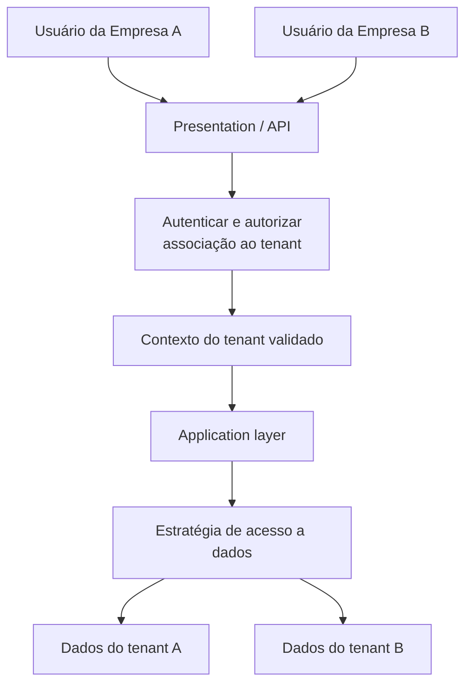
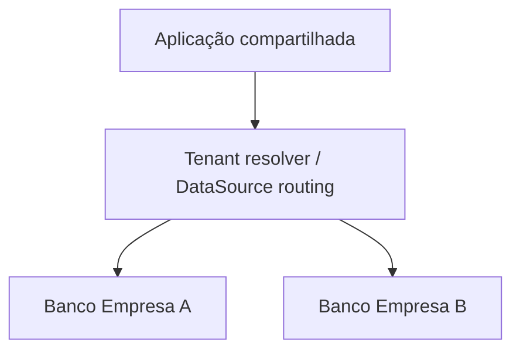
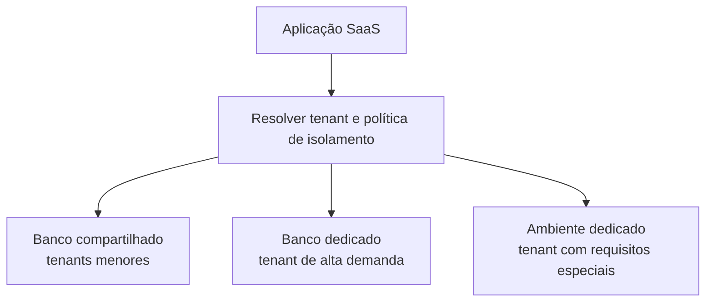

# Aula 03 — Multi-Tenant Architecture

**Módulo:** 01 — Fundamentos de Arquitetura de Solução  
**Tema:** 03 — Design Patterns  
**Origem:** Resumo do estudante, com exemplos e complementos autorais identificados.

## Objetivo de aprendizagem

Entender como uma solução **multi-tenant** atende diferentes organizações, identificar o tenant com segurança, comparar estratégias de segregação de dados e avaliar quando usar isolamento dedicado ou híbrido.

## 1. O que é multi-tenancy?

**Multi-tenancy** é um modelo no qual uma solução atende múltiplas organizações clientes (**tenants**) por meio de recursos compartilhados, preservando fronteiras lógicas de dados, acesso e configuração.

É comum em produtos **SaaS**, pois permite centralizar manutenção e evolução, aproveitando infraestrutura compartilhada.

Não é sinônimo de arquitetura em camadas nem exige microservices. Uma aplicação em camadas pode ser multi-tenant ou single-tenant.

**Nuance:** multi-tenancy pode existir com diferentes graus de compartilhamento. Em soluções híbridas, alguns tenants podem usar bancos ou ambientes dedicados; não é obrigatório que todos compartilhem o mesmo processo ou banco.

## 2. Tenant e tenant ID

- **Tenant:** organização cliente atendida pela plataforma.
- **Tenant ID:** identificador que vincula operações, configurações e dados ao tenant correto.

**Exemplo:** uma aplicação de gestão financeira atende Empresa A (`tenant_id = 1`) e Empresa B (`tenant_id = 2`).

A identificação deve acompanhar as operações relevantes, desde a autenticação até a autorização e o acesso a dados.

### Identificar não é autorizar

**Complemento essencial de segurança:** receber `tenant_id` em uma URL, header ou corpo de requisição **não prova** que o usuário tem permissão para atuar naquele tenant.

O tenant deve ser **resolvido e validado** a partir de um contexto confiável de identidade, associação e permissões. Se o usuário puder selecionar uma organização, o servidor precisa confirmar sua autorização para ela.

## 3. Fluxo de identificação e isolamento



O desenho é **conceitual**: o roteamento pode ocorrer por banco, schema, tabela ou outra estratégia. A camada de apresentação não deve definir sozinha o tenant efetivo sem validação.

## 4. Estratégia A — Banco de dados por tenant

Cada tenant possui um banco separado, embora possa compartilhar a mesma aplicação.



**Vantagens possíveis:** maior isolamento de dados e operações, políticas diferenciadas de backup e restauração, governança individual.

**Custos:** mais bancos para provisionar, migrar, monitorar, atualizar e administrar.

**Cuidado:** banco separado não significa isolamento absoluto se credenciais, rede, aplicação ou controles administrativos forem compartilhados.

## 5. Estratégia B — Tabelas por tenant

Uma mesma base contém estruturas distintas, por exemplo `produtos_tenant_1` e `produtos_tenant_2`.

```text
database_compartilhado
├── produtos_tenant_1
└── produtos_tenant_2
```

**Vantagem possível:** separação física das linhas por tabela sem provisionar um banco por cliente.

**Custos:** aumento de objetos, migrações repetidas, consultas e manutenção mais complexas à medida que os tenants crescem.

**Complemento:** *schema por tenant* é outra estratégia conhecida, distinta de *tabela por tenant*: cada organização recebe um schema com suas próprias tabelas. As duas abordagens têm implicações diferentes de administração e isolamento.

**Segurança:** nomes de tabelas ou schemas dinâmicos não devem ser montados diretamente com valores não confiáveis da requisição. Use mapeamento controlado e validação.

## 6. Estratégia C — Tabela compartilhada com tenant ID

Todos os tenants usam a mesma tabela, com um campo que identifica a organização de cada registro.

```sql
CREATE TABLE produtos (
    tenant_id BIGINT NOT NULL,
    id BIGINT NOT NULL,
    nome VARCHAR(150) NOT NULL,
    PRIMARY KEY (tenant_id, id)
);

SELECT id, nome
FROM produtos
WHERE tenant_id = :tenant_id_validado;
```

**Vantagens possíveis:** menos objetos físicos, operação centralizada e boa eficiência para muitos tenants com necessidades semelhantes.

**Risco central:** uma consulta sem o filtro correto pode expor dados de outro tenant.

### Defesa em profundidade — complemento autoral

- Aplicar filtro de tenant consistentemente em consultas, atualizações e exclusões;
- Usar chaves e restrições compostas que incluam `tenant_id` quando fizer sentido;
- Validar associações entre registros do **mesmo tenant**;
- Testar isolamento com usuários de organizações diferentes;
- Considerar **Row-Level Security (RLS)** quando o banco e o desenho permitirem;
- Incluir o contexto do tenant em auditoria, logs e métricas, sem expor dados sensíveis.

RLS é um controle adicional, **não substituto** de autenticação, autorização e testes.

## 7. Comparação de estratégias

| Critério | Banco por tenant | Tabelas por tenant | Tabela compartilhada |
| --- | --- | --- | --- |
| Compartilhamento de dados físicos | Baixo | Intermediário | Alto |
| Isolamento de armazenamento | Mais forte | Intermediário | Lógico por registro |
| Operação e migrações | Maior esforço por banco | Cresce com número de tabelas | Estrutura mais simples |
| Personalização por cliente | Mais flexível em vários cenários | Possível, com custo estrutural | Exige disciplina no modelo compartilhado |
| Risco de vazamento cruzado | Ainda existe em roteamento/acesso | Ainda existe em seleção de tabela | Alto impacto de filtros incorretos |
| Escala com muitos tenants pequenos | Pode custar mais | Pode gerar muitos objetos | Frequentemente favorável |

**Não há vencedor universal.** Segurança, compliance, carga, recuperação, custo e capacidade operacional orientam a decisão.

## 8. Exemplo Java/Spring Boot — complemento autoral

O exemplo abaixo ilustra a **propagação de um tenant já validado**, sem implementar autenticação completa.

```java
record TenantContext(long tenantId) {}

@Service
class ListarProdutosUseCase {
    private final ProdutoRepository repository;

    ListarProdutosUseCase(ProdutoRepository repository) {
        this.repository = repository;
    }

    List<Produto> executar(TenantContext tenant) {
        return repository.listarPorTenant(tenant.tenantId());
    }
}

interface ProdutoRepository {
    List<Produto> listarPorTenant(long tenantId);
}
```

Consulta correspondente:

```sql
SELECT tenant_id, id, nome
FROM produtos
WHERE tenant_id = :tenantId;
```

**Requisito crítico:** `TenantContext` deve ser construído por um componente de segurança que tenha **verificado a associação entre identidade e tenant**. Não basta converter diretamente o header `X-Tenant-ID` enviado pelo cliente em `TenantContext`.

Em sistemas assíncronos, também é preciso propagar o contexto de tenant com segurança para mensagens, jobs e consumidores, evitando vazamento entre execuções.

## 9. Noisy neighbor e clientes grandes

O efeito **noisy neighbor** acontece quando um tenant consome recursos compartilhados de maneira desproporcional e degrada a experiência dos demais.

Exemplo da aula: uma grande empresa pode exigir mais capacidade ou isolamento por motivos operacionais e de governança.

Possíveis respostas:

- Limites e quotas por tenant;
- Rate limiting e controle de concorrência;
- Filas ou pools separados para cargas pesadas;
- Banco dedicado para tenants específicos;
- Ambiente ou deployment dedicado, se necessário.

**Nuance:** a necessidade de isolamento por razões regulatórias deve ser verificada caso a caso; o porte da empresa, por si só, não cria automaticamente uma obrigação legal de banco exclusivo.

## 10. Estratégia híbrida



Um produto pode atender a maioria dos clientes em infraestrutura compartilhada e reservar recursos exclusivos para casos excepcionais.

Essa flexibilidade tem custos: roteamento, migração de tenants, observabilidade, operações e testes precisam considerar **mais de uma topologia**.

## 11. Checklist de arquitetura e segurança

- [ ] Defini claramente o que constitui um tenant?
- [ ] A identidade do usuário é validada contra o tenant solicitado?
- [ ] Todas as operações de leitura e escrita respeitam o tenant?
- [ ] Chaves, relacionamentos e queries evitam referências cruzadas indevidas?
- [ ] Jobs, eventos e cache preservam o isolamento?
- [ ] Existe estratégia de backup e restauração por tenant, quando necessária?
- [ ] O sistema suporta limites e métricas para identificar noisy neighbors?
- [ ] Os requisitos de governança e compliance foram verificados?
- [ ] O custo operacional da estratégia escolhida é sustentável?
- [ ] Há plano para migrar um tenant entre modelos de isolamento?

## Perguntas de revisão

1. O que caracteriza uma arquitetura multi-tenant?
2. Qual é a diferença entre identificar um tenant e autorizar acesso a ele?
3. Quais são os trade-offs de banco por tenant e tabela compartilhada?
4. Como a segregação por tabelas difere da segregação por schemas?
5. Por que uma query sem `tenant_id` pode representar falha crítica?
6. O que é o problema de noisy neighbor?
7. Quando faz sentido adotar uma estratégia híbrida?
8. Como o isolamento deve ser preservado em processos assíncronos?

## Síntese

> **Multi-tenancy combina compartilhamento eficiente de recursos com isolamento rigoroso entre clientes.** A estratégia de dados deve refletir os requisitos de escala, segurança, governança e operação — e o tenant precisa ser identificado **e autorizado** em todo o fluxo.

## Conexões

- [Aula 01 — Design Patterns: Visão Geral](./aula-01-design-patterns-visao-geral.md)
- [Aula 02 — N-Tier e N-Layered Architecture](./aula-02-n-tier-e-n-layered-architecture.md)
- [Tema 02 — Domínio, Contextos e Linguagens](../tema-02-solution-architecture/aula-12-dominio-contextos-e-linguagens.md)
- [Tema 02 — Risco vs. Documentação](../tema-02-solution-architecture/aula-16-risco-vs-documentacao.md)
