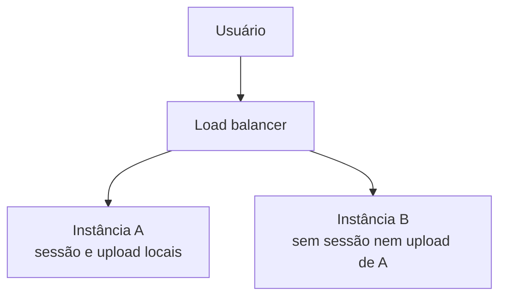
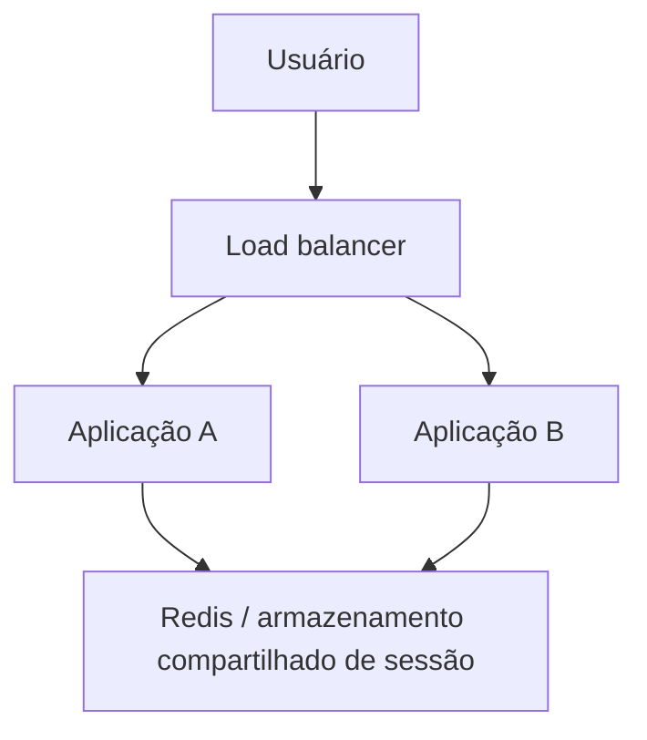
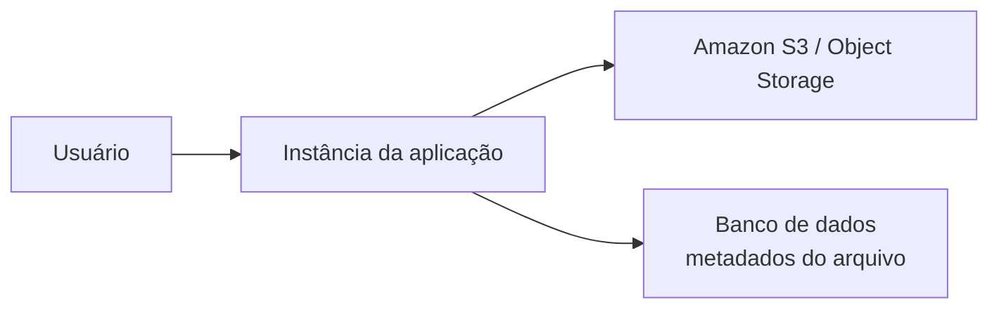
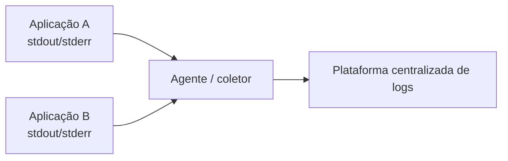
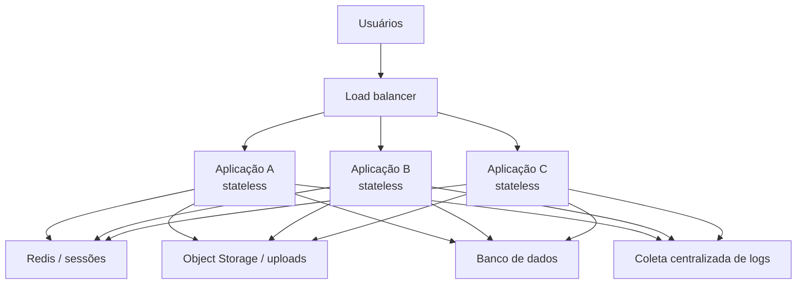

# Aula 04 — Stateless vs. Stateful Architecture

**Módulo:** 01 — Fundamentos de Arquitetura de Solução  
**Tema:** 03 — Design Patterns  
**Origem:** Resumo do estudante, com exemplos e aprofundamentos complementares identificados.

## Objetivo

Entender a diferença entre aplicações **stateful** e **stateless**, os problemas de estado local na escalabilidade horizontal e como externalizar sessões, arquivos e logs para tornar instâncias substituíveis.

## 1. Stateful: estado associado à instância

Uma aplicação **stateful** pode manter informações necessárias à continuidade de operações na própria instância, como:

- Sessões de usuário armazenadas na memória ou em disco local;
- Uploads salvos na pasta `uploads/` do servidor;
- Arquivos temporários necessários a operações futuras;
- Logs gravados apenas no filesystem local.

Esse modelo pode funcionar em uma implantação simples, mas cria dependência da instância que recebeu a requisição. Em ambientes com **load balancing**, **Auto Scaling Groups** ou containers efêmeros, essa dependência se torna um risco.

**Nuance:** stateful não significa necessariamente uma arquitetura ruim. Bancos de dados e outros componentes que gerenciam estado são inerentemente stateful e podem escalar com técnicas apropriadas. O problema tratado nesta aula é **estado operacional preso a instâncias de aplicação que deveriam ser substituíveis**.

## 2. O problema ao escalar horizontalmente



**Cenário:** o usuário faz login na instância A. Na próxima requisição, o balanceador o direciona à instância B, que não possui a sessão.

O mesmo acontece com um arquivo salvo apenas em A: B não consegue encontrá-lo.

**Consequências possíveis:**

- Logout inesperado ou falha na continuidade da sessão;
- Uploads intermitentemente indisponíveis;
- Inconsistência percebida pelo usuário;
- Dificuldade de substituir ou remover instâncias;
- Maior complexidade para operar escalabilidade horizontal.

## 3. Sticky sessions: mitigação, não solução completa

Um balanceador pode manter **afinidade** entre usuário e instância (*sticky session*), reduzindo a frequência do problema.

Porém, isso não resolve integralmente a perda de estado quando a instância falha, é reiniciada ou removida. Também pode gerar distribuição desigual de carga.

**Trade-off:** afinidade pode ser útil em cenários específicos, mas não equivale a tornar a aplicação stateless.

## 4. Externalização de sessões

Em vez de armazenar a sessão na memória de uma instância, a aplicação a mantém em um serviço compartilhado, como **Redis** ou um banco de dados.



Assim, qualquer instância pode consultar o estado da sessão.

**Cuidados complementares:** expiração (TTL), revogação, proteção de credenciais, disponibilidade do storage e políticas de privacidade. O armazenamento compartilhado também passa a ser uma dependência operacional importante.

### E sessões com tokens?

Um token assinado pode permitir autenticação sem uma sessão armazenada no servidor para cada usuário. Entretanto, **revogação, renovação, permissões e outros requisitos** podem exigir estado compartilhado. Usar JWT não torna automaticamente toda a aplicação stateless.

## 5. Externalização de uploads e assets

Guardar imagens, vídeos ou documentos em disco local vincula os arquivos à instância que os recebeu.

Com armazenamento externo de objetos, como **Amazon S3**, todas as instâncias passam a acessar o mesmo repositório lógico de arquivos.



**Benefícios:** persistência independente do ciclo de vida da instância, capacidade de armazenamento desacoplada de CPU/memória e acesso consistente ao repositório compartilhado.

**Cuidados:** políticas de acesso, criptografia, limites de tamanho, validação de arquivos, URLs assinadas quando adequadas e tratamento de falhas de upload.

## 6. Logs: stdout/stderr e coleta centralizada

Logs apenas em disco local podem desaparecer quando a instância é destruída e dificultam a investigação de eventos distribuídos.

Em ambientes com containers, é comum a aplicação emitir logs para **stdout/stderr**, enquanto a plataforma coleta, encaminha e armazena esses registros externamente.



**Importante:** escrever em stdout/stderr, sozinho, **não garante retenção**. A coleta, o transporte, a política de armazenamento e a tolerância a falhas precisam estar configurados.

### Exemplo Spring Boot — complemento autoral

```java
import org.slf4j.Logger;
import org.slf4j.LoggerFactory;

class CompraService {
    private static final Logger log = LoggerFactory.getLogger(CompraService.class);

    void processar(String compraId) {
        log.info("Iniciando processamento da compra id={}", compraId);
    }
}
```

Em uma implantação containerizada, o logging pode ser configurado para saída de console e coletado pela plataforma. Evite incluir tokens, senhas e dados pessoais sensíveis nos registros.

## 7. Arquitetura com instâncias substituíveis



O processamento pode ser distribuído entre instâncias sem depender de qual delas recebeu a requisição anterior.

**Nuance:** instâncias stateless facilitam elasticidade, mas **não garantem escalabilidade ilimitada**. Banco de dados, Redis, serviços externos, conexões e limites de infraestrutura continuam podendo ser gargalos.

## 8. Exemplo Java/Spring Boot: sessão externalizada — complemento autoral

Com **Spring Session** e uma configuração adequada de Redis, o estado da sessão HTTP pode ser compartilhado entre instâncias da aplicação.

Exemplo ilustrativo de dependências:

```xml
<dependency>
    <groupId>org.springframework.session</groupId>
    <artifactId>spring-session-data-redis</artifactId>
</dependency>
<dependency>
    <groupId>org.springframework.boot</groupId>
    <artifactId>spring-boot-starter-data-redis</artifactId>
</dependency>
```

A configuração exata depende da versão do Spring Boot, da infraestrutura Redis e dos requisitos de segurança. A dependência, por si só, não substitui configuração, testes de failover e verificação do ciclo de vida das sessões.

## 9. Passo a passo de migração

1. **Inventariar estado local:** sessões, uploads, arquivos temporários, caches críticos e logs;
2. **Classificar cada estado:** transitório, recuperável ou persistente;
3. **Externalizar sessões:** Redis ou banco compartilhado, com controles de expiração e segurança;
4. **Migrar arquivos persistentes:** object storage e referências persistidas separadamente;
5. **Centralizar logs:** stdout/stderr com pipeline de coleta e retenção;
6. **Revisar jobs e processos assíncronos:** evitar depender de memória ou arquivos locais entre execuções;
7. **Testar múltiplas instâncias:** alternar requisições entre servidores;
8. **Simular falha e substituição:** encerrar uma instância durante a navegação;
9. **Medir gargalos e custo:** observar as novas dependências compartilhadas.

### Critérios de validação

- [ ] Uma nova instância atende um usuário já autenticado conforme a política de sessão?
- [ ] Uploads permanecem acessíveis após remover a instância original?
- [ ] Logs são consultáveis após o encerramento de containers?
- [ ] Uma instância pode ser recriada sem restauração manual de arquivos?
- [ ] A falha de Redis, banco ou object storage possui tratamento e monitoramento?
- [ ] Não existem dados importantes apenas em diretórios temporários locais?

## 10. Trade-offs

| Escolha | Benefício | Custo ou risco |
| --- | --- | --- |
| Estado local na instância | Simplicidade inicial | Dependência da instância e perda em falhas |
| Sticky sessions | Menos mudanças imediatas | Afinidade, desbalanceamento e fragilidade em falhas |
| Sessões em Redis/banco | Continuidade entre instâncias | Dependência externa, latência e operação |
| Uploads em object storage | Persistência independente do servidor | Integração, permissões e custo de armazenamento |
| Logs centralizados | Investigação distribuída e retenção | Pipeline, custo e políticas de acesso |

## 11. Perguntas de revisão

1. Qual é a diferença entre uma aplicação stateful e uma stateless?
2. Por que a sessão em memória local falha com múltiplas instâncias?
3. Sticky sessions resolvem a perda de sessão quando uma instância cai?
4. Por que mover uploads para S3 favorece elasticidade?
5. O que falta para que logs emitidos em stdout/stderr fiquem disponíveis após destruir um container?
6. Uma aplicação stateless pode depender de banco de dados stateful?
7. Quais gargalos continuam existindo após externalizar o estado?
8. Como validar, na prática, que uma instância pode ser substituída sem perda de comportamento?

## Síntese

> **Stateless não é ausência de estado no sistema; é ausência de dependência de estado local persistente nas instâncias de processamento.** Externalizar sessões, arquivos e logs permite substituir e escalar instâncias com mais previsibilidade, ao custo de novas dependências de infraestrutura.

## Conexões

- [Aula 02 — N-Tier e N-Layered Architecture](./aula-02-n-tier-e-n-layered-architecture.md)
- [Aula 03 — Multi-Tenant Architecture](./aula-03-multi-tenant-architecture.md)
- [Tema 01 — Escalabilidade](../tema-01-solution-enterprise/README.md)
- [Tema 02 — Modelo 4+1](../tema-02-solution-architecture/aula-15-modelo-4-mais-1.md)
