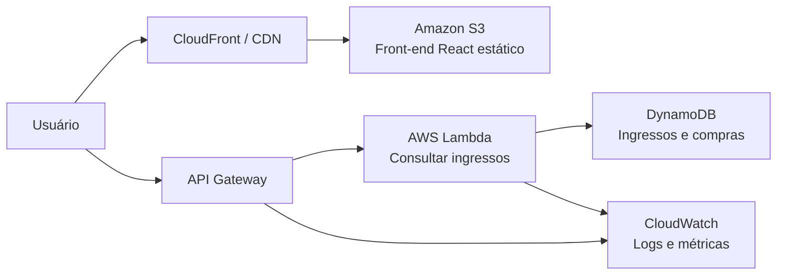
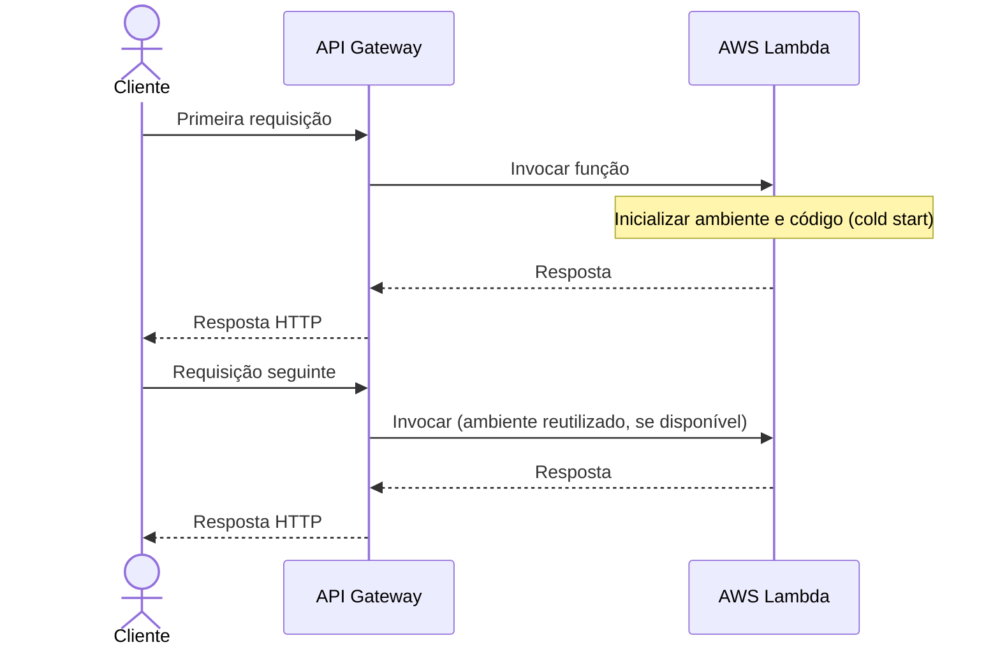

# Aula 05 — Serverless Architecture

**Módulo:** 01 — Fundamentos de Arquitetura de Solução  
**Tema:** 03 — Design Patterns  
**Origem:** Resumo do estudante, organizado com exemplos e complementos autorais identificados.

## Objetivo de aprendizagem

Compreender **serverless** como modelo de execução e consumo de serviços gerenciados, identificar seus componentes em uma arquitetura AWS, analisar **cold starts**, observabilidade, custos e trade-offs operacionais.

## 1. Serverless e pagamento por uso

Serverless reduz a necessidade de provisionar e administrar servidores diretamente. Em diversos serviços, o custo acompanha métricas como **requisições, invocações, duração de execução, leituras, gravações e armazenamento**.

Em uma aplicação com tráfego intermitente, isso pode ser vantajoso: não é necessário manter um servidor de aplicação continuamente ativo apenas para receber acessos esporádicos.

> **Serverless não significa ausência de servidores; significa abstrair sua administração em serviços gerenciados.**

**Atenção:** nem todo custo desaparece quando não há acessos. Armazenamento no S3, dados armazenados no DynamoDB, retenção de logs, recursos provisionados e certas configurações de rede podem continuar gerando cobranças.

## 2. Serverless é mais que AWS Lambda

Uma arquitetura serverless pode combinar:

| Serviço | Papel típico | Dimensões de custo relevantes |
| --- | --- | --- |
| **Amazon S3** | Armazenar arquivos estáticos e uploads | Armazenamento, requisições, transferência e recursos adicionais |
| **Amazon API Gateway** | Expor APIs HTTP e encaminhar chamadas | Requisições e, conforme o tipo, transferência de dados |
| **AWS Lambda** | Executar lógica sob demanda | Invocações, duração, memória e recursos/configurações adicionais |
| **Amazon DynamoDB** | Persistir dados em serviço gerenciado | Operações de leitura/escrita, armazenamento e recursos opcionais |
| **Amazon CloudWatch** | Métricas, logs, alarmes e observabilidade | Ingestão, retenção, consultas e recursos utilizados |
| **AWS CloudTrail** | Auditoria de atividades e chamadas de API da AWS | Conforme o tipo de evento, trilhas e recursos configurados |

Os detalhes de precificação dependem da região, modalidade, configuração e tabela de preços vigente. **Não é correto assumir que todos os componentes cobram somente por requisição.**

## 3. Exemplo: aplicação React com back-end serverless

**Exemplo autoral**, retomando a plataforma de ingressos estudada anteriormente:



**Observação:** o diagrama separa as chamadas para a interface e para a API. O S3 pode servir como origem dos arquivos estáticos; usar CloudFront para distribuição e HTTPS é uma opção comum, mas não obrigatória em todo desenho.

A aplicação pode manter dados e arquivos fora das instâncias de execução, em linha com a [Aula 04 — Stateless vs. Stateful](./aula-04-stateless-vs-stateful-architecture.md).

## 4. S3: arquivos estáticos e uploads

O S3 pode armazenar os arquivos gerados pelo build do React, além de imagens e outros assets.

**Benefícios:**
- Armazenamento independente das funções;
- Durabilidade e acesso compartilhado aos arquivos;
- Integração com CDN para distribuição de conteúdo estático.

**Cuidados:** políticas de acesso, criptografia, cache, custos de armazenamento, requisições e transferência de dados. O S3 **não é uma função de execução** e manter arquivos armazenados pode gerar custo mesmo sem visitas.

## 5. API Gateway: entrada e roteamento

O API Gateway expõe rotas HTTP e integra requisições com o back-end.

Exemplo:

```text
GET /ingressos/{id}
  -> API Gateway
  -> Lambda consultarIngresso
  -> DynamoDB
  -> Resposta HTTP
```

A camada de API também pode aplicar mecanismos de autenticação/autorização, limitação de tráfego e observabilidade, conforme a configuração.

**Nuance:** API Gateway não elimina a necessidade de validação de dados e autorização na aplicação.

## 6. Lambda: execução sob demanda

AWS Lambda executa código em resposta a eventos, incluindo chamadas via API Gateway, mensagens e outros gatilhos.

Em vez de manter um processo de aplicação permanentemente disponível sob responsabilidade direta da equipe, a plataforma administra ambientes de execução conforme a demanda e as configurações.

### Exemplo Java — complemento autoral

Handler simplificado de consulta:

```java
import com.amazonaws.services.lambda.runtime.Context;
import com.amazonaws.services.lambda.runtime.RequestHandler;
import java.util.Map;

public class ConsultarIngressoHandler
        implements RequestHandler<Map<String, Object>, Map<String, Object>> {

    @Override
    public Map<String, Object> handleRequest(
            Map<String, Object> input,
            Context context) {

        String id = String.valueOf(input.get("id"));

        // Em produção: validar entrada, autorização e consultar persistência.
        return Map.of("ingressoId", id, "status", "CONSULTA_RECEBIDA");
    }
}
```

Este código é **didático**, não representa um contrato completo de integração proxy do API Gateway e não acessa DynamoDB de verdade. Em um projeto real, o handler deve seguir o formato de evento da integração escolhida.

### Uma Lambda chamando outra

É possível, mas **não é automaticamente a melhor opção**. Encadear invocações síncronas pode aumentar latência, custo e acoplamento. Para fluxos assíncronos, filas, eventos ou orquestração gerenciada podem ser mais adequados.

## 7. Cold start

Um **cold start** ocorre quando a plataforma precisa preparar um novo ambiente de execução para atender uma invocação.



**Nuance:** cold starts não acontecem somente na primeira chamada após ociosidade; também podem ocorrer quando há aumento de concorrência ou substituição de ambientes. Uma invocação subsequente **não tem garantia** de reutilizar o mesmo ambiente.

**Trade-offs e mitigação:** reduzir inicialização desnecessária, otimizar dependências, ajustar memória e considerar recursos específicos para latência previsível quando justificável. Recursos como **provisioned concurrency** podem reduzir cold starts, mas introduzem custos de capacidade provisionada.

## 8. Logs e observabilidade: CloudWatch vs. CloudTrail

É importante separar responsabilidades:

- **CloudWatch:** logs da execução, métricas, alarmes e diagnóstico operacional. É a referência usual para acompanhar o comportamento das funções Lambda.
- **CloudTrail:** auditoria de ações e chamadas de API no ambiente AWS, útil para governança e investigação de atividades administrativas e de serviços.

**Exemplo:** erro lançado por um handler Lambda é investigado principalmente nos logs operacionais coletados no CloudWatch; alterações na configuração de recursos AWS podem ser investigadas com registros do CloudTrail.

Em ambos os casos, é preciso definir retenção, permissões, proteção de informações sensíveis e custos.

## 9. DynamoDB e consumo sob demanda

DynamoDB é um banco NoSQL gerenciado que pode operar em modalidades de capacidade diferentes.

No modo **on-demand**, o consumo de leitura e gravação influencia diretamente a cobrança. Também existem custos de armazenamento e recursos opcionais.

**Cuidados arquiteturais:**
- Modelar chaves e padrões de acesso antes de criar tabelas;
- Considerar limites e distribuição de carga;
- Planejar consistência, idempotência e tratamento de falhas;
- Evitar supor que toda consulta relacional se traduz facilmente em DynamoDB.

Serverless não elimina a necessidade de modelagem de dados.

## 10. Comparação: servidor continuamente ativo vs. serverless

| Aspecto | Aplicação em servidor provisionado | Composição serverless |
| --- | --- | --- |
| Capacidade de computação | Geralmente provisionada previamente | Ajustada pelo serviço dentro de limites |
| Custo ocioso de computação | Pode persistir enquanto servidor está ativo | Pode ser menor em execução sob demanda |
| Operação do servidor | Mais responsabilidade da equipe | Mais responsabilidade do provedor |
| Latência | Pode ser previsível com processo aquecido | Pode sofrer cold start |
| Escalabilidade | Depende da configuração e automação | Gerenciada, mas sujeita a quotas e gargalos |
| Observabilidade | Instrumentação e coleta necessárias | Instrumentação e coleta continuam necessárias |
| Portabilidade | Varia conforme tecnologia e infraestrutura | Integrações gerenciadas podem elevar dependência do provedor |

**Conclusão:** serverless pode ser excelente para cargas variáveis, eventos e MVPs, mas nem sempre é a alternativa mais econômica para cargas contínuas e previsíveis.

## 11. Implicações operacionais e riscos

Serverless transfere parte da operação de infraestrutura ao provedor, mas mantém decisões importantes com a equipe:

- Limites de concorrência, quotas e proteção contra picos;
- Retries, idempotência, timeouts e tratamento de eventos duplicados;
- Segurança de IAM e segregação de permissões;
- Observabilidade ponta a ponta;
- Custos de chamadas entre serviços e transferência de dados;
- Dependência de serviços gerenciados e portabilidade;
- Gestão de ambientes, deploys, versionamento e rollback.

**Complemento autoral:** a ausência de servidores para administrar não elimina a necessidade de **arquitetura, testes, SRE e governança de custos**.

## 12. Checklist

- [ ] Identifiquei se a carga é intermitente, variável ou contínua?
- [ ] Comparei custos totais, incluindo armazenamento, logs e rede?
- [ ] Defini claramente os gatilhos e contratos das funções?
- [ ] Considerei cold starts e requisitos de latência?
- [ ] Modelei o DynamoDB pelos padrões de acesso reais?
- [ ] Configurei autenticação, autorização e permissões mínimas?
- [ ] Planejei observabilidade com métricas, logs e tracing?
- [ ] Tratei retries, duplicidade e idempotência?
- [ ] Avaliei quotas, concorrência e limites dos serviços?
- [ ] Registrei trade-offs de custo, operação e dependência do provedor?

## Perguntas de revisão

1. Por que serverless não significa ausência de servidores?
2. Quais custos podem existir mesmo sem tráfego?
3. Qual é o papel do API Gateway em uma arquitetura serverless?
4. O que causa cold starts e quais seus impactos?
5. Qual é a diferença entre CloudWatch e CloudTrail?
6. Quando DynamoDB on-demand pode ser adequado?
7. Por que chamar Lambdas em cadeia pode ser um trade-off ruim?
8. Como serverless se relaciona ao princípio stateless?
9. Por que a modalidade serverless não garante automaticamente menor TCO?

## Síntese

> **Serverless reduz a administração direta de servidores e favorece cobrança orientada ao consumo, mas não elimina estado, custos fixos residuais, limites ou responsabilidades arquiteturais.** Seu valor depende do perfil de carga, da composição de serviços e dos trade-offs aceitos.

## Conexões

- [Aula 01 — Design Patterns: Visão Geral](./aula-01-design-patterns-visao-geral.md)
- [Aula 02 — N-Tier e N-Layered Architecture](./aula-02-n-tier-e-n-layered-architecture.md)
- [Aula 04 — Stateless vs. Stateful Architecture](./aula-04-stateless-vs-stateful-architecture.md)
- [Tema 02 — Iniciando com TCO](../tema-02-solution-architecture/aula-05-iniciando-com-tco.md)
- [Tema 02 — Risco vs. Documentação](../tema-02-solution-architecture/aula-16-risco-vs-documentacao.md)
