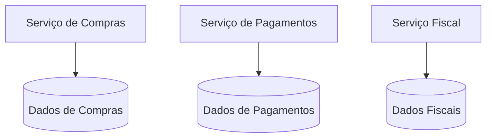
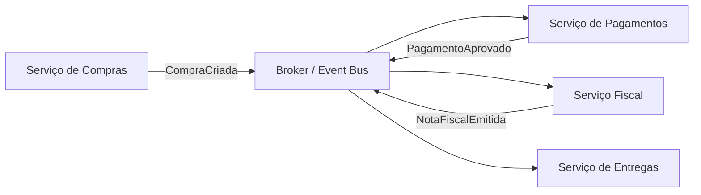
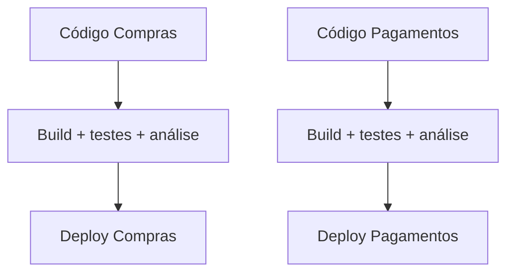
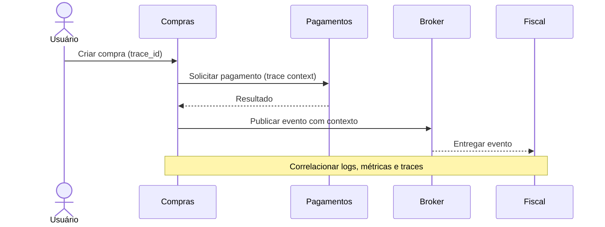

# Aula 06 — Microservices Architecture

**Módulo:** 01 — Fundamentos de Arquitetura de Solução  
**Tema:** 03 — Design Patterns  
**Origem:** Resumo da aula, com exemplos e aprofundamentos complementares identificados.

## Objetivo

Entender **microserviços** como estilo arquitetural que separa responsabilidades e ownership, avaliar comunicação síncrona e assíncrona, autonomia de dados e deploy, escalabilidade e os custos operacionais de sistemas distribuídos.

## 1. Microserviços: responsabilidades e fronteiras

Microserviços organizam a solução como um conjunto de serviços com **responsabilidades de negócio bem delimitadas**. A separação permite que partes do sistema sejam construídas, publicadas e evoluídas com maior autonomia.

O objetivo não é simplesmente criar aplicações pequenas. Um serviço precisa de **fronteira coerente**, contrato explícito e responsabilidade clara.

**Conexão com o domínio:** bounded contexts podem orientar a identificação de fronteiras, mas não existe obrigação de mapear cada bounded context para exatamente um microserviço.

## 2. Motivação organizacional e Lei de Conway

Em organizações com múltiplos times, um único código e um único pipeline podem criar gargalos de coordenação. A decomposição em serviços pode permitir:

- Ownership claro por domínio;
- Mudanças e deploys independentes;
- Trabalho paralelo entre equipes;
- Redução de conflitos em partes não relacionadas do sistema.

Isso só funciona quando a organização consegue sustentar a autonomia prometida. A **Lei de Conway** ajuda a explicar por que a estrutura de comunicação e responsabilidade dos times influencia o desenho dos serviços.

## 3. Comunicação síncrona e efeito dominó

Uma chamada REST ou gRPC entre serviços cria dependência temporal: o chamador precisa que o destinatário responda naquele momento.


Se o serviço de pagamentos demora, o de compras também pode demorar ou falhar. Dependências em cadeia ampliam latência e propagam indisponibilidade.

**Complemento autoral — práticas de resiliência:**
- Timeout explícito por chamada;
- Retries com backoff e jitter **somente quando seguros**;
- Circuit breaker e limites de concorrência;
- Bulkheads para isolar recursos;
- Fallback quando a regra de negócio permitir;
- Orçamento de tempo para a operação inteira.

**Cuidado:** retries indiscriminados podem multiplicar carga e duplicar operações, especialmente pagamentos.

## 4. Banco de dados por serviço

Cada microserviço deve **controlar seu modelo de dados e as regras de acesso**. Outros serviços interagem por contratos, não consultando diretamente suas tabelas internas.



**Nuance importante:** *database per service* é sobretudo **ownership de dados**, não necessariamente um servidor de banco exclusivo por serviço. Pode haver infraestrutura compartilhada com isolamento lógico e permissões, desde que o acesso direto entre domínios seja evitado.

**Trade-offs:** autonomia de schema e deploy versus maior complexidade em relatórios, consultas transversais e consistência entre domínios.

## 5. Comunicação assíncrona e eventos

Eventos permitem comunicar **fatos já ocorridos** sem exigir que todos os consumidores estejam disponíveis simultaneamente.



**Observação conceitual:** esse fluxo é ilustrativo. Em um sistema real, os eventos precisam conter identificadores e contratos estáveis, e cada consumidor precisa distinguir quais eventos são relevantes.

**Benefícios possíveis:** desacoplamento temporal, absorção de picos, processamento posterior e integração entre domínios.

**Custos e riscos:** consistência eventual, mensagens duplicadas, reordenação, falhas de publicação/consumo e diagnóstico distribuído.

### Complemento autoral: confiabilidade de eventos

- **Idempotência:** processar uma mensagem repetida sem aplicar indevidamente a mesma operação duas vezes;
- **Transactional outbox:** coordenar a gravação da mudança local e o registro do evento a publicar;
- **Dead-letter queue:** encaminhar mensagens que não puderam ser processadas após a política de tentativas;
- **Versionamento de contratos:** permitir evolução compatível entre produtores e consumidores;
- **Sagas:** coordenar processos de negócio distribuídos, inclusive compensações quando apropriado.

Mensageria **não garante automaticamente entrega única ou ausência de perda**: as garantias dependem do broker, da configuração e do código.

## 6. Arquitetura mista: síncrono e assíncrono

É comum combinar estilos:

| Necessidade | Abordagem frequentemente adequada | Atenção |
| --- | --- | --- |
| Consulta com resposta imediata | HTTP/gRPC síncrono | Latência e disponibilidade do downstream |
| Notificar emissão de nota fiscal | Evento assíncrono | Duplicidade, atrasos e consistência eventual |
| Autorização de pagamento | Pode exigir resposta síncrona no fluxo | Timeout, idempotência e recuperação |
| Atualizar projeções e relatórios | Eventos e processamento assíncrono | Defasagem dos dados |

O critério não é pureza arquitetural, e sim **requisitos de negócio e consequências da dependência**.

## 7. Escalabilidade independente e heterogeneidade tecnológica

Se a carga está concentrada em pagamentos, pode ser possível aumentar apenas as réplicas desse serviço.

Equipes também podem escolher stacks diferentes, como **Java/Spring Boot** para fluxos transacionais, **Go** para serviços específicos de baixa latência ou **Python** para workloads de ML.

**Trade-off:** múltiplas linguagens ampliam custos de contratação, suporte, observabilidade, bibliotecas, segurança e padronização. Heterogeneidade deve resolver uma necessidade concreta.

## 8. Maturidade organizacional e ownership

A autonomia por serviço exige responsabilidade além do código:

- Contratos e versionamento de APIs/eventos;
- Segurança, autenticação e autorização entre serviços;
- Gestão de incidentes, alertas e SLOs;
- Evolução de schemas e compatibilidade;
- Governança de custos e infraestrutura;
- On-call e processos de suporte quando aplicáveis.

Sem esses elementos, a decomposição pode criar um **monólito distribuído**: vários deployables que continuam exigindo coordenação conjunta para qualquer mudança.

## 9. CI/CD por serviço



Cada serviço pode ter seu próprio ciclo de validação e deploy, sem necessariamente exigir **um repositório por serviço**. Um monorepo também pode sustentar pipelines independentes.

**Complemento autoral:** além de testes unitários, considere testes de contrato, integração, segurança e estratégias de rollout/rollback. A independência de deploy depende de **compatibilidade de contratos**, não apenas de pipelines separados.

## 10. Observabilidade distribuída

Uma requisição pode atravessar múltiplos serviços, filas e eventos. Logs isolados de cada instância não bastam para reconstruir o fluxo.



**Três pilares:** logs, métricas e traces.

**Complemento autoral:** instrumentação com **OpenTelemetry** pode ajudar a propagar contexto de rastreamento entre HTTP e mensageria. IDs de correlação, amostragem, retenção e proteção de dados devem ser planejados.

## 11. Exemplo Java/Spring Boot — complemento autoral

Exemplo simplificado de consumidor idempotente de evento de compra:

```java
@Service
class ProcessarCompraCriada {
    private final EventoProcessadoRepository processados;
    private final PagamentoService pagamentos;

    ProcessarCompraCriada(EventoProcessadoRepository processados,
                          PagamentoService pagamentos) {
        this.processados = processados;
        this.pagamentos = pagamentos;
    }

    @Transactional
    public void executar(CompraCriada evento) {
        if (processados.existe(evento.eventId())) {
            return;
        }

        pagamentos.registrarSolicitacao(evento.compraId());
        processados.registrar(evento.eventId());
    }
}

record CompraCriada(String eventId, String compraId) {}
```

**Limite do exemplo:** os repositórios e serviços são interfaces conceituais omitidas. Em produção, uma **restrição única** sobre `eventId`, transações adequadas e tratamento de concorrência são necessários; a checagem `existe` isoladamente **não evita corridas**. Se `pagamentos.registrarSolicitacao` chamar um sistema externo, é necessário outro desenho de confiabilidade (por exemplo, outbox e idempotency key).

## 12. Microserviços vs. monólito modular

| Critério | Monólito modular | Microserviços |
| --- | --- | --- |
| Deploy | Em geral, conjunto | Potencialmente independente |
| Comunicação interna | Chamadas locais | Rede, eventos e contratos |
| Consistência transacional | Frequentemente mais simples | Mais difícil entre serviços |
| Operação e troubleshooting | Menos componentes distribuídos | Mais infraestrutura e instrumentação |
| Autonomia de times | Pode existir, com limites | Maior potencial, se fronteiras forem boas |
| Escala por domínio | Menos granular | Pode ser granular |
| Custo inicial | Frequentemente menor | Frequentemente maior |

**Regra prática:** começar com um monólito modular pode ser uma excelente decisão quando ainda não existem necessidades comprovadas de autonomia e escala distribuída.

## 13. Checklist de decisão arquitetural

- [ ] Os limites dos serviços correspondem a responsabilidades de negócio coerentes?
- [ ] Existem times com ownership e autonomia reais?
- [ ] Cada serviço controla seu modelo de dados?
- [ ] As chamadas síncronas possuem timeouts e políticas de falha?
- [ ] Eventos possuem contratos, idempotência e recuperação?
- [ ] Há estratégia para consistência e transações distribuídas?
- [ ] Pipelines e deploys são independentes e compatíveis?
- [ ] Logs, métricas e traces permitem reconstruir fluxos?
- [ ] Os custos operacionais e de governança foram estimados?
- [ ] Um monólito modular resolveria o problema com menos complexidade?

## 14. Perguntas de revisão

1. Por que a motivação para microserviços pode ser mais organizacional que tecnológica?
2. Como chamadas REST em cadeia propagam falhas?
3. Banco por serviço exige um servidor físico separado para cada microserviço?
4. Quais problemas novos surgem com eventos assíncronos?
5. Por que idempotência é essencial em consumidores de mensagens?
6. O que diferencia um conjunto de microserviços de um monólito distribuído?
7. Como a Lei de Conway influencia o desenho dos serviços?
8. Quais condições tornam deploy independente uma realidade?
9. Por que observabilidade distribuída é indispensável?
10. Quando um monólito modular é uma escolha melhor?

## Síntese

> **Microserviços trocam simplicidade operacional por potencial de autonomia organizacional, evolução e escala por domínio.** A escolha só se justifica quando seus benefícios compensam o custo de dados distribuídos, contratos, resiliência, CI/CD e observabilidade.

## Conexões

- [Aula 02 — N-Tier e N-Layered Architecture](./aula-02-n-tier-e-n-layered-architecture.md)
- [Aula 03 — Multi-Tenant Architecture](./aula-03-multi-tenant-architecture.md)
- [Aula 04 — Stateless vs. Stateful](./aula-04-stateless-vs-stateful-architecture.md)
- [Aula 05 — Serverless Architecture](./aula-05-serverless-architecture.md)
- [Tema 02 — Lei de Conway](../tema-02-solution-architecture/aula-13-lei-de-conway.md)
- [Tema 02 — Domínio e Contextos](../tema-02-solution-architecture/aula-11-dominio-e-contextos.md)
