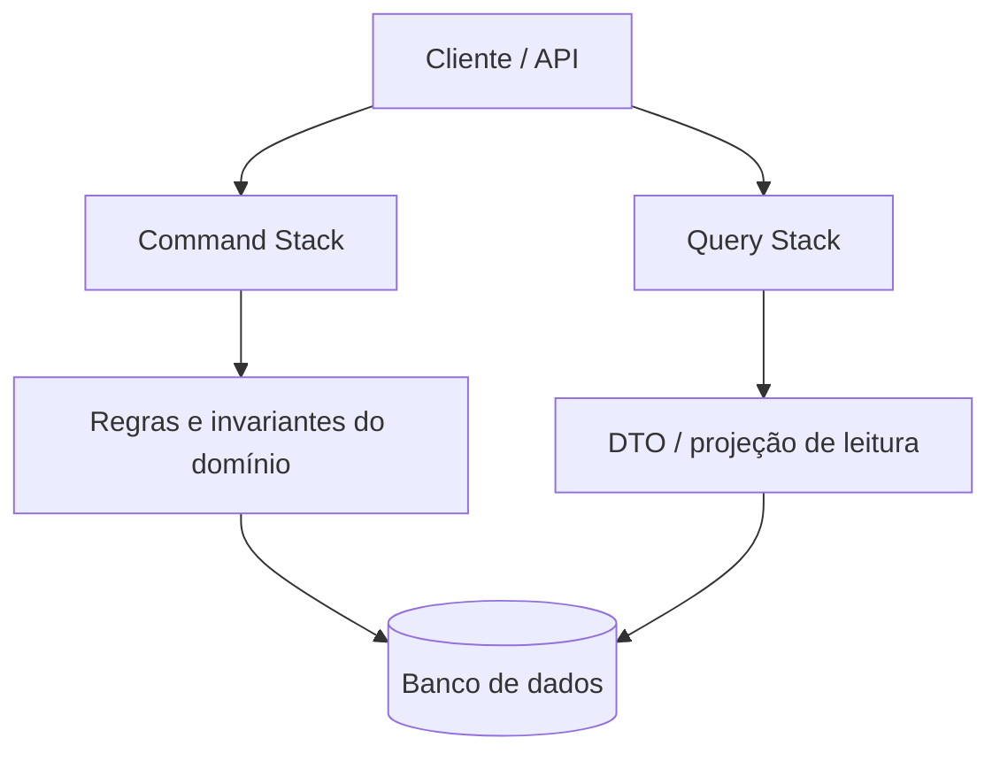
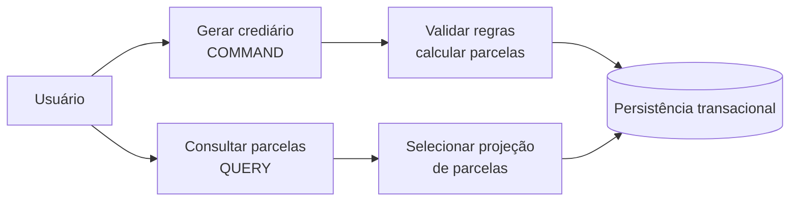
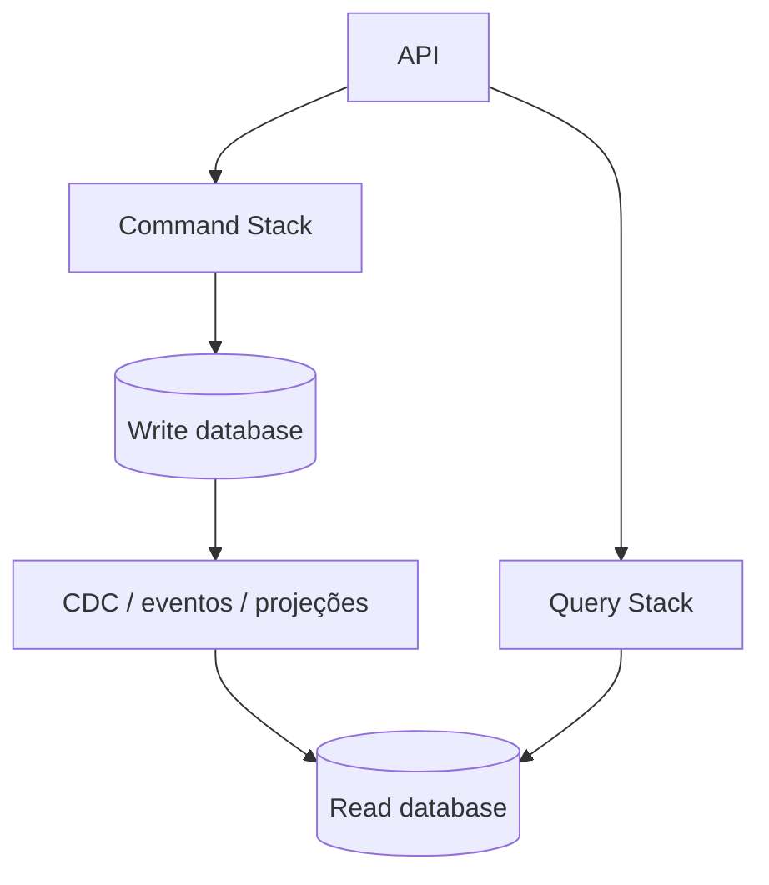

# Aula 07 — CQRS (Command Query Responsibility Segregation)

**Módulo:** 01 — Fundamentos de Arquitetura de Solução  
**Tema:** 03 — Design Patterns  
**Origem:** Resumo da aula, com exemplos e aprofundamentos complementares identificados.

## Objetivo

Entender a separação entre **comandos (escrita)** e **consultas (leitura)**, suas implicações para modelagem, performance, persistência e consistência, e quando CQRS se justifica.

## 1. O problema: um modelo para operações diferentes

Em um CRUD tradicional, o mesmo modelo frequentemente atende tanto a operações de alteração quanto a consultas. Isso pode ser suficiente em sistemas simples, mas torna-se uma restrição quando as necessidades divergem:

- **Escrita:** validar invariantes, executar regras de negócio e preservar consistência;
- **Leitura:** entregar projeções específicas, filtros e respostas rápidas, muitas vezes com alto volume.

**Nuance:** um endpoint que altera dados e retorna uma representação não é, por si só, um problema arquitetural. CQRS é uma opção quando a diferença entre as necessidades de leitura e escrita justifica a separação.

## 2. O que é CQRS?

**CQRS — Command Query Responsibility Segregation** — separa os **modelos e fluxos de comando e consulta**.

- **Command:** expressa a intenção de modificar o estado do sistema.
- **Query:** recupera informações sem produzir uma alteração de estado de negócio.

A separação pode existir **na mesma aplicação e no mesmo banco**, sem exigir microserviços, mensageria ou duas bases de dados.



## 3. Command Stack

O caminho de escrita recebe comandos como:

- `CriarUsuario`;
- `AlterarEmail`;
- `GerarCrediario`;
- `RegistrarPagamento`.

A aplicação coordena a operação, valida regras e persiste mudanças.

**Exemplo autoral em Java/Spring Boot:**

```java
record GerarCrediarioCommand(
    Long clienteId,
    BigDecimal valor,
    int quantidadeParcelas
) {}

@Service
class GerarCrediarioHandler {
    private final CrediarioRepository repository;

    GerarCrediarioHandler(CrediarioRepository repository) {
        this.repository = repository;
    }

    @Transactional
    public void executar(GerarCrediarioCommand comando) {
        if (comando.quantidadeParcelas() <= 0) {
            throw new IllegalArgumentException("Quantidade inválida");
        }

        // Ilustrativo: regras de juros, arredondamento e limites
        // devem ser implementadas e validadas pelo domínio.
        Crediario crediario = Crediario.criar(comando);
        repository.salvar(crediario);
    }
}
```

*Os tipos de domínio e repositório são conceituais e foram omitidos para manter o foco no fluxo.*

### Comandos precisam retornar `void`?

Na abordagem didática apresentada na aula, o comando **não retorna dados de consulta** e pode ser modelado como `void`, sinalizando falhas por exceções.

**Complemento técnico:** isso **não é uma regra absoluta de CQRS**. Comandos podem retornar informações mínimas de execução, como **ID criado, status ou versão**, sem se transformar em uma query. O ponto principal é **não usar o command model para atender consultas ricas**.

Também é importante diferenciar **comando aceito** de **comando efetivamente concluído**, especialmente em processamento assíncrono.

## 4. Query Stack

O caminho de leitura atende perguntas como:

- Quais são as parcelas de um crediário?
- Quais usuários pertencem a uma empresa?
- Quais compras estão pendentes?

Uma query pode retornar um **DTO diretamente do banco**, sem reconstruir agregados de domínio.

```java
record ParcelaResponse(
    Long numero,
    BigDecimal valor,
    String status
) {}

interface ParcelaQueryRepository {
    List<ParcelaResponse> buscarPorCliente(Long clienteId);
}

@Service
class ConsultarParcelasHandler {
    private final ParcelaQueryRepository queries;

    ConsultarParcelasHandler(ParcelaQueryRepository queries) {
        this.queries = queries;
    }

    public List<ParcelaResponse> executar(Long clienteId) {
        return queries.buscarPorCliente(clienteId);
    }
}
```

**Importante:** bypass do **modelo de domínio de escrita** não significa bypass de **autenticação, autorização, escopo de tenant, validação de entrada ou privacidade**.

## 5. Exemplo completo: crediário



O **comando** valida condições, calcula parcelas e grava o resultado. A **query** lê as parcelas já existentes, sem recalcular o contrato nem executar novamente a mutação.

Essa divisão evita que a necessidade de leitura determine a estrutura do domínio transacional.

## 6. Views materializadas e read models

O lado de leitura pode usar **projeções**, tabelas desnormalizadas ou **views materializadas** para responder rapidamente a consultas frequentes.

**Nuance:** uma view materializada do banco e uma projeção mantida por eventos são mecanismos diferentes:

- **View materializada:** resultado de consulta pré-computado, atualizado conforme as capacidades e a política do banco;
- **Projeção por eventos:** read model atualizado por consumidores a partir de eventos de mudança.

Ambos podem servir CQRS, mas têm mecanismos distintos de atualização e consistência.

## 7. CQRS com bancos separados — opção, não requisito



A escrita pode usar um banco transacional e a leitura uma tecnologia otimizada para busca ou agregações. Isso exige um mecanismo de sincronização confiável, como **CDC**, eventos ou atualização de projeções.

**Trade-offs:**
- **Benefícios:** escalar leituras separadamente, otimizar consultas e modelos;
- **Custos:** infraestrutura adicional, atraso de propagação, recuperação de projeções, monitoramento e manutenção de contratos.

### Consistência eventual

Se a atualização do read model é assíncrona, uma query feita imediatamente após o comando **pode retornar dados antigos**.

Estratégias possíveis:
- Informar ao usuário que a atualização está em processamento;
- Usar versões/offsets para acompanhar a projeção;
- Consultar o modelo transacional em operações que exigem leitura imediatamente consistente;
- Projetar a UX para lidar com consistência eventual.

## 8. CQS vs. CQRS

| Conceito | Escopo | Ideia central |
| --- | --- | --- |
| **CQS — Command Query Separation** | Operações/métodos | Uma operação altera estado ou consulta dados, evitando misturar as duas responsabilidades |
| **CQRS — Command Query Responsibility Segregation** | Modelo/arquitetura de aplicação | Fluxos e modelos distintos para escrita e leitura |

CQRS é inspirado pela separação de responsabilidades de CQS, mas não é apenas “ter endpoints GET e POST”.

## 9. CQRS não é Event Sourcing

**Complemento autoral:** CQRS e **Event Sourcing** são conceitos diferentes.

- **CQRS:** separa modelos de leitura e escrita;
- **Event Sourcing:** armazena eventos como fonte de verdade do estado, reconstruindo-o a partir deles.

Podem ser combinados, mas **nenhum exige o outro**.

## 10. Quando adotar?

**Cenários favoráveis:**
- Volume de leitura muito superior ao de escrita;
- Consultas complexas e específicas que não combinam com o modelo transacional;
- Regras de escrita sofisticadas e necessidade de preservar invariantes;
- Necessidade real de escalar, otimizar ou evoluir os lados separadamente.

**Cenários em que pode ser excesso:**
- CRUD pequeno, com modelos simples e volume moderado;
- Equipe sem capacidade de manter projeções, contratos e observabilidade adicionais;
- Requisitos fortes de leitura imediatamente consistente sem necessidade de separar modelos.

| Decisão | Benefício potencial | Custo / risco |
| --- | --- | --- |
| Mesmo modelo para ler e escrever | Menos complexidade | Evolução e otimização podem conflitar |
| CQRS lógico, mesmo banco | Responsabilidades claras com custo moderado | Mais classes/fluxos |
| CQRS com read database separado | Otimização e escala independentes | Consistência eventual e operação mais complexa |

## 11. Checklist

- [ ] Leitura e escrita realmente exigem modelos diferentes?
- [ ] Os comandos preservam regras e invariantes do domínio?
- [ ] As queries retornam projeções adequadas sem mutar estado de negócio?
- [ ] As queries continuam aplicando autorização e isolamento de dados?
- [ ] A separação exige mesmo bancos distintos?
- [ ] Existe estratégia para sincronizar e reconstruir read models?
- [ ] A UX lida com atrasos de atualização?
- [ ] O ganho esperado compensa a complexidade adicional?

## 12. Perguntas de revisão

1. O que significa CQRS e qual problema ele procura resolver?
2. Qual é a diferença entre Command Stack e Query Stack?
3. Um comando pode retornar o identificador do recurso criado?
4. CQRS exige bancos de leitura e escrita separados?
5. Por que o lado de query pode consultar projeções sem reconstruir agregados?
6. Qual a diferença entre uma view materializada e uma projeção por eventos?
7. Como a consistência eventual afeta a experiência do usuário?
8. Qual é a diferença entre CQS, CQRS e Event Sourcing?
9. Quando um CRUD tradicional é uma escolha melhor?

## Síntese

> **CQRS separa as responsabilidades de mutação e consulta para permitir modelos apropriados a cada necessidade.** A separação pode ser lógica ou física, e só se justifica quando seus benefícios superam os custos de complexidade e consistência.

## Conexões

- [Aula 02 — N-Tier e N-Layered Architecture](./aula-02-n-tier-e-n-layered-architecture.md)
- [Aula 06 — Microservices Architecture](./aula-06-microservices-architecture.md)
- [Tema 02 — Domínio e Contextos](../tema-02-solution-architecture/aula-11-dominio-e-contextos.md)
