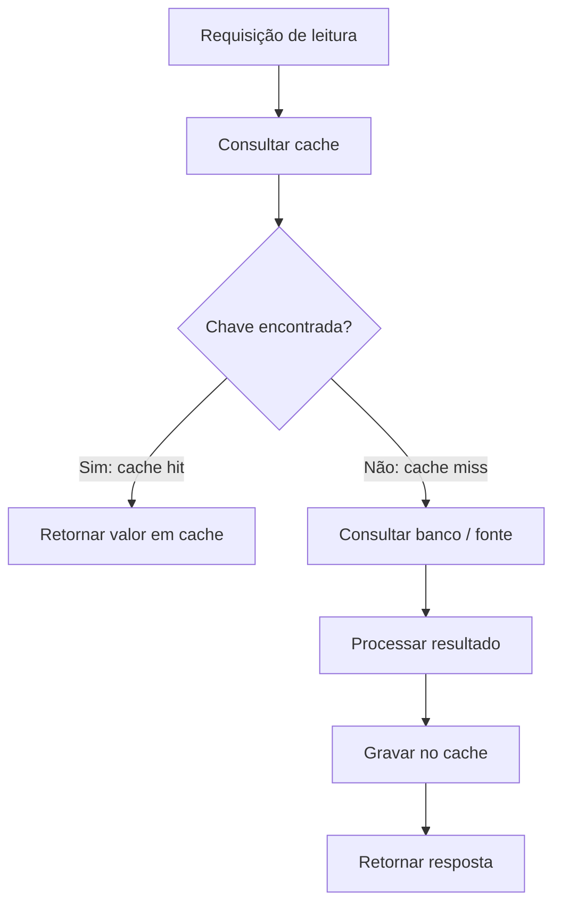
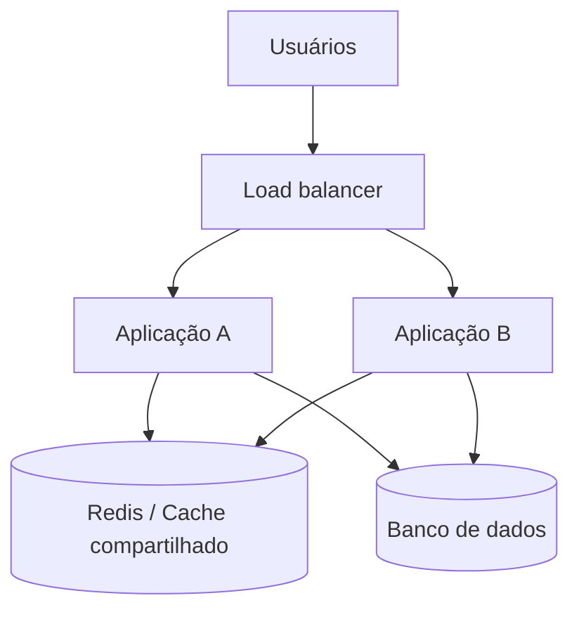
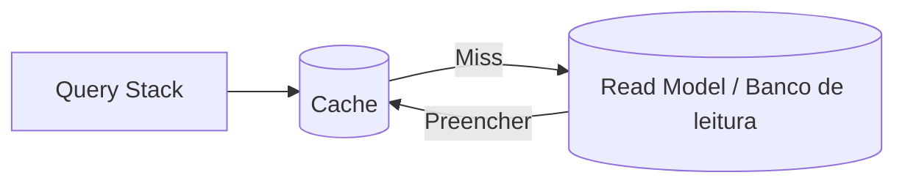

# Aula 08 — Entendendo Cache

**Módulo:** 01 — Fundamentos de Arquitetura de Solução  
**Tema:** 03 — Design Patterns  
**Origem:** Resumo do estudante, com exemplos e aprofundamentos complementares identificados.

## Objetivo

Compreender cache como mecanismo de **reaproveitamento de resultados**, identificar *cache hit* e *cache miss*, entender o fluxo de leitura com cache e avaliar o principal trade-off: **consistência e invalidação**.

## 1. O que é cache?

**Cache** é um armazenamento de acesso rápido que permite reutilizar dados ou resultados de operações, evitando consultas e processamentos repetidos.

O benefício é maior quando:
- A leitura é frequente;
- O mesmo resultado é solicitado muitas vezes;
- O custo de buscar ou calcular o resultado original é relevante;
- Existe uma política aceitável de atualização ou expiração.

**Importante:** cache não é necessariamente a fonte de verdade. Em geral, o banco ou sistema de origem continua sendo a referência autoritativa dos dados.

## 2. Fluxo básico: Cache-Aside (Lazy Loading)

O padrão descrito nesta aula é conhecido como **cache-aside**: a aplicação consulta o cache primeiro e, em caso de ausência, busca na fonte original e armazena o resultado.



**Cache miss não é erro.** Ele acontece naturalmente na primeira leitura, após expiração ou após invalidação.

## 3. Cache hit vs. cache miss

| Evento | Significado | Consequência |
| --- | --- | --- |
| **Cache hit** | O valor está disponível e é reutilizado | Menor latência e menos trabalho no backend |
| **Cache miss** | O valor não está disponível | A aplicação precisa consultar/processar a fonte original |
| **Cache stale** | O valor existe, mas está desatualizado | Risco de resposta inconsistente |

**Exemplo ilustrativo da aula:** uma consulta sem cache pode levar aproximadamente **900 ms**; após preencher o cache, uma consulta equivalente pode responder muito mais rápido. Esses valores são apenas ilustrativos — o ganho real depende de rede, payload, serialização, processamento e carga.

## 4. Por que um cache externo?

Em aplicações com múltiplas instâncias, um cache compartilhado como **Redis** ou **Memcached** permite que diferentes servidores reutilizem os mesmos resultados.



**Trade-off:** um cache remoto também introduz latência de rede, custo operacional, limites de memória e uma nova dependência de infraestrutura. Para alguns cenários, um cache local por instância é suficiente; para outros, a consistência entre instâncias favorece o compartilhado.

## 5. Exemplo prático: consulta de produto

Imagine que a aplicação consulte um produto frequentemente:

1. A requisição pede `produto:42`;
2. A aplicação procura a chave no Redis;
3. Se encontrar, retorna o valor (*hit*);
4. Se não encontrar, consulta o banco (*miss*);
5. A aplicação grava o resultado com um tempo de expiração;
6. A próxima consulta pode reutilizar o valor.

### Exemplo Java/Spring Boot — complemento autoral

```java
@Service
class ConsultarProdutoService {
    private final ProdutoRepository repository;

    ConsultarProdutoService(ProdutoRepository repository) {
        this.repository = repository;
    }

    @Cacheable(cacheNames = "produtos", key = "#id")
    public ProdutoResponse consultar(Long id) {
        Produto produto = repository.buscarPorId(id)
            .orElseThrow(() -> new IllegalArgumentException("Produto não encontrado"));
        return new ProdutoResponse(produto.id(), produto.nome(), produto.preco());
    }
}
```

A anotação `@Cacheable` ilustra o uso do **Spring Cache**. É necessário habilitar e configurar o mecanismo de cache, seu provider e a política de expiração. O código não inclui configuração de Redis nem tratamento completo de erros.

## 6. Invalidação: o principal desafio

Suponha que o estoque real de um produto passe de **10 para 9 unidades**, mas o cache ainda contenha **10**.

A consulta pode continuar rápida, mas passa a retornar um valor incorreto.

**Estratégias comuns — complemento autoral:**

| Estratégia | Como funciona | Trade-off |
| --- | --- | --- |
| **TTL (Time to Live)** | Entrada expira após um período | Simples, mas aceita dados potencialmente desatualizados até a expiração |
| **Invalidação na escrita** | Alteração remove a chave correspondente | Exige mapear corretamente chaves afetadas e coordenar a ordem das operações |
| **Atualização do cache na escrita** | Atualiza o valor armazenado após a mudança | Maior coordenação e possibilidade de condições de corrida |
| **Versionamento de chave** | Usa versão para diferenciar estados | Mais complexidade e gerenciamento de versões |

**Cuidado importante:** operações críticas, como reservar estoque ou efetivar pagamento, não devem depender exclusivamente de um valor possivelmente desatualizado em cache para preservar invariantes do negócio.

## 7. Relação com CQRS

O cache pode complementar o **Query Stack** de CQRS:



A leitura otimizada pode usar projeções específicas e cache de resultados frequentes.

**Nuance:** CQRS **não exige cache**, e cache **não exige CQRS**. São decisões independentes que podem ser combinadas.

## 8. Cuidados adicionais — complemento autoral

- **Chaves corretas:** incluir contexto relevante, como filtros, idioma, versão e `tenant_id` em aplicações multi-tenant;
- **Dados sensíveis:** evitar compartilhar respostas personalizadas entre usuários indevidos;
- **Cache stampede:** muitas requisições simultâneas após um miss podem sobrecarregar o banco;
- **Eviction:** o cache pode remover entradas por limite de memória antes do TTL;
- **Falhas do cache:** definir comportamento de fallback para a fonte de dados;
- **Observabilidade:** acompanhar hit rate, miss rate, latência, memória e carga na origem.

## 9. Checklist

- [ ] Identifiquei consultas repetidas e custosas?
- [ ] Sei qual é a fonte de verdade?
- [ ] Defini corretamente as chaves do cache?
- [ ] Escolhi TTL ou estratégia explícita de invalidação?
- [ ] Avaliei tolerância a dados desatualizados?
- [ ] Evitei usar cache como garantia de consistência para operações críticas?
- [ ] Considerei segurança e isolamento entre usuários/tenants?
- [ ] Planejei comportamento em caso de indisponibilidade do cache?
- [ ] Vou medir hit rate, latência e impacto na origem?

## 10. Perguntas de revisão

1. O que caracteriza um cache hit e um cache miss?
2. Por que o cache-aside pode reduzir a carga do banco?
3. Por que um miss não deve ser tratado como erro?
4. Qual é a vantagem de um cache externo em aplicações com múltiplas instâncias?
5. O que acontece quando o estoque muda, mas o cache não é invalidado?
6. Qual é a diferença entre TTL e invalidação na escrita?
7. Por que uma operação crítica não deve confiar cegamente no cache?
8. Como CQRS e cache podem se complementar?

## Síntese

> **Cache troca parte do custo de processamento e consulta por complexidade de armazenamento e consistência.** Seu sucesso depende tanto da taxa de reutilização quanto da capacidade de invalidar dados no momento adequado.

## Conexões

- [Aula 04 — Stateless vs. Stateful Architecture](./aula-04-stateless-vs-stateful-architecture.md)
- [Aula 06 — Microservices Architecture](./aula-06-microservices-architecture.md)
- [Aula 07 — CQRS](./aula-07-cqrs.md)
- [Aula 03 — Multi-Tenant Architecture](./aula-03-multi-tenant-architecture.md)
