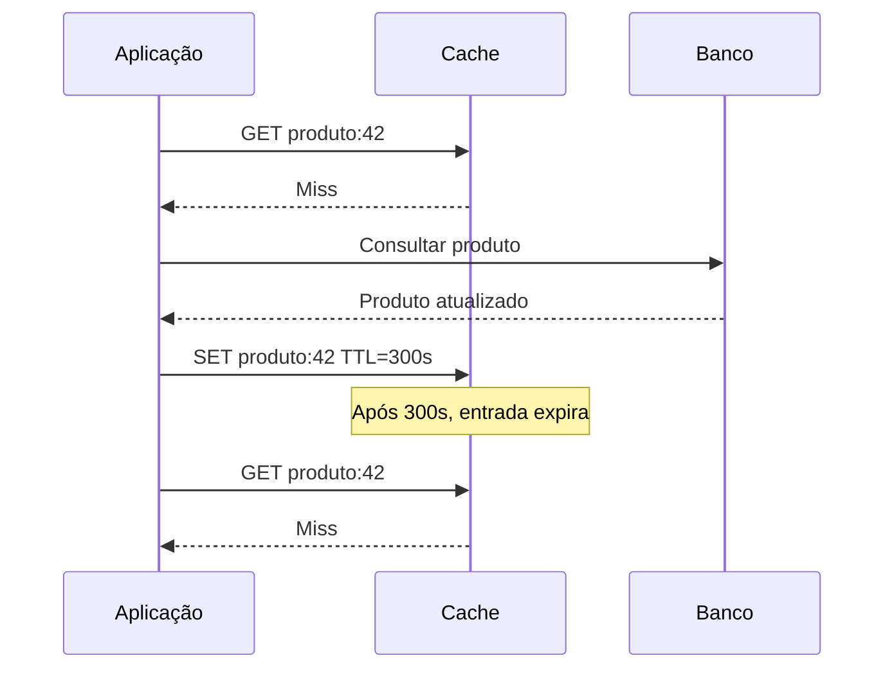
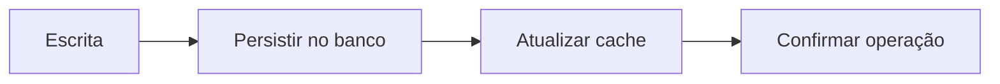
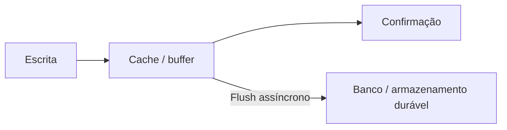
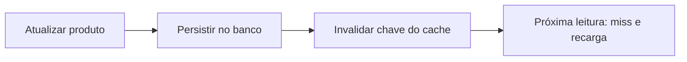

# Aula 09 — Invalidando Cache

**Módulo:** 01 — Fundamentos de Arquitetura de Solução  
**Tema:** 03 — Design Patterns  
**Origem:** Resumo do estudante, com esclarecimentos técnicos e exemplos complementares.

## Objetivo

Distinguir **invalidação por expiração**, **políticas de eviction por capacidade** e **estratégias de escrita/sincronização**. Entender como essas escolhas afetam consistência, durabilidade, latência e taxa de acerto do cache.

## 1. O problema central: dados desatualizados

Cache reduz trabalho repetido, mas uma cópia pode deixar de representar a fonte de verdade quando o dado original muda.

**Exemplo:** o estoque no banco passa de 10 para 9, mas o cache continua retornando 10. O problema não é velocidade, e sim **frescor e consistência**.

Três questões diferentes precisam ser respondidas:

1. **Quando uma entrada deixa de ser válida?** — expiração ou invalidação.
2. **Qual entrada remover quando falta espaço?** — política de eviction.
3. **Quando e onde persistir uma escrita?** — política de atualização/sincronização.

Misturar essas categorias leva a decisões arquiteturais incorretas.

## 2. Time-Based Invalidation e TTL

**Time-Based Invalidation** é a estratégia de expirar dados após um período definido. **TTL (Time to Live)** é um mecanismo comum para implementá-la: cada chave recebe uma duração de validade.



**Trade-off:**
- TTL **curto**: dados tendem a ficar mais frescos, mas a taxa de miss e a carga na origem podem aumentar;
- TTL **longo**: mais hits e menos trabalho, mas maior janela de dados desatualizados.

**Nuance:** TTL não garante atualização imediata após uma escrita. Uma entrada pode ficar desatualizada durante toda a janela de validade. Também é possível combinar TTL com invalidação explícita.

## 3. Eviction: quando o cache fica cheio

**Eviction** é a remoção de entradas para liberar capacidade. Não é a mesma coisa que invalidar uma entrada porque o conteúdo mudou.

| Política | O que remove | Critério |
| --- | --- | --- |
| **LRU — Least Recently Used** | Item menos recentemente acessado | Recência |
| **MRU — Most Recently Used** | Item mais recentemente acessado | Recência inversa |
| **LFU — Least Frequently Used** | Item com menor frequência de acesso | Frequência |
| **TTL** | Item cuja validade expirou | Tempo de vida, não pressão de memória |

### 3.1 LRU

Com capacidade para três entradas, imagine que o cache contém **A, B e C**. Se A e B são acessados recentemente, C passa a ser o menos recentemente utilizado. Ao inserir D, uma política LRU tende a remover **C**.

LRU costuma funcionar bem quando existe **localidade temporal**: itens acessados recentemente têm boa chance de serem reutilizados.

### 3.2 MRU

MRU remove o **item acessado mais recentemente** quando é necessário liberar espaço. É menos comum que LRU, mas pode ser útil em determinados padrões de varredura de dados, nos quais itens recém-acessados têm pouca chance de reutilização.

**Correção técnica importante:** MRU **não é** o mecanismo usado para invalidar uma versão antiga de vídeo em uma CDN. Remover uma versão substituída é um caso de **invalidação/purge por mudança de conteúdo**, independentemente de o item ser o mais recentemente utilizado.

Para assets de CDN, estratégias como **nomes versionados, cache busting, purge/invalidation e cabeçalhos Cache-Control** são mais apropriadas.

### 3.3 LFU

LFU prioriza manter itens populares. Se A recebeu 7 acessos, B recebeu 6, C recebeu 5 e D recebeu 10, **C** é candidato à remoção quando falta espaço, desde que esses sejam os contadores usados pela política.

**Trade-off:** itens historicamente populares podem permanecer mesmo após perderem relevância. Implementações reais podem usar janelas de observação, decaimento ou contadores aproximados.

## 4. Estratégias de escrita e atualização

### 4.1 Write-Through

A escrita atualiza a fonte de dados e o cache como parte do fluxo de atualização.



**Benefício:** o cache tende a refletir rapidamente alterações feitas por esse fluxo.

**Custo:** mais operações e latência de escrita.

**Nuance crítica:** gravar em banco e cache **não cria atomicidade automaticamente**. Se uma das operações falhar, pode haver divergência; é necessário definir ordem, tratamento de falhas e estratégia de recuperação. Em algumas implementações, a atualização do cache pode ocorrer por uma camada específica, não necessariamente pela aplicação.

### 4.2 Write-Back (Write-Behind)

A escrita atualiza primeiro o cache ou uma camada intermediária, e a persistência na fonte principal ocorre posteriormente.



**Benefício:** reduz latência percebida da escrita e pode agrupar operações.

**Riscos:** perda de dados antes do flush, falhas de sincronização, reordenação e divergência temporária.

**Correção técnica:** o flush **não precisa ocorrer na expiração da chave**; pode ser feito por lote, intervalo, fila ou política específica. Para dados críticos, é indispensável considerar durabilidade (por exemplo, log persistente, replicação ou fila durável), recuperação e idempotência.

### 4.3 Cache-Aside com invalidação na escrita

Outra opção frequente é persistir no banco e **remover** a chave do cache, permitindo que a próxima leitura a reconstrua.



**Trade-off:** simples de entender, mas exige tratar falhas de invalidação, concorrência e chaves derivadas (por exemplo, listas e resultados filtrados).

## 5. Comparativo: qual problema cada política resolve?

| Estratégia | Problema principal | Risco ou custo |
| --- | --- | --- |
| Time-based / TTL | Limitar tempo de vida | Dados podem ficar velhos antes da expiração |
| LRU | Liberar memória preservando dados recentes | Pode descartar itens frequentes após uma varredura |
| MRU | Liberar memória removendo item mais recente | Inadequado para muitos padrões comuns |
| LFU | Preservar itens populares | Popularidade histórica pode distorcer decisões |
| Write-through | Atualizar cache junto à escrita | Latência e coordenação de duas gravações |
| Write-back | Adiar persistência definitiva | Risco de perda e consistência temporária |
| Cache-aside + delete | Recarregar dado após mudança | Corridas e falhas de invalidação |

**Importante:** essas técnicas **podem coexistir**. Por exemplo, Redis pode usar TTL por chave e uma política LRU/LFU de eviction ao atingir limites de memória, enquanto a aplicação invalida chaves após mudanças no banco.

## 6. Exemplo Java/Spring Boot — complemento autoral

```java
@Service
class ProdutoService {
    private final ProdutoRepository repository;

    ProdutoService(ProdutoRepository repository) {
        this.repository = repository;
    }

    @Cacheable(cacheNames = "produtos", key = "#id")
    public ProdutoResponse consultar(Long id) {
        return repository.buscarPorId(id)
            .map(p -> new ProdutoResponse(p.id(), p.nome(), p.preco()))
            .orElseThrow();
    }

    @CacheEvict(cacheNames = "produtos", key = "#id")
    public void alterarPreco(Long id, BigDecimal novoPreco) {
        repository.atualizarPreco(id, novoPreco);
    }
}
```

O exemplo ilustra **cache-aside com invalidação** usando Spring Cache. Exige configuração de provider e cache habilitado. **Atenção:** para operações transacionais reais, é necessário coordenar a invalidação com o **commit** do banco e lidar com falhas do cache; uma anotação isolada não garante consistência sob concorrência ou rollback.

## 7. Armadilhas de produção — complemento autoral

- **Cache stampede:** várias requisições fazem miss simultâneo e sobrecarregam a origem;
- **Race condition:** uma leitura antiga pode repopular o cache depois de uma invalidação;
- **Chaves derivadas:** atualizar um produto pode exigir invalidar listas, rankings e filtros;
- **Multi-tenancy:** chaves precisam respeitar isolamento entre tenants e autorização;
- **Cache de estoque:** dados desatualizados não devem ser a autoridade para confirmar reservas ou vendas;
- **Observabilidade:** medir hit/miss rate, eviction, uso de memória, latência, erros e idade dos dados.

Possíveis mitigações incluem **jitter de TTL**, bloqueio por chave, versionamento, atualização assíncrona controlada e desenho de consistência adequado à operação.

## 8. Checklist de decisão

- [ ] Sei diferenciar expiração, eviction e estratégia de escrita?
- [ ] Defini a tolerância a dados desatualizados?
- [ ] Escolhi TTL com base no padrão real de atualização?
- [ ] Entendi a política de eviction do provider?
- [ ] Identifiquei todas as chaves afetadas por uma mutação?
- [ ] Tenho plano para falha parcial entre banco e cache?
- [ ] Trato concorrência, stampede e repopulação com dados antigos?
- [ ] Dados críticos continuam protegidos pela fonte de verdade?
- [ ] Monitoro hits, misses, evictions e latência?

## 9. Perguntas de revisão

1. Qual a diferença entre Time-Based Invalidation e TTL?
2. Por que LRU, MRU e LFU são políticas de eviction, e não de frescor?
3. Em qual padrão de acesso MRU pode fazer sentido?
4. Como invalidar corretamente um vídeo atualizado em uma CDN?
5. Qual o risco de uma gravação write-through falhar pela metade?
6. Por que write-back exige cuidado especial com durabilidade?
7. Como cache-aside com invalidação na escrita funciona?
8. É possível combinar TTL e LFU?
9. O que acontece se uma leitura antiga repopular o cache após uma atualização?

## Síntese

> **Invalidar cache é controlar a validade dos dados; eviction é escolher o que remover quando falta espaço; write-through e write-back definem como a escrita é sincronizada.** Uma boa arquitetura trata essas decisões separadamente e depois as combina conforme o perfil de acesso e consistência.

## Conexões

- [Aula 08 — Entendendo Cache](./aula-08-entendendo-cache.md)
- [Aula 07 — CQRS](./aula-07-cqrs.md)
- [Aula 06 — Microservices Architecture](./aula-06-microservices-architecture.md)
