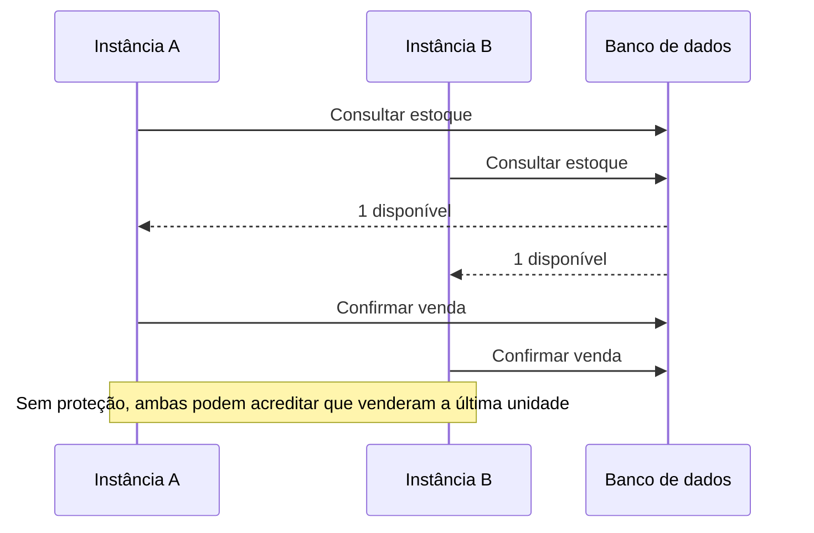
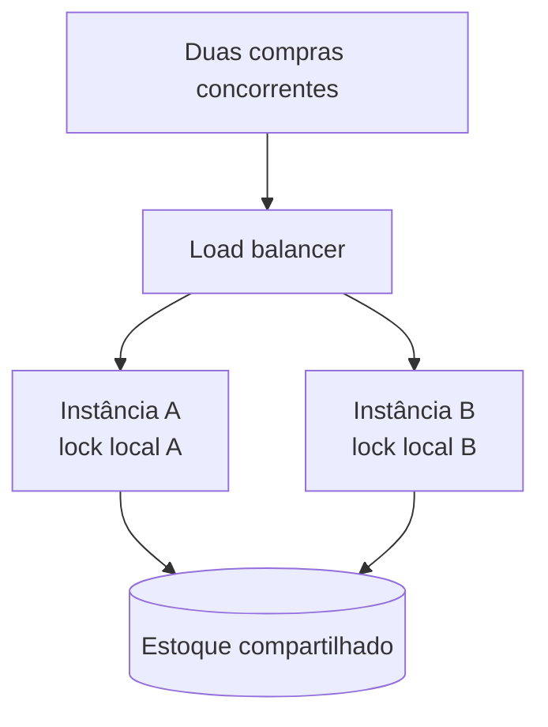
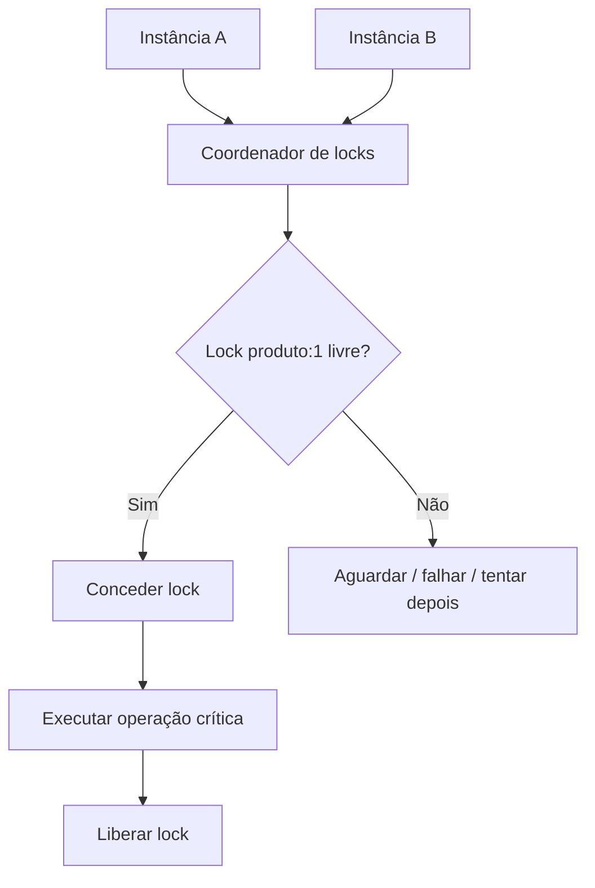
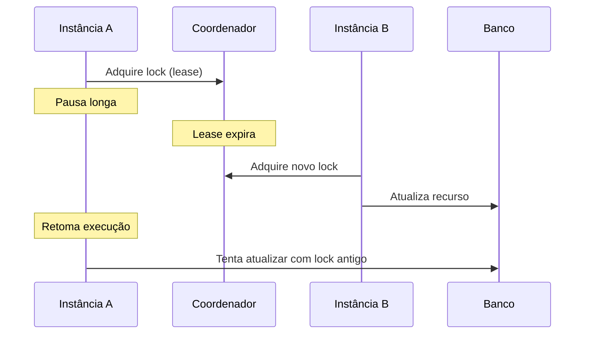

# Aula 10 — Distributed Lock

**Módulo:** 01 — Fundamentos de Arquitetura de Solução  
**Tema:** 03 — Design Patterns  
**Origem:** Resumo da aula, com esclarecimentos técnicos e exemplos autorais.

## Objetivo

Compreender **condições de corrida**, por que locks locais não protegem múltiplas instâncias, como funciona a coordenação de **locks distribuídos**, seus riscos de falha e as alternativas para preservar invariantes de negócio.

## 1. Condição de corrida: duas compras, uma unidade

Imagine um produto com estoque igual a **1**:



Uma **race condition** surge quando o resultado depende da ordem de execução de operações concorrentes. O problema está no intervalo entre **ler**, **validar** e **alterar** o estado.

## 2. Por que um lock local não basta?

Um `synchronized`, `ReentrantLock` ou mutex em memória protege apenas execuções que compartilham o mesmo processo ou ambiente de sincronização.



A instância A não conhece o lock criado em B. Por isso, um mutex local **não é uma garantia global** em uma implantação horizontal.

## 3. Lock distribuído: coordenação compartilhada

Um lock distribuído representa o direito temporário de executar uma seção crítica sobre determinado recurso.



A chave pode representar um recurso como `locks:produto:1` ou, em um sistema hierárquico como ZooKeeper, um caminho como `/locks/produtos/1`.

**Importante:** o lock é um mecanismo de coordenação. **Não substitui transações, restrições de banco e validação de invariantes**, especialmente diante de falhas de rede e expiração de leases.

## 4. Fluxo de lock e unlock

1. Identificar o recurso a proteger;
2. Tentar adquirir o lock no coordenador;
3. Se adquirido, executar a operação crítica;
4. Liberar o lock em `finally`, quando a implementação permitir;
5. Tratar timeout, perda do lock e falhas durante a operação.

### Exemplo Java — pseudocódigo autoral

```java
String chave = "locks:produto:" + produtoId;
LockHandle lock = coordinator.tryAcquire(chave, Duration.ofSeconds(10));

if (lock == null) {
    throw new RecursoOcupadoException("Produto em processamento");
}

try {
    estoqueService.reservarUmaUnidade(produtoId);
} finally {
    coordinator.releaseIfOwner(lock);
}
```

**Atenção:** `LockHandle` e `coordinator` são abstrações didáticas, não classes de uma biblioteca específica. A liberação deve conferir **identidade do proprietário**; nunca remova cegamente uma chave que pode ter sido adquirida por outra instância após expiração.

## 5. O risco de expiração: lock não garante correctness sozinho

Imagine que a instância A obtenha um lock com duração de 10 segundos. A operação pausa por 15 segundos. O lock expira e B consegue adquiri-lo. Quando A retoma, **as duas instâncias podem tentar escrever**, mesmo que o coordenador tenha concedido o lock corretamente em momentos diferentes.



**Complemento importante — fencing token:** um coordenador pode emitir um número monotonicamente crescente a cada concessão. O armazenamento rejeita escritas com tokens antigos, impedindo que um proprietário cujo lease expirou sobrescreva o estado mais recente. Essa proteção exige **validação do token no recurso protegido**.

## 6. Deadlock

Deadlock pode ocorrer quando duas execuções aguardam recursos que a outra mantém:

- Processo A segura lock do recurso X e espera Y;
- Processo B segura lock de Y e espera X.

Mitigações:
- Ordem global consistente de aquisição;
- Timeouts e leases apropriados;
- Seções críticas pequenas;
- Tratamento de falhas e liberação;
- Evitar múltiplos locks quando uma transação atômica resolve o problema.

**Nuance:** expiração evita locks abandonados indefinidamente, mas pode criar o problema de proprietários antigos continuarem a executar; por isso, lease e fencing precisam ser considerados juntos em cenários críticos.

## 7. Ferramentas de coordenação

| Tecnologia | Característica | Atenção arquitetural |
| --- | --- | --- |
| **Apache ZooKeeper** | Coordenação com znodes efêmeros e ordenação | Sessões, falhas e semântica da receita de lock |
| **etcd** | Armazenamento distribuído consistente, leases e transações | Quórum, latência e disponibilidade sob partições |
| **Redis** | Operações atômicas rápidas e TTL de chave | Failover/replicação e garantias de segurança do lock |
| **HashiCorp Consul** | Coordenação baseada em sessões e KV | Expiração de sessão, consistência e operação do cluster |

**Nuance:** essas tecnologias não oferecem garantias idênticas. Redis com replicação assíncrona, por exemplo, pode perder o registro de um lock em failover. O uso de mecanismos de consenso, leases ou replicação não elimina automaticamente todas as condições de corrida.

## 8. Redis: aquisição e liberação segura — complemento autoral

Um padrão básico para aquisição é:

```redis
SET locks:produto:1 token-unico NX PX 10000
```

- `NX`: criar somente se a chave ainda não existir;
- `PX 10000`: definir expiração de 10 segundos;
- `token-unico`: identificar quem adquiriu o lock.

A liberação precisa ser **condicional**: remover somente se o valor ainda corresponder ao token do proprietário. Essa checagem e remoção devem ser **atômicas** (por exemplo, script Lua ou comando apropriado à versão do Redis).

**Limite:** esse padrão é útil para coordenação, mas **não assegura exclusão mútua perfeita em todas as falhas distribuídas**. Para operações financeiramente críticas, analise garantias de persistência e concorrência no banco.

## 9. Alternativa frequentemente mais simples: atualização atômica no banco

Para o caso específico de estoque, pode ser preferível evitar lock externo e deixar o banco impor a regra:

```sql
UPDATE produto
SET estoque = estoque - 1
WHERE id = :produtoId
  AND estoque > 0;
```

Se **uma linha** foi atualizada, a reserva pode prosseguir; se **zero linhas**, não havia estoque disponível no instante da operação.

**Complemento autoral:** o resultado deve ser verificado dentro da transação correta, com restrições e tratamento de erros adequados. Dependendo do fluxo, também cabem `SELECT ... FOR UPDATE`, versionamento otimista ou controle de idempotência.

**Lição arquitetural:** distributed lock é uma ferramenta, **não a primeira resposta obrigatória para toda race condition**.

## 10. Benefícios e trade-offs

| Benefício potencial | Custo ou risco |
| --- | --- |
| Coordenar operações entre instâncias | Nova dependência de rede e infraestrutura |
| Reduzir trabalho concorrente desnecessário | Contenção pode reduzir throughput |
| Serializar processamento por recurso | Expiração, falha e recuperação exigem cuidado |
| Organizar ownership temporário | Risco de lock perdido ou proprietário obsoleto |

**Correção de expectativa:** um lock externo não garante redução de carga no banco em todos os cenários. Dependendo da contenção, latência e topologia, pode apenas transferir o gargalo para o coordenador.

## 11. Checklist de implementação

- [ ] O recurso e a granularidade do lock estão claros?
- [ ] Um lock de banco ou atualização atômica resolveria com menos complexidade?
- [ ] A aquisição é atômica?
- [ ] O lock tem lease/timeout apropriado?
- [ ] A liberação verifica ownership?
- [ ] O sistema trata pausa longa e expiração do lease?
- [ ] É necessário fencing token para impedir escritas obsoletas?
- [ ] Há estratégia para falhas de rede e indisponibilidade do coordenador?
- [ ] A operação crítica é idempotente quando necessário?
- [ ] Existem métricas de contenção, espera e falhas?

## 12. Perguntas de revisão

1. Como duas compras podem vender a última unidade do estoque?
2. Por que um `synchronized` não protege duas instâncias diferentes?
3. Qual a diferença entre lock local e lock distribuído?
4. O que é deadlock e como a ordem de aquisição ajuda a evitá-lo?
5. Por que um lease expirado pode permitir concorrência indevida?
6. Para que serve um fencing token?
7. Por que `DEL` sem validar o proprietário é perigoso no Redis?
8. Quando uma atualização SQL atômica é melhor que um lock distribuído?
9. Como ZooKeeper, etcd, Redis e Consul diferem em garantias e trade-offs?

## Síntese

> **Distributed lock coordena acesso concorrente entre instâncias, mas a correção da operação depende das garantias de aquisição, expiração, ownership e persistência.** Sempre avalie primeiro mecanismos transacionais ou atômicos mais simples quando forem suficientes.

## Conexões

- [Aula 06 — Microservices Architecture](./aula-06-microservices-architecture.md)
- [Aula 07 — CQRS](./aula-07-cqrs.md)
- [Aula 09 — Invalidando Cache](./aula-09-invalidando-cache.md)
