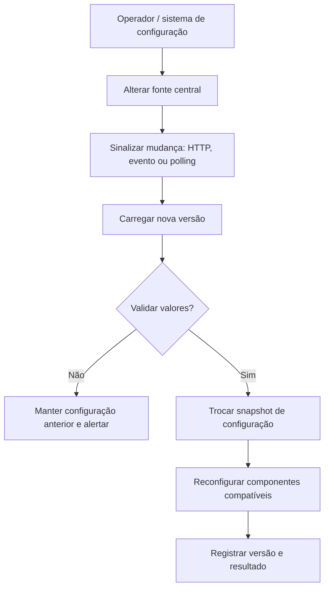
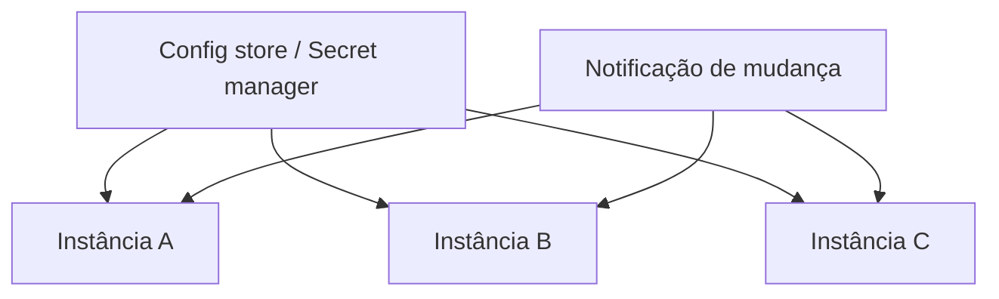

# Aula 01 — Configuration

**Módulo:** 01 — Fundamentos de Arquitetura de Solução  
**Tema:** 04 — Design Pattern (2)  
**Fonte:** Anotações da aula, com complementos técnicos e exemplos autorais.

## Objetivo

Entender o padrão **Configuration** como capacidade de alterar parâmetros operacionais **durante a execução**, sem atrelar toda mudança ao rebuild, redeploy ou reinício completo da aplicação.

## 1. Configuração como dado operacional

Parâmetros como endpoints externos, limites de retry, timeouts, feature flags e credenciais são diferentes do código de negócio. Eles podem variar entre ambientes e mudar mais frequentemente do que o código.

**Externalizar** configuração (arquivo, variável de ambiente, secret manager) é o primeiro passo. **Recarregar dinamicamente** é uma capacidade adicional: nem toda configuração externalizada muda em runtime.

> Observação: variáveis de ambiente de um processo normalmente não são atualizadas automaticamente após sua inicialização. Alterar um arquivo `.env` não significa que a aplicação já em execução receberá os novos valores.

## 2. O problema de depender de restart

Um fluxo tradicional é:


Esse modelo é simples e previsível, mas pode aumentar custo operacional quando a mudança precisa ser aplicada rapidamente. Reinícios **não implicam necessariamente indisponibilidade**: em sistemas com réplicas e rolling updates, podem ser feitos sem interromper o serviço. A decisão deve considerar complexidade e necessidade real de atualização imediata.

## 3. Fluxo de atualização dinâmica



A mudança pode chegar por endpoint administrativo, evento de fila, watch de serviço centralizado ou polling. O **padrão não depende de HTTP**.

### Endpoint de recarga

Um endpoint como `POST /internal/configuration/refresh` pode disparar a leitura de uma fonte confiável. **Não deve ser um endpoint público que aceite credenciais arbitrárias**. É importante aplicar autenticação forte, autorização administrativa, auditoria, rate limiting e controles de rede.

## 4. Boot parcial: o que realmente pode ser recarregado?

Nem toda propriedade pode ser alterada com segurança sem recriar recursos. Há níveis diferentes:

| Parâmetro | Atualização em runtime | Cuidados |
| --- | --- | --- |
| Timeout/retries de cliente HTTP | Geralmente viável | Validação, limites e comportamento de chamadas em andamento |
| URL de serviço externo | Viável com cliente reconfigurável | Conexões antigas, DNS, circuit breakers |
| Credencial de integração | Viável com mecanismo de rotação | Evitar expor segredo; aceitar período de transição |
| Senha de banco | Depende do pool e driver | Rotacionar conexões e garantir novas autenticações |
| Porta HTTP, memória de JVM, certos parâmetros de framework | Frequentemente exige restart | Não prometer recarga universal |

**Boot parcial** é uma descrição didática da reinicialização seletiva de componentes; não é um recurso uniforme de todas as plataformas.

## 5. Exemplo Java — snapshot atômico de configuração

**Complemento autoral:** manter uma configuração imutável e substituir sua referência evita que threads leiam combinações parcialmente atualizadas.

```java
public record RetryConfig(int maxAttempts, Duration delay) {
    public RetryConfig {
        if (maxAttempts < 1 || maxAttempts > 5) {
            throw new IllegalArgumentException("maxAttempts fora do limite");
        }
        if (delay.isNegative()) {
            throw new IllegalArgumentException("delay inválido");
        }
    }
}

@Component
public class RuntimeConfiguration {
    private final AtomicReference<RetryConfig> current =
        new AtomicReference<>(new RetryConfig(3, Duration.ofMillis(200)));

    public RetryConfig snapshot() {
        return current.get();
    }

    public void reload(RetryConfig next) {
        current.set(next);
    }
}
```

Um serviço consulta `snapshot()` ao iniciar uma operação e aplica os valores consistentes daquela versão. O exemplo **não implementa** distribuição entre instâncias nem atualização automática de clientes HTTP já construídos.

## 6. Configuração centralizada em múltiplas instâncias



Em sistemas distribuídos, cada instância pode receber a atualização em momentos diferentes. Por isso, são úteis **versão da configuração, observabilidade, rollback e estratégias de rollout gradual**.

**Complemento:** consistência instantânea em todas as instâncias não é automática. Para parâmetros críticos, é necessário definir o que acontece enquanto coexistem versões diferentes.

## 7. Segredos e rotação segura

Credenciais exigem cuidados adicionais:

- Armazenar em secret manager ou solução equivalente, não em repositório;
- Restringir permissões de leitura e alteração;
- Nunca registrar valores secretos em logs ou mensagens de erro;
- Planejar janela de coexistência entre credenciais antigas e novas quando possível;
- Renovar conexões/pools que utilizam o segredo;
- Auditar quem alterou a configuração e quando.

Exemplos de ferramentas possíveis: AWS Secrets Manager, HashiCorp Vault, Kubernetes ConfigMaps/Secrets e serviços de configuração centralizada. **Atenção:** ConfigMaps e Secrets do Kubernetes não tornam, por si só, qualquer aplicação dinamicamente reconfigurável; o comportamento depende de como os dados são consumidos e de como o processo reage às mudanças.

## 8. Configuration e padrões relacionados

| Conceito | Relação |
| --- | --- |
| **Externalized Configuration** | Separa valores operacionais do código |
| **Dynamic Configuration / Runtime Refresh** | Permite atualizar valores sem reiniciar todo o processo |
| **Feature Flags** | Controla ativação de comportamentos em runtime |
| **Secret Management** | Protege e rotaciona dados sensíveis |
| **Rolling Deployment** | Alternativa operacional para aplicar mudanças com baixa indisponibilidade |

## 9. Trade-offs e riscos

**Ganhos:** resposta operacional rápida, menos necessidade de reiniciar processos, ajustes graduais de comportamento.

**Custos:** complexidade de propagação, estados divergentes entre instâncias, alterações acidentais em produção, reconfiguração incompleta e dificuldade de reproduzir incidentes.

Uma boa implementação registra **qual versão estava ativa** quando uma operação falhou, sem expor dados sensíveis.

## 10. Checklist de implementação

- [ ] A configuração realmente precisa mudar sem restart?
- [ ] A fonte de verdade e o mecanismo de atualização estão definidos?
- [ ] Novos valores são validados antes de entrar em vigor?
- [ ] A troca de valores evita estado parcialmente atualizado?
- [ ] Os componentes afetados suportam reconfiguração?
- [ ] Existe autenticação, autorização e auditoria para alterações?
- [ ] Segredos não aparecem em logs, métricas ou respostas?
- [ ] Há versionamento, rollback e monitoramento?
- [ ] A propagação entre instâncias foi considerada?

## 11. Perguntas de revisão

1. Qual a diferença entre configuração externalizada e configuração recarregável?
2. Por que alterar um `.env` não atualiza necessariamente um processo em execução?
3. Quais parâmetros costumam aceitar refresh e quais podem exigir restart?
4. Quais riscos existem ao expor um endpoint administrativo de recarga?
5. Por que snapshots imutáveis ajudam em atualizações concorrentes?
6. Como evitar divergência de configuração entre múltiplas instâncias?
7. Quais cuidados extras são necessários na rotação de credenciais?

## Síntese

> **Configuration separa o ciclo de vida dos parâmetros operacionais do ciclo de vida do processo**, quando a plataforma e os componentes suportam atualização segura em runtime. A flexibilidade só é valiosa com validação, segurança, rastreabilidade e controle de propagação.

## Conexões

- [Tema 03 — Stateless vs. Stateful](../tema-03-design-patterns/aula-04-stateless-vs-stateful-architecture.md)
- [Tema 03 — Microservices Architecture](../tema-03-design-patterns/aula-06-microservices-architecture.md)
- [Tema 03 — Distributed Lock](../tema-03-design-patterns/aula-10-distributed-lock.md)
