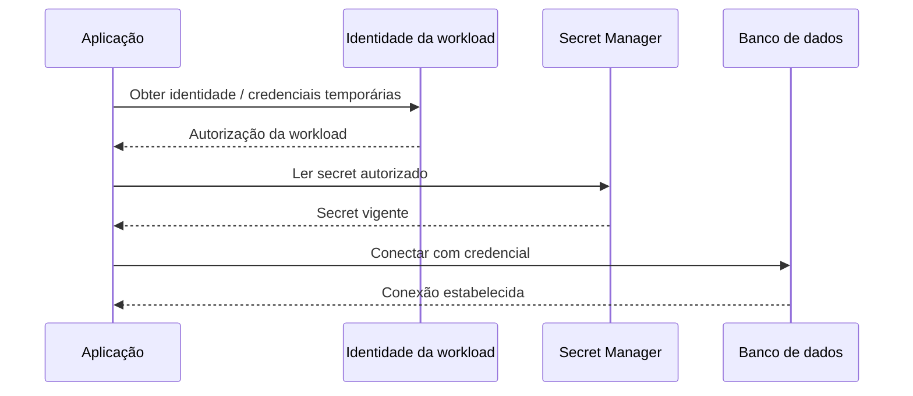
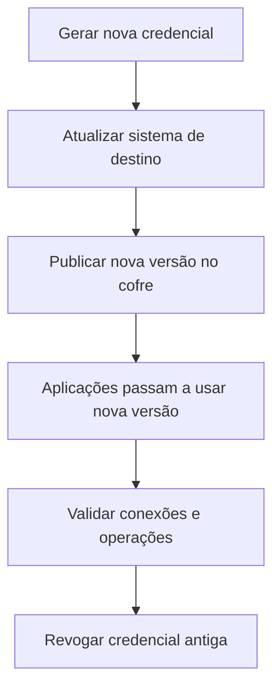

# Aula 02 — Secret Management

**Módulo:** 01 — Fundamentos de Arquitetura de Solução  
**Tema:** 04 — Design Pattern (2)  
**Origem:** Anotações da aula, com exemplos e aprofundamentos complementares.

## Objetivo

Entender como armazenar, distribuir, acessar, auditar e rotacionar **secrets** (senhas, tokens, chaves e credenciais) com segurança, distinguindo **gestão de segredos** de **atualização dinâmica de configuração**.

## 1. O risco de credenciais espalhadas

Uma senha de banco compartilhada em chats, tickets, arquivos locais ou logs pode ser copiada, reenviada e permanecer válida por tempo indeterminado. Mesmo que a mensagem original seja apagada, não há garantia de que as cópias tenham desaparecido.

**Princípio:** secrets não devem ser tratados como informação operacional comum. Precisam de **controle de acesso, rastreabilidade, ciclo de vida e revogação**.

## 2. Cofre centralizado

Um **secret manager** é um serviço especializado em guardar e disponibilizar dados sensíveis para identidades autorizadas.

Exemplos:
- **AWS Secrets Manager**;
- **HashiCorp Vault**;
- Gerenciadores equivalentes em outras nuvens.

Em geral, a solução oferece armazenamento protegido, políticas de autorização, APIs/SDKs e integração com mecanismos de auditoria.

**Nuance:** centralizar reduz a distribuição descontrolada, mas também torna o serviço de secrets uma dependência crítica; disponibilidade, políticas e recuperação precisam ser planejadas.

## 3. Fluxo de acesso com identidade de máquina



A aplicação deve se autenticar com uma **identidade de workload** (por exemplo, IAM role ou mecanismo equivalente), evitando guardar uma **senha permanente para acessar o próprio cofre**.

## 4. Separar acesso humano e acesso de software

A aplicação pode ter permissão para **ler** uma credencial específica em produção, enquanto desenvolvedores podem não ter permissão para visualizar o valor.

| Identidade | Permissão típica | Restrição |
| --- | --- | --- |
| Aplicação em produção | Ler secrets necessários à sua função | Escopo mínimo e ambiente correto |
| Desenvolvedor | Acessar ambiente de desenvolvimento | Sem leitura irrestrita de credenciais de produção |
| Operação/SRE autorizada | Gerenciar configuração e rotação | Acesso auditado e controlado |
| Serviço de rotação | Atualizar secrets específicos | Escopo limitado ao ciclo de rotação |

**Menor privilégio** significa conceder apenas o acesso necessário, pelo tempo e escopo apropriados.

## 5. Rotação de credenciais

Rotacionar um secret é substituir seu valor e retirar a validade do anterior de forma controlada.



**A ordem exata varia** conforme a tecnologia e o mecanismo de rotação. Algumas soluções oferecem rotação com credenciais alternadas ou janelas de coexistência para evitar interrupções.

### Rotação automática

Serviços como AWS Secrets Manager podem orquestrar a rotação em agenda configurada, quando existe integração e implementação compatível com o sistema de destino.

**Nuance:** atualizar o valor no cofre **não atualiza automaticamente** todas as conexões existentes. Pools de conexão, caches locais de secrets e clientes de API podem precisar de refresh, reconexão ou recriação controlada.

## 6. Relação com a Aula 01 — Configuration

| Padrão | Pergunta que responde |
| --- | --- |
| **Configuration** | Como alterar parâmetros operacionais durante a execução? |
| **Secret Management** | Como proteger, distribuir, controlar e rotacionar valores sensíveis? |

São complementares: o secret manager guarda e governa a credencial; a aplicação precisa de um mecanismo para **consumir a versão atual** e aplicar mudanças com segurança.

## 7. Exemplo Java/Spring Boot com AWS SDK — complemento autoral

Exemplo ilustrativo de leitura de secret usando a identidade IAM da aplicação:

```java
import software.amazon.awssdk.regions.Region;
import software.amazon.awssdk.services.secretsmanager.SecretsManagerClient;
import software.amazon.awssdk.services.secretsmanager.model.GetSecretValueRequest;

public final class SecretReader {
    private final SecretsManagerClient client;

    public SecretReader(Region region) {
        this.client = SecretsManagerClient.builder()
            .region(region)
            .build();
    }

    public String read(String secretId) {
        var request = GetSecretValueRequest.builder()
            .secretId(secretId)
            .build();

        return client.getSecretValue(request).secretString();
    }
}
```

**Cuidados de produção:**
- O exemplo pressupõe dependências do AWS SDK e credenciais da workload corretamente configuradas;
- O valor retornado pode ser um JSON com múltiplos campos, não necessariamente uma senha simples;
- Não imprimir nem incluir o valor em exceptions, traces ou logs;
- Gerenciar o ciclo de vida do cliente SDK e evitar consultas excessivas;
- Se houver cache local de secrets, definir TTL/refresh e comportamento de falha;
- Tratar erros de permissão, indisponibilidade e versão ausente.

## 8. Governança e auditoria

A política deve definir quem pode:
- Criar e atualizar um secret;
- Ler seu valor;
- Configurar ou executar rotação;
- Revogar acesso;
- Consultar eventos de auditoria.

**Importante:** auditoria deve registrar **quem acessou ou alterou** o secret e quando, **sem registrar seu valor**. Integrações de auditoria dependem do provedor e de sua configuração.

## 9. Incidentes e vazamentos

Se uma credencial foi exposta:

1. Tratar como potencialmente comprometida;
2. Rotacionar ou revogar a credencial;
3. Identificar acessos e usos suspeitos;
4. Remover exposições conhecidas em repositórios, tickets e logs quando possível;
5. Revisar permissões e corrigir a origem do vazamento.

**Apenas apagar a mensagem que continha a senha não é resposta suficiente.**

## 10. Trade-offs e decisões

**Benefícios:** menor exposição humana, acesso granular, rotação automatizável, auditoria e padronização.

**Custos:** dependência de serviço externo, latência de leitura, custo por operação, necessidade de gestão de permissões e integração de rotação.

**Alternativa complementar:** quando a plataforma suporta, **identidades temporárias ou autenticação sem senha estática** podem reduzir ainda mais a necessidade de distribuir credenciais duradouras.

## 11. Checklist

- [ ] Secrets estão fora do código-fonte e de canais informais?
- [ ] Aplicações usam identidade de workload para acessar o cofre?
- [ ] Permissões seguem menor privilégio e segregação de ambientes?
- [ ] Logs, métricas e traces não revelam valores sensíveis?
- [ ] Existe plano de rotação e revogação?
- [ ] Clientes e pools sabem lidar com credenciais rotacionadas?
- [ ] Acesso e alterações são auditáveis?
- [ ] Há estratégia para indisponibilidade do cofre?
- [ ] A equipe conhece o procedimento para vazamento?

## 12. Perguntas de revisão

1. Por que compartilhar uma senha em um ticket representa risco mesmo após apagar o ticket?
2. Qual a diferença entre Configuration e Secret Management?
3. Como uma aplicação deve se autenticar no cofre sem embutir outra senha permanente?
4. Por que um desenvolvedor não precisa necessariamente enxergar o secret de produção?
5. O que muda no banco e no pool de conexões durante a rotação?
6. O que um evento de auditoria deve registrar — e o que nunca deve registrar?
7. Como proceder após a exposição de uma credencial?

## Síntese

> **Secret Management governa todo o ciclo de vida das credenciais: armazenamento, acesso, distribuição, rotação, revogação e auditoria.** A segurança depende tanto da tecnologia do cofre quanto das identidades, permissões e práticas operacionais.

## Conexões

- [Aula 01 — Configuration](./aula-01-configuration.md)
- [Tema 03 — Microservices Architecture](../tema-03-design-patterns/aula-06-microservices-architecture.md)
- [Tema 03 — Invalidando Cache](../tema-03-design-patterns/aula-09-invalidando-cache.md)
