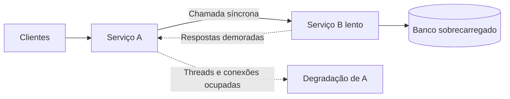
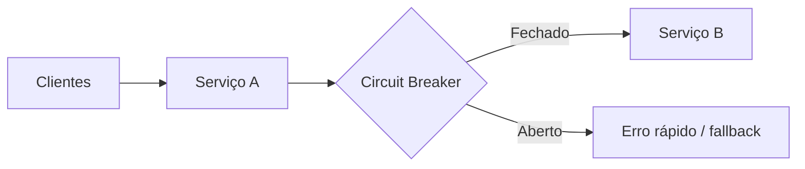
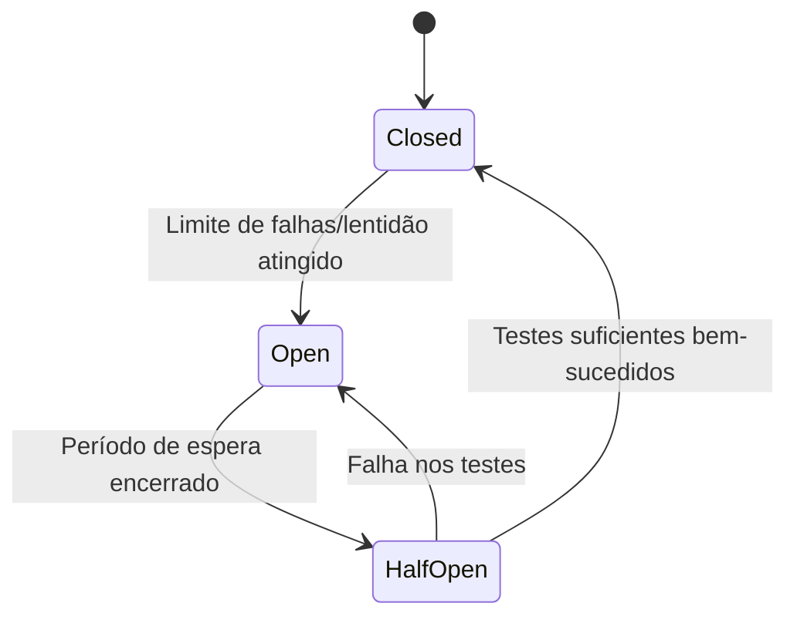

# Aula 03 — Circuit Breaker

**Módulo:** 01 — Fundamentos de Arquitetura de Solução  
**Tema:** 04 — Design Pattern (2)  
**Origem:** Anotações da aula, com exemplos e aprofundamentos autorais.

## Objetivo

Entender como o **Circuit Breaker** protege serviços contra dependências instáveis, evita **falhas em cascata** e permite retomada controlada do tráfego.

## 1. Analogia do disjuntor

Assim como um disjuntor elétrico interrompe um circuito sob condições perigosas, o **Circuit Breaker** impede temporariamente novas chamadas a uma dependência que apresenta falhas ou lentidão excessivas.

Seu objetivo é **falhar rapidamente** (*fail fast*) e preservar recursos do chamador, em vez de insistir indefinidamente em chamadas com baixa chance de sucesso.

> Circuit Breaker não conserta o serviço dependente; ele limita o impacto de sua degradação sobre o restante do sistema.

## 2. Falha lenta versus falha rápida

| Situação | Efeito típico no chamador |
| --- | --- |
| Erro imediato, como *connection refused* | Falha rápida; recursos são liberados mais cedo |
| Timeout longo ou serviço que demora a responder | Threads, conexões e filas podem ficar ocupadas |
| Circuit Breaker aberto | Rejeição imediata ou fallback sem chamada remota |

**Nuance:** nem toda indisponibilidade falha imediatamente; falhas de rede podem levar a timeouts. Da mesma forma, lentidão não significa necessariamente indisponibilidade total. O problema crítico é **consumo prolongado de recursos e propagação da degradação**.

## 3. Efeito cascata em microserviços



Quando B responde lentamente, A acumula chamadas pendentes. Com a chegada contínua de requisições, a lentidão pode afetar também outros consumidores de A.

Com Circuit Breaker:



## 4. Os três estados



### Closed — Fechado

- Chamadas são encaminhadas normalmente;
- O mecanismo monitora métricas como falhas e chamadas lentas;
- Quando critérios configurados são atingidos, o circuito abre.

### Open — Aberto

- Novas chamadas à dependência são bloqueadas;
- O chamador recebe falha rápida ou executa um fallback;
- Após um intervalo de espera, o circuito pode passar a meio aberto.

### Half-Open — Meio aberto

- Um número **limitado** de chamadas de teste é permitido;
- Sucesso suficiente fecha o circuito;
- Novas falhas podem reabri-lo.

**Importante:** o circuito não precisa abrir na primeira falha. Em implementações reais, é comum configurar janela de observação, quantidade mínima de chamadas e limiares de taxa de erro ou de lentidão.

## 5. Self-healing: recuperação gradual

Ao bloquear tráfego para uma dependência degradada, o Circuit Breaker pode ajudar a reduzir pressão e dar tempo para o serviço se recuperar.

**Limite conceitual:** isso **não garante autocura**. Um banco indisponível, uma credencial inválida ou um bug persistente não serão corrigidos apenas pela pausa nas chamadas. A recuperação depende da causa da falha.

O estado **Half-Open** testa a recuperação antes de permitir novamente o fluxo completo.

## 6. Exemplo Java com Resilience4j — complemento autoral

```java
@Service
public class CotacaoService {
    private final CotacaoClient client;

    public CotacaoService(CotacaoClient client) {
        this.client = client;
    }

    @CircuitBreaker(name = "cotacaoExterna", fallbackMethod = "fallback")
    public Cotacao consultar(String moeda) {
        return client.buscarCotacao(moeda);
    }

    private Cotacao fallback(String moeda, Throwable erro) {
        throw new CotacaoIndisponivelException(
            "Cotação temporariamente indisponível", erro
        );
    }
}
```

Configuração ilustrativa:

```yaml
resilience4j:
  circuitbreaker:
    instances:
      cotacaoExterna:
        slidingWindowType: COUNT_BASED
        slidingWindowSize: 20
        minimumNumberOfCalls: 10
        failureRateThreshold: 50
        slowCallRateThreshold: 50
        slowCallDurationThreshold: 2s
        waitDurationInOpenState: 10s
        permittedNumberOfCallsInHalfOpenState: 3
```

**Observações:** o exemplo pressupõe as dependências e a integração Spring do Resilience4j. O método de fallback pode retornar resposta degradada **apenas quando isso for seguro para o negócio**. Para cotações financeiras, por exemplo, inventar um valor seria inadequado; falhar explicitamente pode ser a decisão correta.

## 7. Complementos: Timeout, Retry e Bulkhead

Circuit Breaker não substitui outras técnicas de resiliência:

| Técnica | Problema tratado | Cuidados |
| --- | --- | --- |
| **Timeout** | Limita quanto tempo uma chamada espera | Definir limites coerentes com a operação |
| **Retry** | Reexecuta falhas transitórias | Pode amplificar sobrecarga; usar limites, backoff e jitter |
| **Circuit Breaker** | Interrompe chamadas a dependência degradada | Configurar limiares e recuperação |
| **Bulkhead** | Isola recursos entre grupos de chamadas | Evita que uma dependência consuma toda a capacidade |
| **Rate Limiting** | Controla volume de requisições | Pode proteger receptor e orçamento operacional |

Uma estratégia robusta frequentemente combina essas técnicas, mas **ordem de composição e limites** importam.

## 8. Cliente, proxy e Service Mesh

O Circuit Breaker pode existir em diferentes camadas:

- **Cliente da aplicação:** biblioteca como Resilience4j acompanha falhas por dependência e aplica políticas específicas;
- **Proxy/sidecar:** infraestrutura pode limitar conexões, detectar hosts degradados e aplicar proteção de tráfego;
- **Service Mesh:** centraliza políticas de resiliência entre serviços, conforme capacidades da tecnologia adotada.

**Nuance importante:** nem todo recurso de *outlier detection*, *connection pooling* ou *retry* em proxy equivale exatamente à máquina de estados **Closed / Open / Half-Open** de um Circuit Breaker de biblioteca. É preciso verificar as garantias e a semântica de cada implementação.

## 9. Granularidade e observabilidade

Defina o circuito de acordo com a dependência e a operação: um único circuito para todo um serviço pode bloquear rotas saudáveis devido a falhas em uma rota específica.

Monitore:
- Estado atual e transições do circuito;
- Taxa de erros e de chamadas lentas;
- Chamadas rejeitadas enquanto aberto;
- Tempo de resposta e timeouts;
- Volume de fallback e impacto ao usuário.

**Complemento:** em sistemas com várias instâncias, circuit breakers locais podem estar em estados diferentes. Isso não é necessariamente um erro: cada instância observa seu próprio tráfego.

## 10. Armadilhas

- **Abrir cedo demais:** poucas falhas esporádicas bloqueiam uma dependência saudável;
- **Abrir tarde demais:** a aplicação já acumulou muitas chamadas lentas;
- **Retry agressivo:** aumenta a pressão justamente durante a falha;
- **Fallback enganoso:** devolve dados falsos ou antigos como se fossem atuais;
- **Sem timeout:** chamadas podem continuar presas por muito tempo antes de alimentar as métricas;
- **Half-Open sem limite:** retorno brusco de tráfego pode degradar novamente o serviço.

## 11. Checklist

- [ ] Identifiquei dependências remotas críticas?
- [ ] Defini timeout apropriado?
- [ ] Configurei limiares de erro, lentidão e janela mínima de amostras?
- [ ] Limitei chamadas no estado Half-Open?
- [ ] Tenho fallback seguro ou erro explícito?
- [ ] Evitei retries que amplificam a sobrecarga?
- [ ] Defini granularidade por dependência/operação?
- [ ] Monitoro transições, rejeições e latência?
- [ ] Testei indisponibilidade, lentidão e recuperação?

## 12. Perguntas de revisão

1. Por que uma falha lenta pode causar mais impacto que um erro imediato?
2. O que muda entre os estados Closed, Open e Half-Open?
3. Como o Circuit Breaker ajuda a limitar falhas em cascata?
4. Por que Circuit Breaker não garante self-healing?
5. Qual é a diferença entre Timeout, Retry, Bulkhead e Circuit Breaker?
6. Quando um fallback é mais perigoso do que retornar erro?
7. Por que o comportamento de um proxy não é necessariamente idêntico ao de uma biblioteca Circuit Breaker?
8. O que monitorar para ajustar corretamente os limiares?

## Síntese

> **Circuit Breaker protege o chamador de dependências degradadas ao interromper temporariamente chamadas e testar a recuperação de forma controlada.** Sua eficácia depende de timeout, limiares adequados, observabilidade e fallback seguro.

## Conexões

- [Aula 01 — Configuration](./aula-01-configuration.md)
- [Tema 03 — Microservices Architecture](../tema-03-design-patterns/aula-06-microservices-architecture.md)
- [Tema 03 — Distributed Lock](../tema-03-design-patterns/aula-10-distributed-lock.md)
