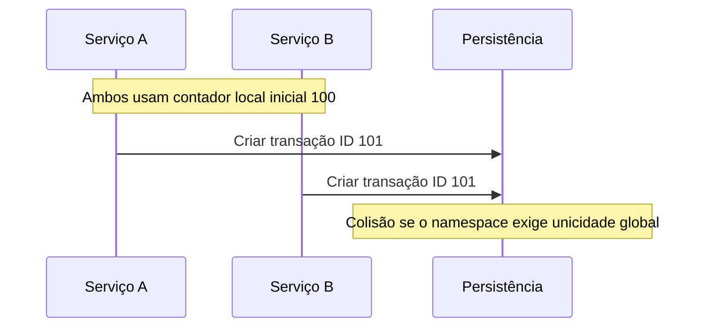
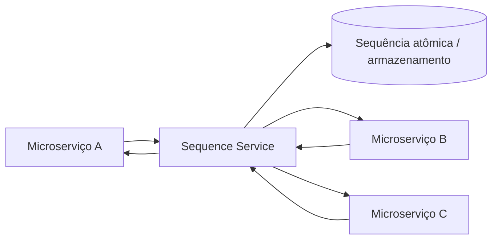
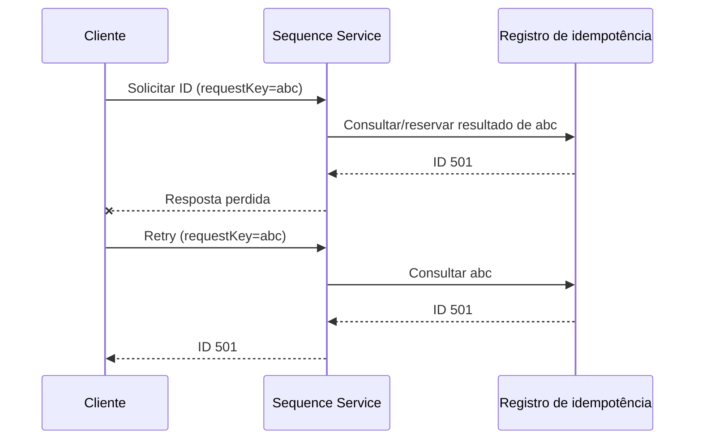

# Aula 04 — Sequencing

**Módulo:** 01 — Fundamentos de Arquitetura de Solução  
**Tema:** 04 — Design Pattern (2)  
**Origem:** Resumo da aula, com exemplos e aprofundamentos técnicos autorais.

## Objetivo

Compreender como gerar **identificadores únicos** sob alta concorrência em sistemas distribuídos, quando um **serviço central de sequencing** faz sentido e quais alternativas podem reduzir o acoplamento e a latência.

## 1. O problema da geração distribuída de IDs

Em um ecossistema de microserviços, várias instâncias podem criar registros simultaneamente. Se cada instância mantém um contador local sem coordenação, duas operações podem receber o mesmo identificador.

**Colisão** significa atribuir um mesmo ID a entidades distintas dentro do **mesmo domínio de unicidade** (por exemplo, duas transações globais). IDs iguais em tabelas ou domínios diferentes não são necessariamente um problema.



**Nuance importante:** UUIDs corretamente gerados já oferecem unicidade probabilística extremamente alta sem coordenador central; não é correto assumir que a escala de microserviços, por si só, torna UUIDs inviáveis. O padrão é particularmente relevante quando existem requisitos de **IDs numéricos, legados, ordenação ou controle centralizado**.

## 2. Serviço central de Sequencing

O serviço de Sequencing oferece uma interface para reservar ou obter identificadores e encapsula o mecanismo de concorrência.



Fluxo:
1. O serviço consumidor solicita um identificador;
2. O gerador realiza uma operação atômica;
3. Retorna o ID reservado;
4. O consumidor utiliza o valor ao criar seu registro.

**Atenção:** centralização simplifica governança, mas adiciona **dependência de rede, latência e possível gargalo ou ponto único de falha**, caso não haja estratégia de alta disponibilidade.

## 3. Atomicidade e concorrência

O requisito central é que duas solicitações concorrentes **não recebam o mesmo ID**.

Um mecanismo simples é uma **sequence de banco**:

```sql
CREATE SEQUENCE transacao_id_seq START WITH 1 INCREMENT BY 1;

SELECT nextval('transacao_id_seq');
```

O exemplo usa sintaxe PostgreSQL. O banco controla a concorrência da sequência, sem que a aplicação implemente um contador com leitura e escrita separadas.

**Nuance:** sequências de banco normalmente **não garantem ausência de lacunas**. Rollbacks, falhas e alocação antecipada de valores podem consumir IDs sem criar registros.

## 4. Exemplo Java/Spring Boot — complemento autoral

Um serviço HTTP pode encapsular a emissão:

```java
@RestController
@RequestMapping("/internal/sequences")
class SequenceController {
    private final JdbcTemplate jdbc;

    SequenceController(JdbcTemplate jdbc) {
        this.jdbc = jdbc;
    }

    @PostMapping("/transactions/next")
    Map<String, Long> nextTransactionId() {
        Long id = jdbc.queryForObject(
            "SELECT nextval('transacao_id_seq')", Long.class
        );
        return Map.of("id", Objects.requireNonNull(id));
    }
}
```

O endpoint é **ilustrativo**: em produção, exige autenticação entre serviços, autorização, rate limiting, monitoramento e gestão de falhas. O código pressupõe PostgreSQL, Spring Web e Spring JDBC configurados.

## 5. A armadilha dos retries

Considere:

1. O cliente solicita um ID;
2. O servidor gera **501**, mas a resposta se perde;
3. O cliente faz retry;
4. O servidor gera **502**.

Não houve colisão: ambos os IDs são únicos. Porém, o cliente pode não saber que o primeiro foi reservado.

**Implicação:** é importante distinguir **unicidade** de **emissão exatamente uma vez**. Para requisitos de rastreabilidade, pode-se usar uma chave de idempotência por solicitação, com armazenamento durável do resultado.



**Nota:** o exemplo exige uma implementação atômica da reserva por chave; apenas receber um campo `requestKey` não torna o endpoint idempotente.

## 6. Rastreabilidade e auditoria

Um serviço central pode registrar metadados como:
- Identidade do serviço solicitante;
- Nome do namespace ou tipo de sequência;
- Horário e identificador de correlação;
- Resultado, erro e duração da chamada.

**Trade-off:** registrar cada ID individualmente pode gerar enorme volume de escrita. Quando a auditoria exata não é requisito, métricas agregadas e tracing podem ser mais econômicos. Nunca confundir log de emissão com prova de que a transação de negócio foi concluída.

## 7. Estratégias alternativas de geração de IDs

| Estratégia | Unicidade | Ordenação | Trade-off principal |
| --- | --- | --- | --- |
| **Sequence/identity do banco** | Garantida no escopo configurado | Geralmente crescente por alocação | Dependência do banco; lacunas possíveis |
| **Serviço central de sequencing** | Depende de gerador atômico e namespace | Pode emitir números crescentes | Chamada remota e disponibilidade |
| **UUID v4** | Probabilística, com colisão extremamente improvável | Não é ordenado temporalmente | Tamanho e distribuição de índices |
| **UUID v7** | Probabilística, com componente temporal | Aproximadamente ordenável por tempo | Não garante sequência estrita global |
| **Snowflake-like IDs** | Depende de configuração correta de worker, tempo e contador | Aproximadamente ordenável | Clock skew, IDs de worker e coordenação |
| **Alocação de blocos (hi/lo)** | Depende de reserva atômica de faixas | Não garante ordem global de criação | Lacunas e complexidade de alocação |

**Correção conceitual:** não é obrigatório ter um serviço central para gerar IDs únicos em sistemas distribuídos. A arquitetura deve partir dos requisitos de **unicidade, ordenação, formato, disponibilidade e volume**.

## 8. Sequência crescente não significa ordem de negócio

Mesmo que o ID **100** seja emitido antes do **101**, a transação associada a 101 pode ser confirmada primeiro.

Logo:
- **ID único** não implica **ID sem lacunas**;
- **ID crescente na emissão** não implica **ordem de commit**;
- **ID ordenável** não equivale a **relógio global confiável**.

Se o domínio exige numeração fiscal contínua, ordenação estrita ou trilha contábil, pode ser necessária uma solução especializada e regras de negócio adicionais.

## 9. Desempenho e escalabilidade

Possíveis otimizações:
- Reservar **blocos de IDs** para reduzir chamadas remotas;
- Usar geradores distribuídos quando a unicidade global não exige serialização central;
- Monitorar latência p95/p99, throughput e taxa de erro;
- Projetar alta disponibilidade e recuperação do armazenamento;
- Dimensionar namespaces para evitar contenção desnecessária.

**Trade-off de blocos:** se uma instância reservar IDs 100–199 e falhar após usar 100–105, os demais números podem nunca aparecer.

## 10. Checklist arquitetural

- [ ] Qual é o escopo de unicidade (tabela, serviço, organização ou global)?
- [ ] O identificador precisa ser numérico ou pode ser UUID?
- [ ] É necessário ordenação temporal, ordem estrita ou ausência de lacunas?
- [ ] Qual é o throughput e a latência tolerável?
- [ ] O gerador é atômico sob concorrência?
- [ ] Existe estratégia para falhas, retries e idempotência?
- [ ] O serviço central introduz gargalo ou dependência crítica?
- [ ] Há observabilidade e auditoria proporcionais ao requisito?
- [ ] O banco mantém restrições de unicidade como defesa adicional?

## 11. Perguntas de revisão

1. O que é colisão de IDs e em qual escopo ela importa?
2. Por que contadores locais independentes podem colidir?
3. Como uma sequence de banco preserva unicidade sob concorrência?
4. Por que uma sequência pode apresentar lacunas?
5. O que acontece quando a resposta de um ID gerado se perde?
6. Qual é a diferença entre unicidade e ordenação estrita?
7. Quando UUID v7 ou Snowflake-like IDs podem substituir um serviço central?
8. Como alocação de blocos melhora throughput e quais são seus custos?

## Síntese

> **Sequencing encapsula a emissão coordenada de identificadores quando o domínio exige controle centralizado, mas unicidade distribuída não depende necessariamente de centralização.** Escolha a estratégia conforme requisitos reais de formato, ordenação, disponibilidade e escala.

## Conexões

- [Aula 03 — Circuit Breaker](./aula-03-circuit-breaker.md)
- [Tema 03 — Distributed Lock](../tema-03-design-patterns/aula-10-distributed-lock.md)
- [Tema 03 — Microservices Architecture](../tema-03-design-patterns/aula-06-microservices-architecture.md)
