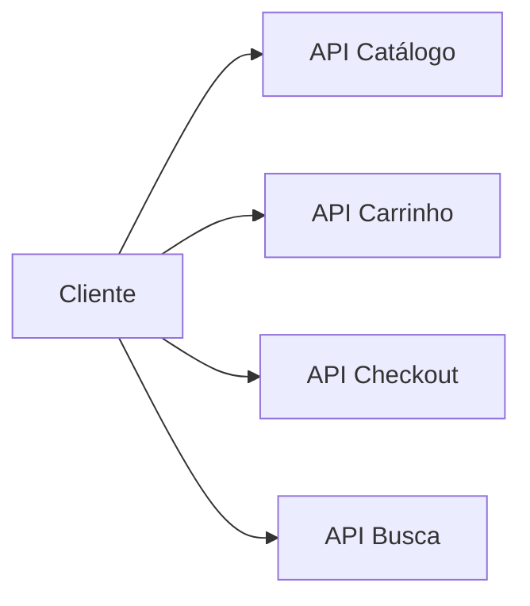
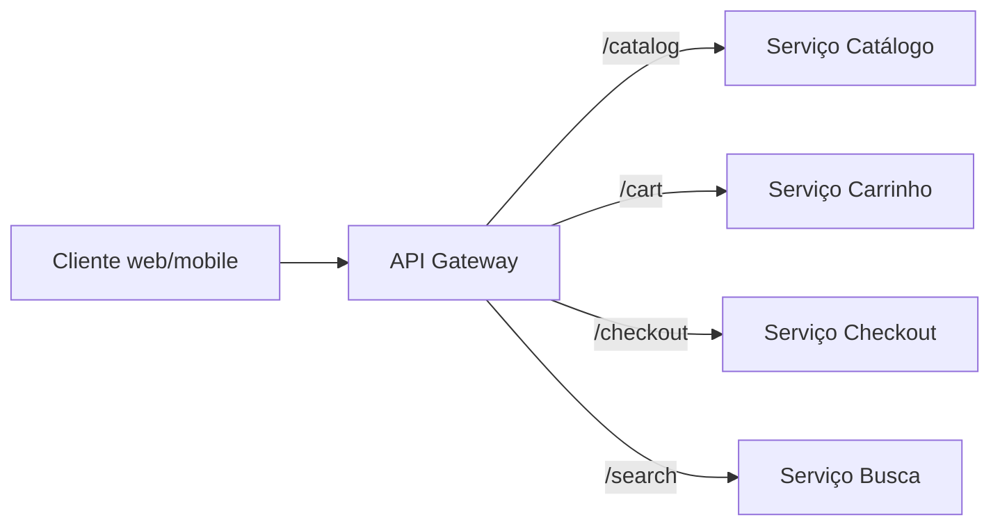
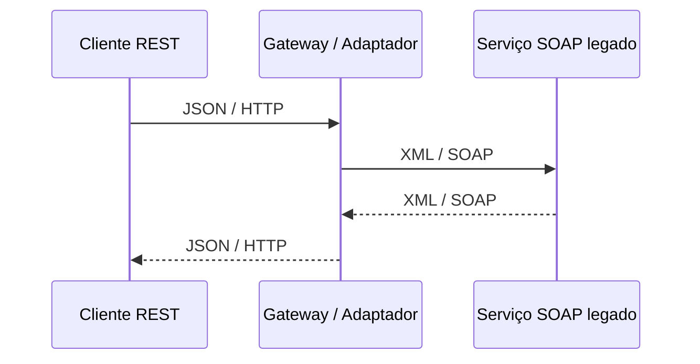

# Aula 05 — API Gateway

**Módulo:** 01 — Fundamentos de Arquitetura de Solução  
**Tema:** 04 — Design Pattern (2)  
**Origem:** Resumo da aula, com exemplos, ressalvas e aprofundamentos autorais.

## Objetivo

Entender o **API Gateway** como ponto de entrada para APIs, responsável por roteamento e políticas transversais na borda, além de reconhecer seus trade-offs de segurança, disponibilidade, desempenho e acoplamento.

## 1. O problema: múltiplos serviços expostos

Sem uma camada de entrada, clientes podem precisar conhecer endpoints diferentes para catálogo, carrinho, busca e checkout. Isso aumenta a complexidade dos consumidores e acopla a interface pública à implantação interna.



O gateway oferece uma **entrada lógica unificada**:



**Nuance:** uma entrada lógica única não significa necessariamente uma única máquina. Gateways de produção normalmente precisam de múltiplas instâncias e balanceamento para evitar ponto único de falha.

## 2. Roteamento por regras

O gateway decide o destino conforme caminho, método HTTP, host, cabeçalhos ou outras condições.

| Requisição pública | Destino interno |
| --- | --- |
| `GET /catalog/products` | Serviço de catálogo |
| `POST /cart/items` | Serviço de carrinho |
| `POST /checkout` | Serviço de checkout |
| `GET /search?q=...` | Serviço de busca |

O consumidor não precisa conhecer IPs, portas ou a descoberta interna dos serviços.

## 3. Autenticação e autorização

O gateway pode validar tokens, chaves de API ou políticas de acesso **antes de encaminhar** a chamada. Isso reduz duplicação de verificações na borda.

**Atenção de segurança:** autenticação centralizada **não dispensa autorização no serviço de destino**. O microserviço ainda precisa verificar permissões de negócio e escopo do usuário ou serviço (por exemplo, se um cliente pode acessar determinado pedido). Redes internas não devem ser consideradas confiáveis por padrão.

Também é importante:
- Proteger o tráfego gateway → serviços, conforme a arquitetura;
- Não confiar em cabeçalhos de identidade enviados diretamente pelo cliente;
- Remover ou sobrescrever cabeçalhos sensíveis antes de encaminhar;
- Aplicar menor privilégio às identidades dos componentes.

## 4. Transformação de mensagens e protocolos

Um gateway pode adaptar requisições e respostas: reescrever caminhos, ajustar cabeçalhos e, em alguns produtos, transformar payloads.

Exemplo de modernização de legado:



**Nuance:** conversão completa REST/JSON ↔ SOAP/XML não é capacidade universal de qualquer gateway; pode exigir plugin, integração especializada ou um **serviço adaptador**. Evite concentrar regras de negócio complexas nessa camada.

## 5. Cabeçalhos, correlation ID e tracing

O gateway pode criar ou propagar um **correlation ID** para relacionar logs de uma mesma operação entre serviços.

Exemplo:

```http
GET /checkout/orders/123 HTTP/1.1
X-Correlation-ID: 4f67a1c2-...
```

**Complemento:** para tracing distribuído, prefira propagação padronizada como **W3C Trace Context** (`traceparent`, `tracestate`) e integração com OpenTelemetry. Correlation ID e trace ID são conceitos relacionados, mas não necessariamente idênticos.

Não confie cegamente em IDs recebidos de fontes externas: valide formato e limites e defina política de propagação.

## 6. Throttling e rate limiting

Os termos são próximos, mas há uma distinção útil:

| Técnica | Comportamento possível |
| --- | --- |
| **Rate limiting** | Impõe um limite de chamadas por consumidor/rota/janela; pode rejeitar excedentes |
| **Throttling** | Controla o ritmo de entrada ou processamento; pode atrasar, enfileirar ou rejeitar |

Exemplo: um plano permite **100 requisições por segundo** por cliente. Quando excedido, a API pode responder **HTTP 429 Too Many Requests**, eventualmente com `Retry-After`.

**Nuance:** enfileirar requisições indefinidamente pode piorar latência e consumir memória. Limites de fila, timeouts e política de rejeição são necessários.

## 7. Priorização de clientes e cotas

Políticas podem variar por:
- Identidade autenticada ou chave de API;
- Plano contratado ou nível de serviço;
- Endpoint e custo da operação;
- Região, organização (*tenant*) ou origem de tráfego.

**Cuidado:** limitar apenas por IP pode prejudicar usuários legítimos atrás de NAT/proxy e é insuficiente para proteger APIs autenticadas. Também é preciso pensar em **limites globais** quando há várias réplicas do gateway.

## 8. Plugins e extensibilidade

Gateways frequentemente suportam plugins ou integrações para autenticação, métricas, transformação e execução de políticas. Alguns produtos podem encaminhar eventos para funções serverless, como AWS Lambda.

**Princípio de design:** mantenha a lógica de negócio no serviço responsável. O gateway deve concentrar políticas de borda, não se transformar em um monólito de regras de domínio.

## 9. Exemplo de configuração — Spring Cloud Gateway

**Complemento autoral:** exemplo ilustrativo de rotas com Spring Cloud Gateway.

```yaml
spring:
  cloud:
    gateway:
      routes:
        - id: catalogo
          uri: http://catalog-service:8080
          predicates:
            - Path=/catalog/**
        - id: checkout
          uri: http://checkout-service:8080
          predicates:
            - Path=/checkout/**
```

A sintaxe e a localização das propriedades dependem da **versão e da variante do Spring Cloud Gateway** adotada. O exemplo demonstra roteamento e **não configura** autenticação, resiliência ou descoberta de serviços.

## 10. API Gateway vs. Load Balancer vs. Reverse Proxy

| Componente | Papel principal |
| --- | --- |
| **Load Balancer** | Distribuir tráfego entre instâncias |
| **Reverse Proxy** | Receber chamadas em nome de servidores internos |
| **API Gateway** | Aplicar roteamento e políticas específicas de APIs |
| **Service Mesh** | Gerenciar comunicação **entre serviços**, frequentemente com proxies e políticas internas |

As funções podem se sobrepor em produtos reais. Uma arquitetura pode combinar load balancer na borda, API Gateway para tráfego externo e Service Mesh para comunicação interna.

## 11. Trade-offs arquiteturais

**Benefícios**
- Interface pública estável;
- Menor exposição da topologia interna;
- Políticas transversais centralizadas;
- Controle de tráfego e observabilidade;
- Evolução de serviços sem alterar todos os consumidores.

**Riscos e custos**
- Latência adicional por salto de rede;
- Gargalo ou ponto único de falha se mal dimensionado;
- Dependência operacional crítica;
- Regras excessivas concentradas no gateway;
- Políticas incorretas com impacto em várias APIs.

O gateway **não torna os serviços internos automaticamente seguros**; segmentação de rede, autenticação entre serviços e autorização continuam necessárias.

## 12. Soluções de mercado

Exemplos citados na aula:
- **Amazon API Gateway** — serviço gerenciado da AWS;
- **Kong** — plataforma de API gateway;
- **Sensedia** — plataforma de gerenciamento de APIs;
- **MuleSoft** — plataforma de integração e gestão de APIs.

A escolha deve considerar autenticação, políticas, observabilidade, operação, custo, integração e necessidade de transformação.

## 13. Checklist

- [ ] As rotas públicas estão desacopladas dos endereços internos?
- [ ] O gateway tem alta disponibilidade e capacidade dimensionada?
- [ ] Autenticação de borda e autorização de negócio estão bem separadas?
- [ ] Cabeçalhos de identidade e rastreabilidade são validados?
- [ ] Há limites por cliente, rota e custo da operação?
- [ ] Timeouts e respostas de erro são consistentes?
- [ ] Logs, métricas e tracing permitem acompanhar requisições?
- [ ] Transformações complexas foram mantidas fora da borda quando apropriado?
- [ ] Existe estratégia para falhas e mudanças de configuração?

## 14. Perguntas de revisão

1. Por que expor cada microserviço diretamente aumenta o acoplamento do cliente?
2. Como o gateway roteia `/cart` e `/checkout` para destinos diferentes?
3. Por que autenticar no gateway não elimina autorização no serviço?
4. Qual a diferença prática entre rate limiting e throttling?
5. Como um correlation ID se relaciona com `traceparent`?
6. Em que cenário um adaptador dedicado é melhor que converter SOAP no gateway?
7. Quais são os riscos de tornar o gateway um ponto único de entrada?
8. Como API Gateway, reverse proxy, load balancer e Service Mesh se relacionam?

## Síntese

> **API Gateway centraliza a entrada e as políticas transversais de APIs**, simplificando o acesso externo a sistemas distribuídos. O ganho vem acompanhado de responsabilidade por segurança, disponibilidade, latência e governança da borda.

## Conexões

- [Aula 03 — Circuit Breaker](./aula-03-circuit-breaker.md)
- [Aula 01 — Configuration](./aula-01-configuration.md)
- [Tema 03 — Microservices Architecture](../tema-03-design-patterns/aula-06-microservices-architecture.md)
