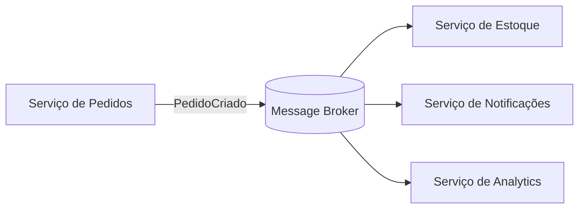
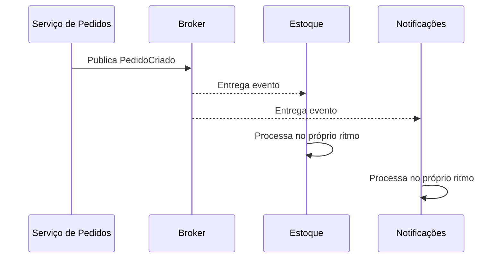
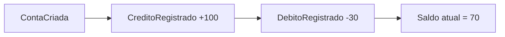
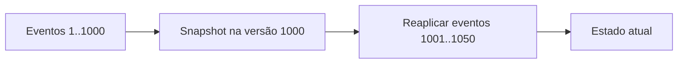
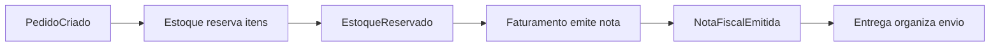
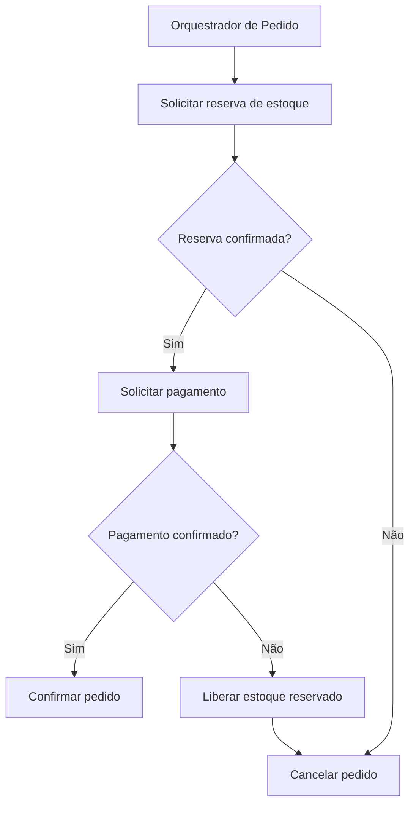
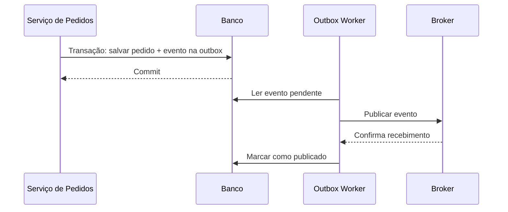

# Aula 06 — Arquitetura Baseada em Eventos

**Módulo:** 01 — Fundamentos de Arquitetura de Solução  
**Tema:** 04 — Design Pattern (2)  
**Origem:** Resumo da aula, complementado com exemplos e considerações arquiteturais autorais.

## Objetivo

Compreender **Event-Driven Architecture (EDA)**, a diferença entre notificação, transferência de estado e Event Sourcing, além de **coreografia**, **orquestração** e **compensações** em processos distribuídos.

## 1. O que é arquitetura baseada em eventos?

Em uma arquitetura baseada em eventos, componentes publicam fatos relevantes e outros componentes reagem a eles, frequentemente de maneira assíncrona.



**Benefício central:** o produtor não precisa conhecer todos os consumidores nem esperar que todos concluam seu processamento. Isso reduz o **acoplamento temporal**.

**Nuance:** EDA não elimina dependências de negócio nem garante consistência imediata. O produtor e os consumidores continuam vinculados ao **contrato do evento** e às expectativas sobre o que o fato significa.

## 2. Evento é um fato, não uma ordem

Eventos normalmente expressam algo que **já aconteceu**:
- `PedidoCriado`
- `PagamentoAprovado`
- `EstoqueReservado`
- `NotaFiscalEmitida`

Uma mensagem como `ReservarEstoque` é melhor descrita como **comando**, pois solicita que uma ação aconteça.

| Mensagem | Natureza | Significado |
| --- | --- | --- |
| `PagamentoAprovado` | Evento | Pagamento já foi aprovado |
| `AprovarPagamento` | Comando | Solicita avaliação/aprovação |
| `EstoqueReservado` | Evento | Reserva já foi confirmada |
| `ReservarEstoque` | Comando | Solicita reserva |

**Correção importante para o fluxo de compra:** `PedidoCriado` não significa automaticamente `CompraConcluida`. O nome do evento precisa refletir o fato efetivamente confirmado.

## 3. Papel do message broker

O **broker** intermedeia a distribuição de mensagens entre produtores e consumidores.



Exemplos de tecnologias: **Apache Kafka**, **RabbitMQ**, **Amazon SNS/SQS** e **Amazon EventBridge**. Cada uma tem modelos distintos de retenção, roteamento, entrega e consumo.

**Nuance:** o broker não garante, por si só, entrega exatamente uma vez no efeito de negócio. É necessário projetar idempotência, tratamento de duplicatas e recuperação.

## 4. Event Notification

**Event Notification** informa que um fato ocorreu, geralmente com payload pequeno.

```json
{
  "eventId": "evt-123",
  "type": "PedidoStatusAlterado",
  "pedidoId": 1,
  "status": "APROVADO"
}
```

**Vantagens:** menor payload, menos dados expostos e contrato mais simples.

**Trade-off:** o consumidor pode precisar consultar o produtor para obter detalhes, criando uma dependência adicional. Eventos pequenos **podem ser persistidos e auditados**; não existe regra de que precisem ser descartados após o consumo.

## 5. Event-Carried State Transfer

**Event-Carried State Transfer** transporta informações suficientes para o consumidor atualizar seu próprio modelo sem consultar imediatamente o produtor.

```json
{
  "eventId": "evt-124",
  "type": "PedidoConfirmado",
  "pedidoId": 1,
  "clienteId": 55,
  "itens": [
    { "produtoId": 7, "quantidade": 2, "precoUnitario": 49.90 }
  ],
  "total": 99.80
}
```

**Vantagens:** autonomia do consumidor e menos consultas síncronas.

**Trade-offs:** payload maior, versionamento de contratos, dados potencialmente desatualizados e cuidados com privacidade. Compartilhe apenas o estado necessário, evitando replicar informações sensíveis sem justificativa.

## 6. Event Sourcing: eventos como fonte de verdade

**Event Sourcing** persiste eventos de domínio que descrevem a evolução de um agregado. O estado atual pode ser reconstruído aplicando os eventos em ordem.



Um exemplo de reconstrução:

```java
BigDecimal saldo = BigDecimal.ZERO;

for (EventoConta evento : eventosOrdenados) {
    if (evento instanceof CreditoRegistrado credito) {
        saldo = saldo.add(credito.valor());
    } else if (evento instanceof DebitoRegistrado debito) {
        saldo = saldo.subtract(debito.valor());
    }
}
```

O código é **didático**: pressupõe eventos válidos e ordenados, e não representa um ledger financeiro completo.

**Distinção essencial:** publicar eventos em um broker **não significa adotar Event Sourcing**. Um sistema pode usar EDA com banco de estado atual e sem event store. Event Sourcing exige persistir o histórico como fonte primária do estado do agregado.

## 7. Deltas, ordenação e evolução de eventos

Um evento pode descrever uma **mudança** (por exemplo, `SaldoDebitado(30)`) ou carregar informações relevantes de um estado. Event Sourcing não exige que todos os eventos sejam deltas matemáticos; o importante é representar fatos de domínio suficientes para reconstruir o agregado.

Cuidados:
- Preservar a **ordem por agregado** quando necessária;
- Usar **versão do agregado** para controlar concorrência;
- Evoluir schemas sem invalidar consumidores antigos;
- Evitar modificar retroativamente eventos históricos;
- Planejar migração/upcasting quando contratos evoluírem.

## 8. Snapshots e reprocessamento

Reexecutar milhões de eventos para reconstruir uma entidade pode ser custoso. Um **snapshot** guarda um estado intermediário e sua versão:



O snapshot acelera reconstruções, mas **não substitui** o histórico quando este é a fonte de verdade.

**Nuance:** reprocessar eventos pode disparar efeitos colaterais indesejados (enviar e-mails, cobrar novamente). Diferencie **reconstrução de projeções** de **reexecução de integrações externas**.

## 9. Coreografia: coordenação distribuída

Na **coreografia**, cada serviço reage a eventos e publica novos fatos, sem um coordenador central comandando todo o fluxo.



**Vantagens:** autonomia, baixo acoplamento direto e facilidade de adicionar consumidores.

**Riscos:** lógica de negócio espalhada, fluxos difíceis de visualizar, dependências indiretas e maior complexidade de investigação de incidentes.

## 10. Orquestração: coordenação explícita

Na **orquestração**, um componente acompanha o processo e decide quais passos executar, como lidar com erros e quando compensar.



**Vantagens:** fluxo mais explícito, controle de estados, timeouts e políticas de compensação.

**Trade-off:** o orquestrador adiciona uma responsabilidade central e precisa ser confiável, observável e recuperável.

## 11. Saga e compensações

Uma **Saga** coordena uma sequência de transações locais, usando **ações compensatórias** quando uma etapa posterior falha.

Exemplo:
1. Reservar estoque;
2. Autorizar pagamento;
3. Emitir nota;
4. Se houver falha, avaliar estorno, cancelamento ou correção conforme o estágio.

**Compensação não é rollback ACID distribuído.** Uma cobrança estornada ainda pode aparecer no histórico; uma nota fiscal emitida pode exigir procedimento fiscal específico de cancelamento. Algumas ações não são totalmente reversíveis e exigem tratamento de negócio.

Sagas podem ser implementadas com **coreografia ou orquestração**; não são sinônimo exclusivo de nenhuma delas.

## 12. Confiabilidade de entrega: Outbox, idempotência e DLQ

Um problema clássico é atualizar o banco e falhar antes de publicar o evento.



O **Transactional Outbox** evita a lacuna entre commit da entidade e registro da intenção de publicar, desde que ambos estejam na mesma transação local.

Ainda assim, pode haver **publicação duplicada**. Por isso:
- Consumidores devem ser **idempotentes**;
- Mensagens podem precisar de **retry com backoff**;
- Falhas persistentes podem ir para uma **DLQ** (*Dead Letter Queue*), conforme o broker;
- É necessário monitorar eventos pendentes e atrasos.

## 13. Consistência eventual e observabilidade

Em fluxos assíncronos, consumidores podem observar o estado novo **em momentos diferentes**. Esse é um exemplo de **consistência eventual**.

Defina:
- O que o usuário vê enquanto o pedido está `PROCESSANDO`;
- Qual atraso é aceitável;
- Como detectar eventos presos ou não processados;
- Como correlacionar `eventId`, `pedidoId` e `traceId`;
- Como recuperar o fluxo após falhas.

**Importante:** eventos são contratos públicos para seus consumidores. Schema, semântica, versionamento e compatibilidade devem ser tratados como parte da arquitetura.

## 14. Comparação das abordagens

| Conceito | Pergunta principal | Característica |
| --- | --- | --- |
| **Event Notification** | O que aconteceu? | Notificação enxuta |
| **Event-Carried State Transfer** | Que dados do fato preciso consumir? | Carrega estado relevante |
| **Event Sourcing** | Como reconstruir o estado a partir da história? | Histórico de eventos como fonte de verdade |
| **Coreografia** | Quem reage ao evento? | Coordenação distribuída |
| **Orquestração** | Quem decide o próximo passo? | Coordenador explícito |
| **Saga** | Como manter o processo coerente após falhas? | Transações locais e compensações |

## 15. Checklist arquitetural

- [ ] Eventos representam fatos já confirmados?
- [ ] Produtores e consumidores compartilham contratos versionados?
- [ ] O modelo de entrega e ordenação do broker está compreendido?
- [ ] Existe idempotência para mensagens repetidas?
- [ ] Publicação confiável foi considerada (ex.: outbox)?
- [ ] Falhas, retries e DLQ têm tratamento operacional?
- [ ] Consistência eventual e estados intermediários são aceitáveis ao negócio?
- [ ] Reprocessamento não repete efeitos externos indevidos?
- [ ] Coreografia ou orquestração foi escolhida conforme complexidade do fluxo?
- [ ] Compensações respeitam limites reais do domínio?

## 16. Perguntas de revisão

1. Por que um evento deve representar algo que já aconteceu?
2. Qual a diferença entre `PedidoCriado` e `CriarPedido`?
3. O que muda entre Event Notification e Event-Carried State Transfer?
4. Publicar eventos em Kafka significa necessariamente usar Event Sourcing?
5. Para que servem snapshots em um event store?
6. Qual o risco de reprocessar eventos que enviam e-mails ou cobram clientes?
7. Quais são as diferenças entre coreografia, orquestração e Saga?
8. Por que compensar uma transação não equivale a apagá-la?
9. Como Outbox e idempotência se complementam?
10. O que significa consistência eventual para a experiência do usuário?

## Síntese

> **Arquitetura baseada em eventos desacopla produtores e consumidores no tempo e favorece fluxos assíncronos, mas exige contratos claros, tolerância a duplicatas, observabilidade e estratégias explícitas de consistência e recuperação.**

## Conexões

- [Tema 03 — Microservices Architecture](../tema-03-design-patterns/aula-06-microservices-architecture.md)
- [Tema 03 — CQRS](../tema-03-design-patterns/aula-07-cqrs.md)
- [Aula 03 — Circuit Breaker](./aula-03-circuit-breaker.md)
