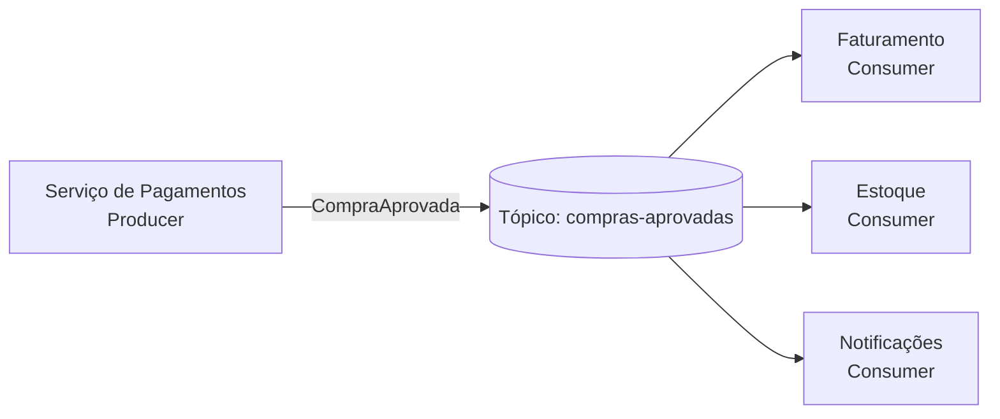
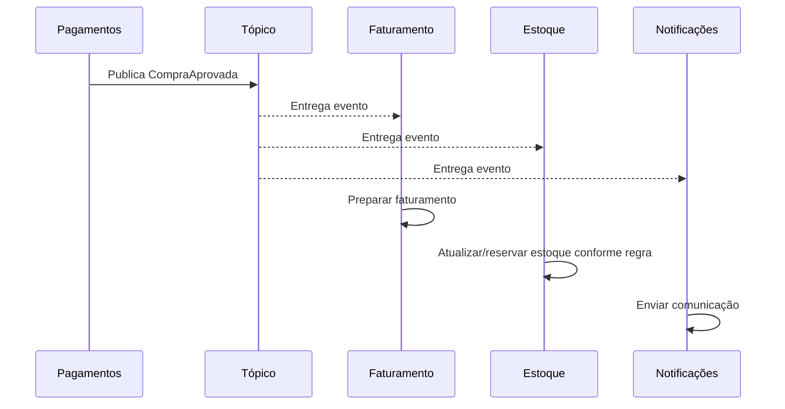
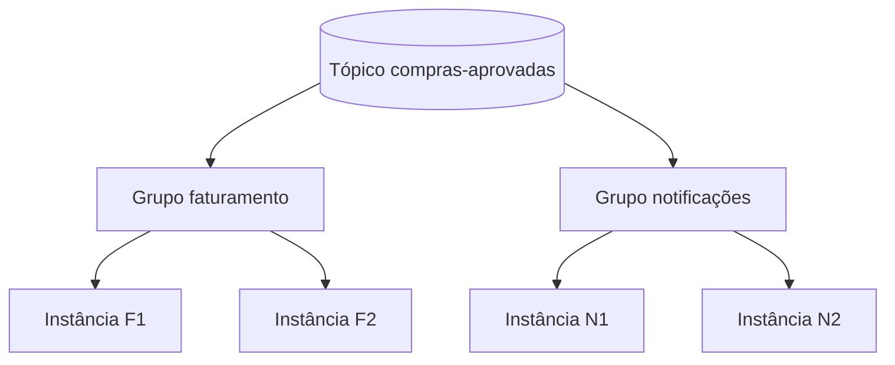
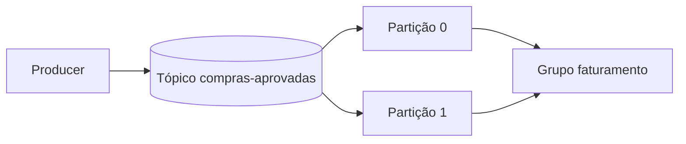
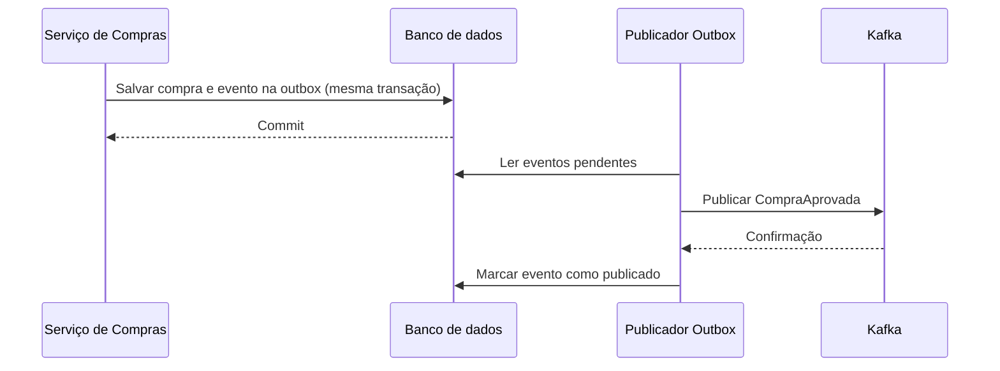

# Aula 07 — Publish/Subscribe (Pub/Sub)

**Módulo:** 01 — Fundamentos de Arquitetura de Solução  
**Tema:** 04 — Design Pattern (2)  
**Origem:** Resumo da aula, com aprofundamentos e exemplos autorais.

## Objetivo

Compreender o padrão **Publish/Subscribe (Pub/Sub)**, o papel de **producer**, **topic** e **consumer**, como distribuir um evento a múltiplos sistemas e quais garantias e limitações dependem do broker escolhido.

## 1. O que é Pub/Sub?

**Publish/Subscribe** é um padrão de comunicação em que o produtor publica uma mensagem em um canal lógico e os interessados recebem essa mensagem por meio de assinaturas ou mecanismos equivalentes de consumo.

O produtor não precisa conhecer os destinatários nem chamar cada um diretamente.



**Benefício central:** desacoplamento entre quem publica o fato e os sistemas que reagem a ele.

**Nuance:** o produtor publica uma vez *logicamente*, mas o broker pode replicar, armazenar ou entregar múltiplas cópias conforme sua implementação. Não se deve presumir entrega exatamente uma vez aos efeitos de negócio.

## 2. Componentes

| Componente | Responsabilidade |
| --- | --- |
| **Producer** | Produz e publica a mensagem |
| **Topic** | Organiza o canal lógico de publicação |
| **Consumer / Subscriber** | Recebe ou lê mensagens de interesse |
| **Broker** | Gerencia armazenamento, roteamento ou distribuição conforme o produto |
| **Subscription / Consumer group** | Define como mensagens são distribuídas entre instâncias ou grupos de consumidores |

### Producer

Um serviço publica `CompraAprovada` sem conhecer o faturamento, estoque ou notificações. A responsabilidade do produtor é produzir um evento correto e publicá-lo de forma confiável.

**Nuance:** enviar ao broker não significa necessariamente que o evento já foi persistido com sucesso. O produtor deve observar confirmações de publicação e tratar falhas.

### Topic

O tópico é o canal lógico que organiza mensagens relacionadas. Pode ter partições, retenção, regras de assinatura e políticas de acesso, dependendo da tecnologia.

### Consumer

Cada sistema interessado processa o evento conforme sua responsabilidade. Por exemplo, faturamento emite a nota e notificações envia uma confirmação.

**Nuance de domínio:** o evento `CompraAprovada` só deve ser emitido quando a aprovação realmente aconteceu; reserva ou baixa de estoque pode exigir regras adicionais para evitar vender produtos indisponíveis.

## 3. Exemplo: uma compra, múltiplos processamentos



Os consumidores podem processar em ritmos diferentes. Isso cria **consistência eventual** entre seus resultados, não uma transação atômica envolvendo todos eles.

## 4. Pub/Sub vs. fila de trabalho

Uma distinção importante:

- **Pub/Sub:** a mesma mensagem pode ser entregue a **múltiplas assinaturas independentes**, cada uma representando um processamento diferente.
- **Work queue / competing consumers:** várias instâncias concorrem para processar uma mensagem de um mesmo grupo, e o objetivo é distribuir a carga, não repetir o trabalho em todas as instâncias.



**No Kafka**, consumidores com o **mesmo `group.id`** compartilham as partições do tópico; grupos diferentes podem consumir independentemente o mesmo evento. Dentro de um grupo, cada partição é atribuída a no máximo um consumidor ativo por vez.

## 5. Kafka: tópicos, partições e offsets

Kafka é um exemplo de plataforma que permite implementar Pub/Sub por meio de tópicos e grupos de consumidores.



Conceitos fundamentais:

- **Partition:** unidade de paralelismo e ordenação local;
- **Offset:** posição de um registro dentro de uma partição;
- **Consumer group:** conjunto de consumidores que compartilha a leitura das partições;
- **Retention:** política de preservação dos registros, mesmo depois de consumidos, conforme configuração.

**Correção importante:** Kafka não garante uma ordem global única entre todas as partições. A ordem é preservada **dentro de cada partição**. Quando a ordem por compra importa, uma estratégia é usar `compraId` como chave de particionamento.

## 6. Exemplo de evento JSON

```json
{
  "eventId": "c0e4b5f0-7f29-4f43-b919-7a381b5d4518",
  "eventType": "CompraAprovada",
  "eventVersion": 1,
  "compraId": "cmp-1024",
  "occurredAt": "2026-10-27T14:00:00Z",
  "total": 159.90,
  "currency": "BRL"
}
```

O contrato deve ser estável e versionado. Inclua somente dados necessários; evite transportar informações pessoais ou credenciais sem necessidade.

## 7. Exemplo Java com Spring Kafka

**Complemento autoral:** implementação simplificada de produtor e consumidor.

### Producer

```java
@Service
public class CompraEventPublisher {
    private final KafkaTemplate<String, CompraAprovadaEvent> kafka;

    public CompraEventPublisher(
        KafkaTemplate<String, CompraAprovadaEvent> kafka
    ) {
        this.kafka = kafka;
    }

    public void publicar(CompraAprovadaEvent evento) {
        kafka.send("compras-aprovadas", evento.compraId(), evento);
    }
}
```

### Consumer de faturamento

```java
@Component
public class FaturamentoConsumer {
    private final FaturamentoService faturamento;

    public FaturamentoConsumer(FaturamentoService faturamento) {
        this.faturamento = faturamento;
    }

    @KafkaListener(
        topics = "compras-aprovadas",
        groupId = "faturamento"
    )
    public void processar(CompraAprovadaEvent evento) {
        faturamento.processarCompraAprovada(evento);
    }
}
```

### Consumer de notificações

```java
@Component
public class NotificacaoConsumer {
    private final NotificacaoService notificacoes;

    public NotificacaoConsumer(NotificacaoService notificacoes) {
        this.notificacoes = notificacoes;
    }

    @KafkaListener(
        topics = "compras-aprovadas",
        groupId = "notificacoes"
    )
    public void processar(CompraAprovadaEvent evento) {
        notificacoes.notificarCompraAprovada(evento);
    }
}
```

Os exemplos pressupõem Spring Kafka, serialização/deserialização JSON e os tipos de domínio configurados. Em produção, é preciso tratar confirmação de publicação, exceções, retries, idempotência e observabilidade.

## 8. Entrega, duplicidade e idempotência

O broker pode reenviar uma mensagem se o consumidor processou o evento, mas falhou antes de confirmar o consumo.

Exemplo:
1. Faturamento recebe `CompraAprovada`;
2. Registra a operação no banco;
3. Falha antes de confirmar o offset;
4. Recebe o evento novamente após reiniciar.

Sem proteção, o serviço pode faturar duas vezes.

**Solução comum:** persistir `eventId` processado com uma restrição de unicidade e executar a alteração de negócio na **mesma transação local**, quando possível.

```sql
CREATE TABLE processed_events (
    consumer_name VARCHAR(100) NOT NULL,
    event_id VARCHAR(100) NOT NULL,
    processed_at TIMESTAMP NOT NULL DEFAULT CURRENT_TIMESTAMP,
    PRIMARY KEY (consumer_name, event_id)
);
```

**Nuance:** garantias *exactly-once* do Kafka para determinadas operações de leitura/escrita no próprio Kafka **não tornam automaticamente exatamente uma vez** efeitos externos como pagamentos, envio de e-mails ou gravações em outro banco.

## 9. Publicação confiável com Transactional Outbox

Se o produtor salva uma compra no banco e publica o evento em operações separadas, uma falha entre elas pode deixar o sistema inconsistente.



**Transactional Outbox** torna durável a intenção de publicar junto à alteração de negócio, mas ainda pode gerar publicações duplicadas. Por isso, **outbox e idempotência são complementares**.

## 10. Retenção, replay e DLQ

- **Retenção:** define por quanto tempo o broker mantém mensagens;
- **Replay:** permite reler eventos armazenados, conforme offsets e retenção;
- **Retry:** repete processamento após falhas transitórias;
- **Dead Letter Topic/Queue (DLT/DLQ):** separa mensagens que não puderam ser processadas após tentativas configuradas.

**Nuance:** não existe garantia universal de replay em qualquer implementação de Pub/Sub. Em Kafka, replay depende da retenção e da posição de consumo; em outros brokers, mensagens podem ser removidas após confirmação.

## 11. Trade-offs arquiteturais

| Benefícios | Custos e riscos |
| --- | --- |
| Baixo acoplamento direto | Consistência eventual |
| Novos consumidores sem alterar produtor | Contratos e versionamento de eventos |
| Processamento independente | Duplicatas e reprocessamento |
| Escala por grupos/partições | Ordenação parcial e rebalances |
| Amortecimento de picos conforme broker | Operação e observabilidade do broker |

**Pub/Sub não garante independência total:** consumidores ainda dependem da semântica e compatibilidade dos eventos publicados.

## 12. Checklist

- [ ] Eventos descrevem fatos de negócio realmente ocorridos?
- [ ] Tópicos e contratos têm nomes claros e versionamento?
- [ ] Cada responsabilidade usa grupo/assinatura independente?
- [ ] A chave de particionamento atende à ordenação necessária?
- [ ] Produtores verificam sucesso da publicação?
- [ ] Consumidores tratam duplicatas de forma idempotente?
- [ ] Retries, DLT/DLQ e retenção estão configurados?
- [ ] Há monitoramento de lag, falhas e throughput?
- [ ] Dados sensíveis e permissões dos tópicos estão protegidos?
- [ ] O fluxo tolera consistência eventual?

## 13. Perguntas de revisão

1. Qual é a diferença entre producer, topic e consumer?
2. Por que Pub/Sub reduz o acoplamento entre serviços?
3. Como três sistemas diferentes podem receber o mesmo evento?
4. O que acontece quando duas instâncias pertencem ao mesmo consumer group do Kafka?
5. Por que Kafka não oferece ordem global entre partições?
6. Quando um evento pode ser processado duas vezes?
7. Como Transactional Outbox e idempotência se complementam?
8. Qual a diferença entre replay e retry?
9. Em quais cenários Pub/Sub pode ser menos adequado que uma chamada síncrona?

## Síntese

> **Pub/Sub permite que um produtor publique um evento sem conhecer os consumidores, enquanto assinaturas ou grupos independentes processam o mesmo fato de acordo com suas responsabilidades.** A robustez depende das garantias reais do broker, da ordenação necessária e do tratamento de falhas e duplicatas.

## Conexões

- [Aula 06 — Arquitetura Baseada em Eventos](./aula-06-arquitetura-baseada-em-eventos.md)
- [Tema 03 — Microservices Architecture](../tema-03-design-patterns/aula-06-microservices-architecture.md)
- [Tema 03 — CQRS](../tema-03-design-patterns/aula-07-cqrs.md)
