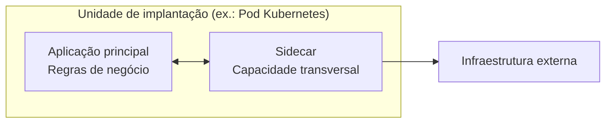
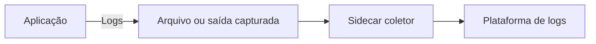
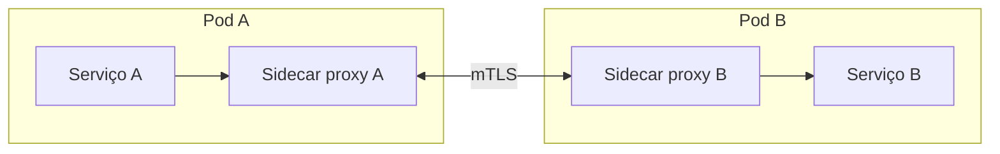
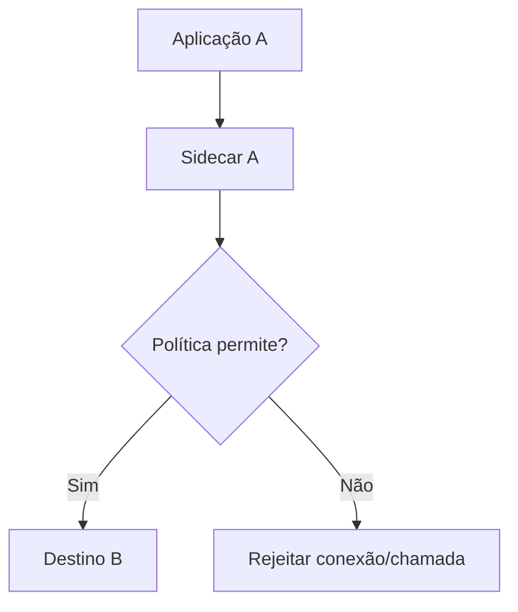
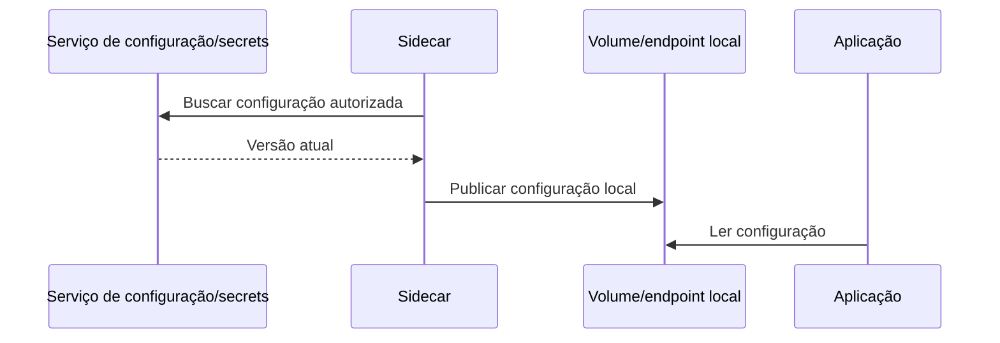
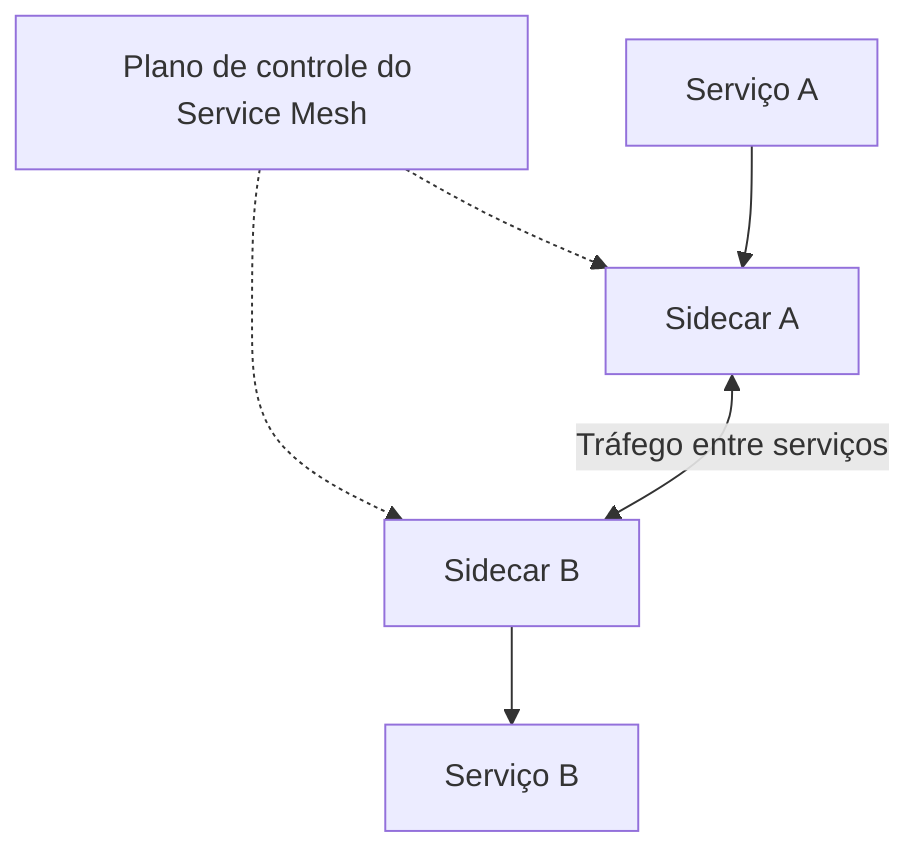

# Aula 08 — Sidecar

**Módulo:** 01 — Fundamentos de Arquitetura de Solução  
**Tema:** 04 — Design Pattern (2)  
**Origem:** Resumo da aula, com exemplos e aprofundamentos técnicos autorais.

## Objetivo

Compreender o padrão **Sidecar**, como ele separa capacidades transversais do código de negócio e de que forma contribui para observabilidade, segurança, tráfego e configuração em ambientes de microserviços.

## 1. O que é Sidecar?

Um **sidecar** é um processo ou contêiner auxiliar implantado **junto a uma aplicação principal**, compartilhando parte de seu contexto operacional e acompanhando seu ciclo de vida. Ele executa responsabilidades que dão suporte à aplicação sem precisar incorporá-las ao domínio.



**Distinção:** uma aplicação auxiliar remota e compartilhada por muitos serviços não é necessariamente um sidecar. O padrão pressupõe **proximidade operacional** e associação com uma aplicação ou instância específica.

## 2. Por que executar ao lado?

O objetivo é retirar do código de negócio responsabilidades repetidas, como:
- Encaminhamento de telemetria;
- Proxy de comunicação;
- Políticas de tráfego;
- Integração com serviços de configuração e secrets;
- Adaptação de protocolos ou tarefas operacionais específicas.

**Benefícios:** padronização, reutilização, independência de linguagem e menor acoplamento da aplicação às ferramentas de infraestrutura.

**Trade-off:** o sidecar consome CPU/memória, adiciona complexidade operacional e pode introduzir latência ou novos modos de falha.

## 3. Coleta de logs

A aplicação escreve logs e um agente auxiliar pode encaminhá-los para uma plataforma central, como Elasticsearch/Elastic.



**Nuance importante:** um sidecar **não consegue automaticamente ler o `stdout` de outro contêiner** só por compartilhar o mesmo Pod. A implementação precisa de um mecanismo de acesso, como **volume compartilhado**, redirecionamento de logs ou integração com o runtime.

No Kubernetes, a abordagem comum para logs de `stdout/stderr` é a coleta **em nível de nó**, via agentes como DaemonSets. Portanto, **sidecar não é obrigatório nem sempre é a melhor opção** para centralização de logs.

## 4. mTLS entre serviços

Um sidecar proxy pode estabelecer **mTLS (mutual TLS)** com outro proxy, protegendo o tráfego entre workloads.



No mTLS, **ambos os lados autenticam a identidade apresentada pelo outro**, além de criptografar a comunicação.

**Nuances:**
- A proteção entre proxies **não garante automaticamente criptografia ponta a ponta até o processo da aplicação**; o trecho local depende do modelo de implantação;
- Em uma malha de serviços, emissão e rotação de certificados normalmente dependem de componentes de identidade e de um **plano de controle**;
- A aplicação não deve assumir que tráfego interno é confiável apenas porque passa por proxies.

## 5. Controle de tráfego e políticas

Sidecars proxy podem executar políticas locais de:
- Roteamento e descoberta de destinos;
- Autorização entre workloads;
- Timeouts, retries e limites;
- Métricas e rastreamento de chamadas.



**Nuance:** a capacidade exata depende do proxy e da configuração. **Políticas de rede e autenticação na infraestrutura não substituem autorização de negócio** dentro dos serviços.

## 6. Configuração e secrets

Um sidecar pode consultar um serviço de configuração ou secrets e disponibilizar dados para a aplicação via:
- Arquivo em volume compartilhado;
- Endpoint local;
- Outro mecanismo controlado de comunicação.



**Cuidados:** permissões mínimas, proteção do volume, não registrar secrets em logs e planejar rotação.

**Ponto importante:** atualizar um arquivo pelo sidecar **não faz a aplicação recarregar automaticamente** a configuração. O processo precisa suportar refresh ou reinicialização controlada.

## 7. Exemplo com Kubernetes — complemento autoral

Exemplo **ilustrativo** de Pod com aplicação e sidecar que compartilham um volume de logs:

```yaml
apiVersion: v1
kind: Pod
metadata:
  name: pedidos-com-sidecar
spec:
  volumes:
    - name: logs
      emptyDir: {}
  containers:
    - name: pedidos
      image: exemplo/pedidos:1.0
      volumeMounts:
        - name: logs
          mountPath: /var/log/app
    - name: log-sidecar
      image: busybox:1.36
      command:
        - sh
        - -c
        - "touch /var/log/app/pedidos.log; tail -n+1 -F /var/log/app/pedidos.log"
      volumeMounts:
        - name: logs
          mountPath: /var/log/app
          readOnly: true
```

Neste exemplo, **a aplicação precisa escrever no arquivo compartilhado** `/var/log/app/pedidos.log`. O sidecar apenas acompanha o arquivo e escreve em seu próprio `stdout`; **não há envio real ao Elastic**. Para produção, use um coletor apropriado e políticas de recursos e segurança.

**Nota:** o exemplo demonstra coimplantação, mas não usa a semântica específica de *native sidecar containers* do Kubernetes (contêineres de inicialização com `restartPolicy: Always`), que pode ser relevante para controle de inicialização e encerramento.

## 8. Sidecar e Service Mesh

Um **Service Mesh** pode usar sidecars proxy para padronizar comunicação entre serviços, enquanto um **plano de controle** distribui políticas e configuração.



**Distinção importante:** nem todo sidecar faz parte de um Service Mesh, e **nem todo Service Mesh exige sidecars**; existem arquiteturas com proxies de nó ou modos *sidecarless/ambient*, conforme a tecnologia.

## 9. Comparação: Sidecar, API Gateway e agente por nó

| Padrão | Onde atua | Exemplo |
| --- | --- | --- |
| **Sidecar** | Junto a uma instância de aplicação | Proxy de mTLS ou adaptador local |
| **API Gateway** | Borda de entrada para APIs | Autenticação e roteamento externo |
| **DaemonSet/agente por nó** | Compartilhado entre workloads de um nó | Coleta de logs de contêineres |
| **Service Mesh** | Infraestrutura de comunicação entre serviços | Políticas e telemetria distribuídas |

Essas abordagens podem coexistir e não são substitutas diretas em todos os cenários.

## 10. Trade-offs e falhas

**Vantagens**
- Reutilização de capacidades transversais;
- Menor dependência de bibliotecas específicas em cada linguagem;
- Padronização operacional;
- Políticas locais próximas à aplicação.

**Riscos**
- Consumo extra de recursos por réplica;
- Necessidade de coordenar inicialização e encerramento;
- Falhas do sidecar afetando a aplicação;
- Latência adicional de proxy;
- Dificuldade de depuração quando a infraestrutura intercepta tráfego;
- Mais componentes para atualizar e monitorar.

Uma decisão arquitetural importante é definir se o sidecar falhará **aberto** (*fail-open*) ou **fechado** (*fail-closed*) em cada política; para segurança, permitir tráfego sem verificação pode ser inaceitável.

## 11. Checklist

- [ ] A capacidade é transversal e justifica um componente auxiliar por aplicação?
- [ ] A proximidade com a aplicação é realmente necessária?
- [ ] Defini como o sidecar acessa logs, tráfego ou configuração?
- [ ] Existem limites de CPU e memória?
- [ ] Inicialização, prontidão e encerramento foram considerados?
- [ ] Há observabilidade da aplicação **e** do sidecar?
- [ ] Certificados, identidades e secrets são protegidos?
- [ ] Defini o comportamento quando o sidecar falha?
- [ ] Avaliei alternativas por nó ou sem sidecar?
- [ ] Entendi se a ferramenta escolhida depende de Service Mesh?

## 12. Perguntas de revisão

1. O que diferencia um sidecar de um serviço auxiliar remoto?
2. Por que um sidecar reduz acoplamento do código de negócio?
3. Um sidecar consegue ler diretamente o `stdout` de outro contêiner? Explique.
4. Como dois sidecars podem estabelecer mTLS entre serviços?
5. Por que mTLS entre proxies não elimina a autorização de domínio?
6. Atualizar um arquivo de configuração garante refresh automático?
7. Quando um DaemonSet pode ser melhor que um sidecar de logs?
8. Todo Service Mesh precisa de sidecars?
9. Quais são os custos operacionais de executar um sidecar por réplica?

## Síntese

> **Sidecar extrai responsabilidades operacionais para um componente implantado junto da aplicação**, favorecendo padronização e separação de preocupações. O ganho deve ser equilibrado com consumo de recursos, observabilidade, ciclo de vida e modos de falha.

## Conexões

- [Aula 01 — Configuration](./aula-01-configuration.md)
- [Aula 02 — Secret Management](./aula-02-secret-management.md)
- [Aula 03 — Circuit Breaker](./aula-03-circuit-breaker.md)
- [Aula 05 — API Gateway](./aula-05-api-gateway.md)
- [Tema 03 — Microservices Architecture](../tema-03-design-patterns/aula-06-microservices-architecture.md)
