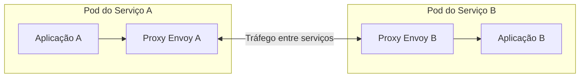
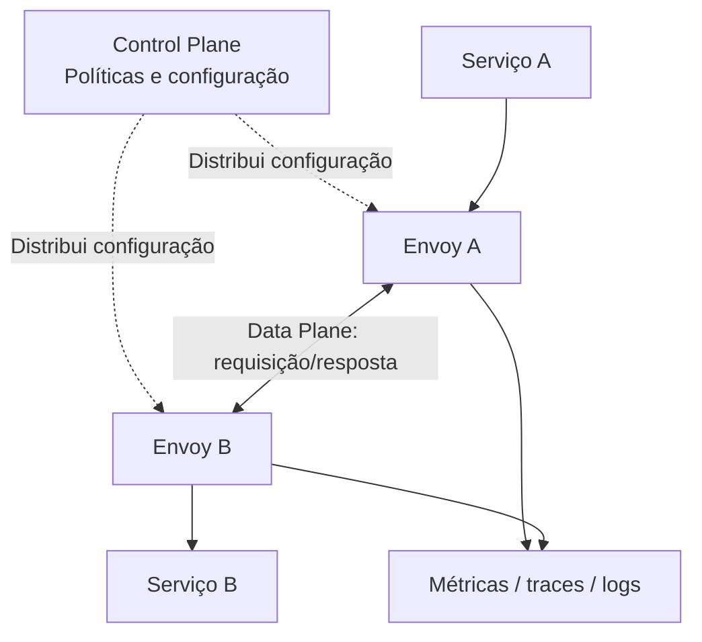
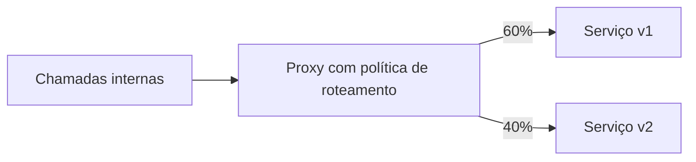
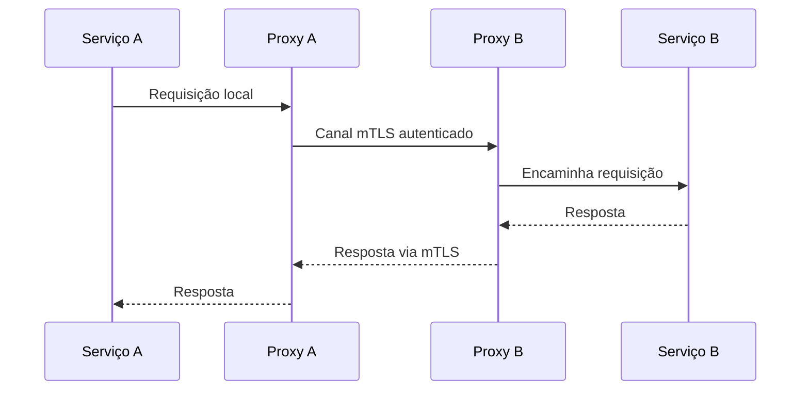

# Aula 09 — Service Mesh

**Módulo:** 01 — Fundamentos de Arquitetura de Solução  
**Tema:** 04 — Design Pattern (2)  
**Origem:** Anotações da aula, com exemplos e aprofundamentos autorais.

## Objetivo

Compreender **Service Mesh** como infraestrutura para controlar e observar a comunicação **entre serviços**, sua relação com **sidecars**, a separação entre **data plane** e **control plane**, e os trade-offs de segurança, resiliência e operação.

## 1. O que é Service Mesh?

**Service Mesh** é uma camada de infraestrutura dedicada à comunicação entre workloads. Ela permite aplicar de maneira consistente políticas de **roteamento, segurança, observabilidade e resiliência**, reduzindo a necessidade de implementar essas capacidades em cada aplicação.



**Nuance:** Service Mesh não substitui regras de negócio, autorização por recurso ou uma arquitetura de serviços bem definida. Ele atua sobretudo nas preocupações de **comunicação e infraestrutura**.

## 2. Relação com o padrão Sidecar

O **Sidecar** é um componente auxiliar implantado ao lado de uma aplicação. Uma **Service Mesh** pode coordenar diversos proxies sidecar com políticas comuns.

| Conceito | Escopo |
| --- | --- |
| **Sidecar** | Componente adjacente a uma aplicação |
| **Service Mesh** | Infraestrutura e políticas de comunicação entre workloads |
| **Envoy** | Proxy frequentemente usado no plano de dados |
| **Control Plane** | Distribuição de configuração, identidade e políticas, conforme implementação |

**Importante:** nem toda Service Mesh exige um proxy por Pod. Existem arquiteturas **sidecarless**, com proxies por nó e/ou gateways compartilhados, como modalidades *ambient*.

## 3. Data Plane e Control Plane

### Data Plane

É onde o tráfego efetivamente passa. Proxies executam as regras recebidas, como encaminhamento, mTLS, balanceamento e políticas de resiliência.

### Control Plane

É responsável por **gerenciar e distribuir configurações e políticas** para o data plane, podendo integrar descoberta de serviços e gerenciamento de identidades/certificados.



**Correção conceitual:** o control plane **não precisa receber diretamente todo o tráfego ou todas as métricas**. A telemetria normalmente é produzida pelo data plane e exportada para sistemas de observabilidade, enquanto o control plane se concentra na configuração e coordenação.

## 4. Gerenciamento de tráfego

Uma mesh pode controlar:
- Roteamento entre versões de serviços;
- Balanceamento de carga;
- Timeouts e retries;
- Detecção de endpoints degradados e mecanismos de proteção;
- Regras de entrada e saída (*ingress* e *egress*), conforme topologia.

**Exemplo:** enviar 60% do tráfego para a versão `v1` e 40% para a versão `v2`.



**Nuance importante:** dividir tráfego **60/40 entre versões** não é necessariamente o mesmo que aplicar pesos a **duas instâncias com capacidades diferentes**. Alguns produtos oferecem roteamento ponderado por destino; balanceamento entre endpoints depende do algoritmo e dos recursos específicos.

## 5. Policy Enforcement

**Policy enforcement** significa aplicar políticas no caminho de comunicação, como:
- Quais identidades de workload podem chamar determinado serviço;
- Quais portas ou rotas são permitidas;
- Quando exigir mTLS;
- Quais destinos externos podem ser acessados, dentro das capacidades do mesh.

**Cuidado:** proibir acesso à internet exige considerar tráfego que **não atravessa a mesh**, DNS, configurações de rede e possíveis caminhos de bypass. Para isolamento forte, combine políticas da mesh com controles de rede e infraestrutura.

A mesh pode validar identidade de workload, mas **autorização de negócio** — por exemplo, se o usuário pode consultar o pedido de outra pessoa — permanece no serviço responsável.

## 6. Segurança com mTLS

No **mutual TLS**, os dois lados apresentam identidades verificáveis e o canal é criptografado.



O control plane e componentes de identidade podem automatizar distribuição e rotação de certificados.

**Limite:** mTLS entre proxies não garante, por si só, criptografia de cada trecho local entre proxy e aplicação. É necessário compreender o modelo de confiança adotado.

## 7. Observabilidade distribuída

Como os proxies participam do caminho de comunicação, podem registrar:
- Volume e taxa de requisições;
- Latência e erros;
- Identidades e destinos das chamadas;
- Métricas de conexões e respostas.


**Nuance:** métricas de proxy ajudam a visualizar dependências, mas **tracing ponta a ponta** pode exigir propagação de contexto (`traceparent`) e instrumentação da aplicação. A mesh não conhece automaticamente cada operação de negócio executada dentro do processo.

## 8. Envoy

**Envoy** é um proxy de rede e aplicação de alto desempenho, frequentemente usado como componente do data plane de uma mesh.

Em implantações com sidecars, ele pode:
- Encaminhar chamadas de saída e entrada;
- Aplicar configurações de roteamento;
- Estabelecer conexões mTLS;
- Exportar métricas;
- Executar políticas de resiliência suportadas.

**Importante:** Envoy é um **proxy**, não o Service Mesh completo. A malha envolve também distribuição de configuração, identidades, políticas e operação.

## 9. Exemplo prático com Istio — complemento autoral

Exemplo **ilustrativo** de divisão de tráfego entre versões de um serviço usando recursos do Istio:

```yaml
apiVersion: networking.istio.io/v1
kind: DestinationRule
metadata:
  name: catalogo
spec:
  host: catalogo
  subsets:
    - name: v1
      labels:
        version: v1
    - name: v2
      labels:
        version: v2
---
apiVersion: networking.istio.io/v1
kind: VirtualService
metadata:
  name: catalogo
spec:
  hosts:
    - catalogo
  http:
    - route:
        - destination:
            host: catalogo
            subset: v1
          weight: 60
        - destination:
            host: catalogo
            subset: v2
          weight: 40
```

**Pré-requisitos:** Istio instalado e configurado, serviço `catalogo` existente e workloads rotulados com `version: v1` e `version: v2`. O exemplo demonstra roteamento ponderado, **não** define mTLS, autorização ou política de egress.

As APIs e compatibilidade devem ser conferidas com a versão do Istio utilizada.

## 10. Retries, timeouts e Circuit Breaker

A mesh pode aplicar mecanismos de resiliência, mas eles precisam de limites.

| Recurso | Objetivo | Risco de configuração incorreta |
| --- | --- | --- |
| **Timeout** | Limitar tempo de espera | Encerrar operações legítimas cedo demais |
| **Retry** | Recuperar falhas transitórias | Multiplicar carga sobre serviço degradado |
| **Outlier detection** | Isolar endpoints problemáticos | Remover capacidade saudável por falso positivo |
| **Circuit Breaker** | Falhar rápido diante de degradação | Bloquear chamadas em excesso |

**Nuance:** mecanismos de *outlier detection* e limitação de conexões de proxies não são necessariamente equivalentes à máquina de estados **Closed / Open / Half-Open** de uma biblioteca como Resilience4j.

Em operações não idempotentes, retries automáticos podem causar efeitos duplicados.

## 11. Service Mesh vs. API Gateway

| Dimensão | API Gateway | Service Mesh |
| --- | --- | --- |
| Foco típico | Entrada e políticas de APIs externas | Comunicação entre workloads |
| Público principal | Clientes externos e parceiros | Serviços internos |
| Funções comuns | Autenticação de borda, roteamento, cotas | mTLS, identidade de workload, telemetria, políticas |
| Implantação | Borda do sistema | Infraestrutura de comunicação |

Há sobreposição de capacidades, e ambas podem coexistir na mesma solução.

## 12. Trade-offs

**Benefícios**
- Políticas uniformes entre serviços;
- mTLS e identidade de workload gerenciados;
- Melhor visibilidade da comunicação distribuída;
- Roteamento e resiliência sem alterar cada aplicação;
- Governança centralizada de políticas operacionais.

**Custos e riscos**
- Mais componentes e complexidade de operação;
- Consumo adicional de recursos e latência;
- Curva de aprendizado;
- Dependência de configuração e observabilidade do plano de dados;
- Possibilidade de falhas amplas por política incorreta;
- Dificuldade de depurar tráfego interceptado.

**Decisão arquitetural:** Service Mesh não é obrigatória para todo conjunto de microserviços. Seu valor cresce quando os benefícios de padronização e governança superam os custos operacionais.

## 13. Checklist

- [ ] Existe necessidade real de políticas uniformes entre muitos serviços?
- [ ] Defini quais comunicações passam pelo data plane?
- [ ] Compreendo a separação entre control plane e data plane?
- [ ] Configurei identidade e mTLS de forma coerente?
- [ ] Políticas de autorização não substituem regras de negócio?
- [ ] Timeouts e retries consideram idempotência e carga?
- [ ] Tenho métricas, tracing e alertas adequados?
- [ ] Avaliei impacto em latência, CPU e memória?
- [ ] Entendi limitações e bypass de políticas de egress?
- [ ] Comparei sidecars com opções sidecarless quando aplicável?

## 14. Perguntas de revisão

1. Qual a diferença entre Sidecar e Service Mesh?
2. Quais responsabilidades pertencem ao data plane e ao control plane?
3. Por que Envoy sozinho não constitui uma mesh completa?
4. Como mTLS entre proxies protege a comunicação?
5. Por que policy enforcement não substitui autorização de negócio?
6. Qual a diferença entre roteamento 60/40 por versão e balanceamento entre instâncias?
7. Por que tracing distribuído pode exigir instrumentação da aplicação?
8. Como retries automáticos podem agravar uma falha?
9. Quando Service Mesh não compensa seu custo operacional?

## Síntese

> **Service Mesh padroniza segurança, observabilidade e gerenciamento de tráfego entre serviços por meio de uma infraestrutura coordenada.** Ela pode usar sidecars Envoy, mas sua essência está na separação entre execução das políticas no **data plane** e coordenação no **control plane**.

## Conexões

- [Aula 08 — Sidecar](./aula-08-sidecar.md)
- [Aula 05 — API Gateway](./aula-05-api-gateway.md)
- [Aula 03 — Circuit Breaker](./aula-03-circuit-breaker.md)
- [Tema 03 — Microservices Architecture](../tema-03-design-patterns/aula-06-microservices-architecture.md)
