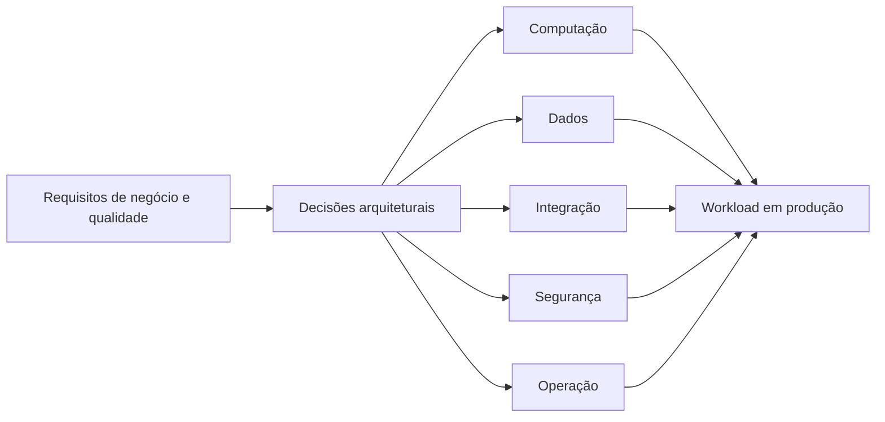
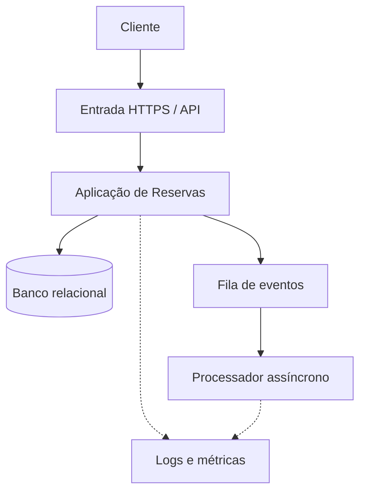

# Aula 01 — Arquitetura de Solução para Cloud

**Módulo:** 01 — Fundamentos de Arquitetura de Solução  
**Tema:** 05 — AWS Well-Architected Framework  
**Origem:** Resumo da aula, complementado com exemplos e considerações arquiteturais.

## Objetivo

Entender como traduzir requisitos de um **workload** em decisões concretas de arquitetura cloud e introduzir o **AWS Well-Architected Framework** como instrumento de avaliação contínua.

## 1. Workload: o que estamos arquitetando?

Um **workload** é o conjunto de recursos e componentes que entregam valor de negócio: aplicações, dados, integrações, processos operacionais e dependências.

Não se limita a um diagrama de microsserviços. Inclui requisitos de segurança, continuidade, desempenho, custo, operação e restrições regulatórias.

**Exemplo:** uma plataforma de reservas de voos pode envolver API de reservas, banco transacional, processamento assíncrono, integrações com provedores externos, monitoramento e estratégias de recuperação.

## 2. Da necessidade ao serviço cloud

O arquiteto transforma capacidades abstratas em escolhas concretas de serviços e configurações.

O serviço escolhido deve ser consequência dos requisitos, não o ponto de partida da solução.

### Exemplo de mapeamento na AWS

| Necessidade | Serviços possíveis | Critérios de escolha |
| --- | --- | --- |
| Executar uma API Java/Spring Boot | ECS/Fargate, EKS, EC2, Lambda com adaptação apropriada | Modelo operacional, escalabilidade, duração e perfil de execução |
| Banco relacional | Amazon RDS, Amazon Aurora | Compatibilidade, disponibilidade, capacidade e custo |
| Arquivos e objetos | Amazon S3 | Durabilidade, acesso, retenção e segurança |
| Mensageria assíncrona | Amazon SQS, SNS, EventBridge | Fila, fan-out, roteamento e contratos |
| Expor APIs | Amazon API Gateway, Application Load Balancer | Recursos de API, autenticação, roteamento e custo |
| Métricas e logs | Amazon CloudWatch, integração com OpenTelemetry | Diagnóstico, retenção e observabilidade |
| Segredos | AWS Secrets Manager, Systems Manager Parameter Store | Rotação, sensibilidade e acesso |

**Importante:** os serviços acima são **alternativas**, não uma arquitetura obrigatória. Nem toda aplicação precisa de Kubernetes, microserviços ou múltiplos serviços gerenciados.

## 3. Especialização por provedor

AWS, Azure e Google Cloud compartilham conceitos fundamentais, mas diferem em serviços, limites, modelo de cobrança e operação.

Conhecimento transferível:
- Redes, DNS, balanceamento e identidade;
- Bancos de dados, armazenamento e mensageria;
- Escalabilidade, disponibilidade e observabilidade;
- Automação e infraestrutura como código.

Conhecimento específico:
- Recursos e quotas de cada serviço;
- Políticas de IAM e integração entre produtos;
- Opções de disponibilidade por região;
- Custos e responsabilidades de operação.

**Trade-off:** usar serviços gerenciados pode reduzir trabalho operacional, mas aumenta dependência das capacidades e APIs do provedor. Portabilidade é uma decisão de negócio e arquitetura, não um requisito automático.

## 4. Boas práticas desde o desenho

Uma arquitetura que funciona em ambiente de desenvolvimento pode falhar em produção por falta de:
- Monitoramento e resposta a incidentes;
- Controle de identidades e permissões;
- Backups testados e estratégia de recuperação;
- Dimensionamento e proteção contra picos;
- Visibilidade de custos;
- Automação de implantação e mudanças.

Essas preocupações devem entrar na definição do workload **desde o início**.

## 5. Segurança, compliance e modelo de responsabilidade compartilhada

Na AWS, a segurança segue um **modelo de responsabilidade compartilhada**: a AWS responde pela segurança **da** cloud, enquanto o cliente mantém responsabilidades de segurança **na** cloud, cujo escopo varia conforme o serviço.

Exemplos de responsabilidades do cliente:
- Configurar IAM e menor privilégio;
- Proteger dados, chaves e segredos;
- Configurar redes e exposição de serviços;
- Aplicar controles exigidos por normas e políticas;
- Administrar patches de sistemas sob sua gestão, quando aplicável.

**Compliance** não é garantido apenas por escolher um serviço certificado: depende também de configuração, processos, evidências e tratamento adequado dos dados.

## 6. O papel do arquiteto e do desenvolvedor

O **arquiteto de solução** traduz necessidades de negócio em decisões verificáveis, registra trade-offs e avalia o comportamento do workload em produção.

O **desenvolvedor** também precisa entender o ambiente de execução: permissões, limites, latência de rede, configurações, logs, escalabilidade e falhas de dependências.

Exemplo em Java: escolher uma aplicação **stateless** facilita escalar réplicas; porém, sessões locais, conexões de banco e operações não idempotentes precisam ser revisadas antes do escalonamento.

## 7. O AWS Well-Architected Framework

O **AWS Well-Architected Framework** é uma referência de boas práticas para **avaliar workloads e orientar melhorias**. Não é uma receita única nem uma certificação automática de que a arquitetura está correta.

A avaliação usa perguntas por pilar para identificar **riscos e oportunidades de melhoria**, que devem ser priorizados conforme contexto, impacto e restrições do negócio.

### Os seis pilares

| Pilar | Pergunta orientadora |
| --- | --- |
| **Excelência Operacional (Operational Excellence)** | Conseguimos operar, observar e melhorar o workload continuamente? |
| **Segurança (Security)** | Protegemos identidades, sistemas e dados adequadamente? |
| **Confiabilidade (Reliability)** | O sistema resiste a falhas e se recupera quando necessário? |
| **Eficiência de Performance (Performance Efficiency)** | Utilizamos recursos adequados e adaptamos a capacidade à demanda? |
| **Otimização de Custos (Cost Optimization)** | Entregamos valor com uso eficiente dos recursos financeiros? |
| **Sustentabilidade (Sustainability)** | Reduzimos impactos ambientais e desperdício de recursos? |

**Nota:** o framework tem **seis pilares**; materiais antigos podem citar apenas cinco, antes da inclusão de Sustentabilidade.

## 8. Exemplo aplicado: serviço de reservas

Essa é uma **visão conceitual**, sem presumir serviços AWS específicos.

Perguntas de arquitetura:
- **Confiabilidade:** o que acontece se o banco ou o provedor de pagamento falhar?
- **Segurança:** quem pode consultar ou cancelar uma reserva?
- **Operação:** como detectar uma fila acumulando mensagens?
- **Performance:** qual a proporção de consultas e escritas no horário de pico?
- **Custos:** qual o custo por reserva processada?
- **Sustentabilidade:** há recursos ociosos ou processamento desnecessário?

## 9. Trade-offs: não existe arquitetura perfeita

Decisões em cloud exigem equilibrar objetivos que podem competir entre si:
- Alta disponibilidade pode aumentar custo;
- Serviços gerenciados reduzem operação, mas podem criar dependência do provedor;
- Replicação melhora recuperação, mas eleva complexidade e consumo;
- Escalabilidade automática ajuda em picos, mas exige limites e monitoramento de gastos.

O trabalho do arquiteto é **explicitar e justificar** essas escolhas.

## 10. Como conduzir uma revisão Well-Architected

1. **Definir o workload** e seus responsáveis.
2. **Registrar requisitos** de negócio, qualidade, riscos e restrições.
3. **Avaliar os seis pilares** por meio de perguntas e evidências.
4. **Identificar riscos**, inclusive os de maior prioridade.
5. **Planejar melhorias** com responsáveis, impacto e custo.
6. **Revisitar a avaliação** após mudanças importantes.

A ferramenta **AWS Well-Architected Tool** pode apoiar o registro das revisões e dos planos de melhoria. Uma revisão não substitui testes, auditorias ou validação operacional.

## 11. Checklist da aula

- [ ] Consigo descrever o workload além do código da aplicação?
- [ ] Relacionei requisitos a capacidades concretas de cloud?
- [ ] Justifiquei serviços gerenciados vs. autogerenciados?
- [ ] Identifiquei responsabilidades de segurança do cliente?
- [ ] Considerei operação, observabilidade e recuperação?
- [ ] Registrei premissas e trade-offs de custo e desempenho?
- [ ] Conheço os seis pilares do AWS Well-Architected Framework?
- [ ] Planejei revisões periódicas do workload?

## 12. Perguntas de revisão

1. O que compõe um workload além da aplicação?
2. Por que conhecer apenas conceitos genéricos de cloud não basta para implantar uma solução?
3. Como escolher entre ECS/Fargate, EKS e EC2 para uma API Java?
4. O que significa responsabilidade compartilhada em segurança?
5. Quais são os seis pilares do AWS Well-Architected Framework?
6. Por que uma arquitetura funcional pode ser operacionalmente inadequada?
7. Qual é a relação entre requisitos de negócio, trade-offs e escolha de serviços?
8. Como transformar uma revisão Well-Architected em ações concretas?

## Síntese

> **Arquitetar para cloud é traduzir requisitos de um workload em escolhas implementáveis e operáveis.** O AWS Well-Architected Framework oferece seis perspectivas para avaliar essas escolhas, identificar riscos e orientar melhoria contínua.

## Conexões

- [Tema 04 — API Gateway](../tema-04-design-patterns-2/aula-05-api-gateway.md)
- [Tema 04 — Arquitetura Baseada em Eventos](../tema-04-design-patterns-2/aula-06-arquitetura-baseada-em-eventos.md)
- [Tema 02 — Aprofundando no TCO](../tema-02-solution-architecture/aula-06-aprofundando-no-tco.md)
- [Tema 03 — Serverless Architecture](../tema-03-design-patterns/aula-05-serverless-architecture.md)
